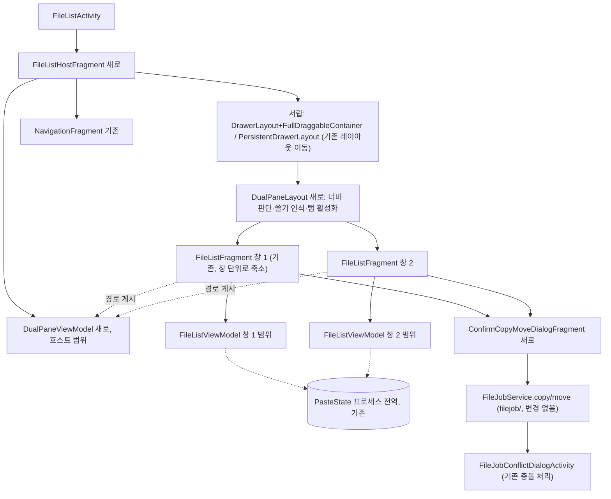

# HLD — 두 창 파일 목록 (이슈 #2)

| 항목 | 내용 |
|---|---|
| 상태 | 검수 통과(v4.8, SRS v4.8 기준) |
| 근거 | SRS v4.8 (`docs/design/2-dual-pane/SRS.md`, 요구사항 정리 v2 반영). HLD v3까지는 SRS v3 기준 |
| 기준 코드 | `origin/develop` a76055e(#5 화면/창 분리 머지 뒤). 단 1.1(지금 구조)과 D2·R8의 "지금은" 배치 서술은 #5 이전 3d87794의 줄이다(그 절에 표시). 줄 번호 앞에 파일 이름이 없으면 그 칸에서 앞서 나온 파일이다 |

## 1. 구조 개요

### 1.1 지금 구조 (바꾸는 이유)
이 절은 #5 이전 구조(3d87794)를 적는다. 화면 단위 책임은 #5에서 K2로 옮겼다(그 줄 번호는 2장 이후, a76055e).

- `FileListActivity`는 `FileListFragment` 하나를 `android.R.id.content`에 붙인다(`FileListActivity.kt:30-36`).
- `FileListFragment` 하나가 화면 전체를 가진다: 서랍(`DrawerLayout`+`FullDraggableContainer` 또는 `PersistentDrawerLayout`, `FileListFragment.kt:1658-1703`), 탐색 서랍 `NavigationFragment`(`:213-220`, `NavigationFragment.Listener` 구현 `:1445-1463`), 툴바를 액티비티의 지원 액션바로 지정(`:221-223`), 경로 표시줄·목록·붙여넣기 막대·speed dial, 뒤로 가기 콜백(`:264-280`), 저장소·알림 권한 요청(`:373-382`, `:1465-1630`), 시작 경로 결정(`:282-342`).
- 그래서 `FileListFragment`를 두 개 붙이면 서랍·탐색 서랍·지원 액션바·권한 요청·뒤로 가기 콜백이 둘이 된다. **화면 단위(서랍·탐색 서랍·권한) 책임과 창 단위(경로·목록·선택) 책임을 나눈다.**
- 복사 목록(`PasteState`)은 이미 `FileListViewModel`의 `companion object`에 있는 프로세스 전역 값이다(`FileListViewModel.kt:240-242`, 사용 `:195-220`). 프래그먼트가 둘이어도 이미 공유된다.
- 복사·이동의 유일한 시작점은 `FileListFragment.pasteFiles()`(`:1167-1179`, 확인 없이 `FileJobService.copy/move` 호출)이다(`FileJobService.copy`/`.move` 호출은 저장소 전체에서 이 두 곳뿐 — `grep -rn "FileJobService\.\(copy\|move\)"`). 같은 이름 충돌 창은 작업 스레드 안에서 뜬다(`FileJobs.kt:550-573`, 호출 `:1304-1328`).

### 1.2 새 구조



- 바뀌는 모듈은 `filelist/`(액티비티·프래그먼트·뷰모델·레이아웃)와 `res/`뿐이다. `provider/`·`filejob/`은 바꾸지 않는다(SRS C-1). `filejob/`의 공개 `CopyMoveType`(`FileJobs.kt:575-579`)과 `FileJobService.copy/move`(`FileJobService.kt:126-140`)를 그대로 쓴다.
- 새 경계는 "호스트(화면) / 창" 하나다. 이유: 1.1의 화면 단위 자원이 둘이 되면 안 되기 때문이다.

## 2. 구성요소

| 구성요소 | 위치(패키지·파일) | 책임 | 추적 REQ |
|---|---|---|---|
| K1 `FileListActivity` (수정) | `filelist/FileListActivity.kt` | `FileListHostFragment`를 붙인다(지금 `FileListFragment` 자리). `onKeyShortcut`을 호스트 → 활성 창으로 넘긴다. #5에서 구현됨(`FileListActivity.kt:31-36`, `:58-63` → `FileListHostFragment.kt:158-163`). | 01, 09 |
| K2 `FileListHostFragment` (새로) | `filelist/FileListHostFragment.kt`, 레이아웃 `res/layout/file_list_host_fragment*.xml`, `res/layout-sw600dp-land/…` | 화면 단위 책임을 `FileListFragment`에서 옮겨 받는다: 서랍 두 종류(기존 `file_list_fragment_include.xml` 두 벌의 서랍 부분), `NavigationFragment`와 그 `Listener`(활성 창에 위임), 고정 메뉴 열림 설정 관찰(`FileListHostFragment.kt:140-144`, `:165-173` — 호스트는 서랍 열고 닫기에 쓰고, 창(K5)도 같은 설정을 따로 관찰해 격자 열 수 계산에 쓴다: `FileListFragment.kt:320-324` `updateSpanCount()`. 둘 다 관찰한다 — LLD-A F6), 서랍 뒤로 가기 콜백(`FileListHostFragment.kt:136-138`)과 활성 창으로 뒤로 가기를 넘기는 전달 콜백(`:122-135`, 3.5), 툴바 메뉴 단추 처리(창 `FileListFragment.kt:403-406` → 호스트 `FileListHostFragment.kt:185-192`, 창이 콜백으로 요청), 저장소·알림 권한 요청 흐름(`FileListHostFragment.kt:147-156`, `:217-375` — 허용되면 두 창 모두 새로 고침, `:175-177`). 여기까지는 #5에서 옮겼다. 시작 Intent를 보고 선택 모드면 창 1만, 아니면 창 1(Intent 전달)·창 2(Intent 없음)를 만든다. | 01, 03, 04, 09, 10, 18, 19 |
| K3 `DualPaneViewModel` (새로) | `filelist/DualPaneViewModel.kt` (호스트 프래그먼트 범위) | `activePane`(0/1, 처음 0), `isDualPaneEnabled`(선택 모드면 false — 뷰모델에 저장하지 않고 K2가 프래그먼트를 만들 때마다 Intent에서 다시 계산해 넣는다. 프로세스 종료 뒤 복원에서도 Intent는 남으므로 값이 맞다), 권한 요청 진행 상태(`isStorageAccessRequested`·`isNotificationPermissionRequested` — #5에서 창 뷰모델에서 옮김: `DualPaneViewModel.kt:12-24`), 두 창의 현재 경로 게시판(`panePaths[0..1]` — **#7이 더하고 소유한다**. 첫 소비자가 #7의 K7 반대쪽 경로 표시이고, #9의 반대쪽 명령 대상은 #7의 `panePaths`를 쓴다. #6에는 읽는 곳이 없어 두지 않는다 — LLD-B FB-4, PM 결정 PR #17), `paneMode`(한 창/두 창, K4가 씀). `togglePane()`: 활성 창을 반대쪽으로(쓸기 확정·창 표시 누르기가 함께 쓴다). 창은 `viewModels(ownerProducer = { requireParentFragment() })`(`util/FragmentViewModelLazy.kt:15-19`)로 얻는다. | 02, 04, 05, 06, 07, 09, 12, 17, 20 |
| K4 `DualPaneLayout` (새로) | `filelist/DualPaneLayout.kt` (서랍의 내용 뷰 자리) | 창 컨테이너 두 개를 가진다. (a) 너비 판단(3.2) → 두 창은 반씩 나란히, 한 창은 활성 창만 보이고 다른 창은 `GONE`. (b) 오른쪽→왼쪽 쓸기 인식(3.3). (c) 탭 활성화(3.4)와 접근성 클릭 수신(`onRequestSendAccessibilityEvent`로 자손의 `TYPE_VIEW_CLICKED`를 받아 그 창 활성화, 3.9). (d) RTL이면 배치·방향 반전(SRS A2 — 오너 결정, 규격 근거는 `RTL-5` 원문 판독 필요). 창 배치는 start/end 기준(`RTL-1`). (e) 서랍 제스처보다 안쪽에 있어 서랍 열기·닫기 제스처를 먼저 서랍이 처리하게 둔다(3.3). | 03, 04, 05, 06, 07, 10, 11 |
| K5 `FileListFragment` (수정 — 창) | `filelist/FileListFragment.kt`, 레이아웃은 기존 `res/layout/file_list_fragment*.xml`과 `res/layout-sw600dp-land/file_list_fragment_include.xml`을 창 레이아웃으로 그대로 쓰고 서랍 부분만 호스트로 옮긴다(남는 것: `PersistentBarLayout` 하위의 앱바·내용·붙여넣기 막대·speed dial. 창 클래스 이름이 그대로라 뷰 바인딩 클래스도 그대로 — LLD-A F4) | 창 단위 책임만 남긴다: 경로·뒤로 가기 기록·선택·검색(`FileListViewModel`, 창마다 별도 — 지금도 프래그먼트 범위 `FileListFragment.kt:130`). 인자에 창 번호를 더한다. 자기 툴바를 지원 액션바로 지정하지 않고 툴바 자체 메뉴(`Toolbar`의 `MenuHost`, appcompat 1.7.1 `app/build.gradle:133`)로 메뉴를 붙인다(5장 D2) — **이 전환은 창 2가 생기는 #6에서 한다**. #5(화면/창 분리, 창 하나)는 지금처럼 `setSupportActionBar`·옵션 메뉴 경로를 유지한다(LLD-A F1, PM 결정). #6의 전환은 D2의 동등성 목록 ①~⑥을 모두 유지해야 한다(①은 지원 액션바가 원래 적용하지 않아 조치 없음 — D2). 뒤로 가기 콜백은 창 전용 디스패처에 등록하고 호스트 전달 콜백이 활성 창의 것만 부른다(3.5). 자기 현재 경로를 K3에 게시한다. 반대쪽 복사·이동 명령(선택 메뉴 `res/menu/file_list_select.xml`에 두 항목 추가), 붙여넣기를 K6을 거쳐 실행한다. 창 번호·활성·반대쪽 경로 표시(K7)를 그린다. 격자 열 수는 **두 창 모드에서만** 창 너비(K4가 고정 메뉴 목표 상태로 계산한 창 너비, 3.2)로 계산하고, **한 창 모드는 기존 공식**(`screenWidthDp` − 고정 메뉴가 열려 있으면 `navigation_max_width`, `FileListFragment.kt:595-606`)을 그대로 쓴다 — **#6에서 한다**(LLD-B FB-5, PM 결정 PR #17). 이유: 두 창 모드에서 `screenWidthDp`는 창 너비의 약 두 배라 열이 너무 많고, 한 창 모드까지 창 너비로 바꾸면 고정 메뉴 실제 너비·인셋 때문에 열 수가 달라지는 화면이 생긴다(LLD-A F3). #5는 창이 하나라 기존 공식 그대로다. | 01, 02, 04, 08, 09, 12, 13, 14, 17, 18, 19, 20 |
| K6 `ConfirmCopyMoveDialogFragment` (새로) | `filelist/ConfirmCopyMoveDialogFragment.kt` (`ConfirmDeleteFilesDialogFragment.kt:22-63`와 같은 모양: `ParcelableArgs` + 부모 프래그먼트 `Listener`) | 인자: 작업 종류(`CopyMoveType` COPY/EXTRACT/MOVE), 원본 `FileItemSet`, 대상 폴더 `Path`, 출처(붙여넣기 / 반대쪽 명령). 내용: 종류, 항목 수(1개면 이름), 원래 위치(여러 곳이면 SRS A3) → 대상, 그리고 **같은 폴더 안내**(3.6-1, 같은 항목이 있을 때만). 버튼: 취소 / 실행. 같은 창에 확인 창이 이미 떠 있으면 새로 열지 않는다(중복 열림 방지 — 붙여넣기·메뉴를 연달아 눌러 확인 창이 둘 뜨고 작업이 두 번 실행되는 것을 막는다. 보이는 것은 "확인 창이 하나만 뜬다"뿐 — LLD-D F5, PM 승인 PR #16). 실행 시 리스너가 `FileJobService.copy/move`를 부르고(원본·대상은 판정에 쓴 값 `j`, 3.6-1), 출처가 붙여넣기면 복사 목록을 비우고, 반대쪽 명령이면 그 항목들의 선택을 해제한다. 취소·닫기는 아무것도 바꾸지 않는다. 인자가 Parcelable이라 회전 뒤에도 같은 내용으로 복원된다(안내는 인자에서 다시 계산). 기존 확인 창(`ConfirmDeleteFilesDialogFragment`)과 같은 대화상자 빌더·테마를 써서 큰 화면에서 전체 폭으로 늘지 않게 하고(`UI_Secondary_Elements`), 외부 키보드 Esc는 취소와 같게 한다(`Keyboard_Exit` — 대화상자 기본 처리로 되는지 LLD 확인, R11). 문장에 끼우는 경로·이름은 `BidiFormatter.unicodeWrap()`으로 감싼다(`RTL-3`, SRS 3.5). | 12, 14, 15, 16, 21 |
| K7 창 표시 | K5의 앱바(`res/layout/file_list_fragment_app_bar_include.xml`)의 경로 표시줄 아래 새 한 줄(창 표시 줄) | 툴바 제목은 지금과 같다(`file_list_title`, 선택 모드는 기존 제목 `FileListFragment.kt:720-733`). 창 표시 줄 = **창 표시 컨트롤** + 보조 글자. (1) 한 창 모드: 컨트롤은 `N / 2`를 보이는 누를 수 있는 단추이고, 누르면 K3 `togglePane()`(쓸기 확정과 같은 함수)으로 창 1↔2를 바꾼다. 보조 글자는 "창 M: <반대쪽 경로>"(K3 경로 게시판 관찰). (2) 두 창 모드: 컨트롤은 `창 N` 글자다. 활성 창이면 "활성" 표시와 앱바 아래 굵은 선(형태 표시)을 더하고 누를 수 없다. 비활성 창이면 누를 수 있으며 누르면 그 창이 활성 창이 된다 — 창 전환(REQ-2-20)이 아니라 REQ-2-07의 탭 활성화와 같은 결과이고, TalkBack 사용자의 결정적 활성화 경로다(3.9). 반대쪽 경로는 반대쪽 창의 경로 표시줄로 보인다. (3) 선택 모드: 창 표시 줄을 숨긴다(창이 하나). 접근성·터치 대상(48dp)·대비는 3.9. 반대쪽 경로 글자는 `BidiFormatter`로 감싼다(`RTL-3`). | 07, 08, 17, 20 |
| K8 `PasteState` (변경 없음, 범위 유지) | `filelist/PasteState.kt`, `FileListViewModel.kt:195-220`, `:226-228` | 프로세스 전역 공유를 그대로 쓴다. 두 창의 붙여넣기 막대가 같은 LiveData를 관찰해(`FileListFragment.kt:331`, `:964-966`) 같은 내용을 보인다. 한 창에서 막대를 닫으면(`:1097-1102` → `clearPasteState`) 다른 창도 관찰로 닫힌다. | 04, 13 |
| K9 문자열 | `res/values/strings.xml`, `res/values-ko/strings.xml` | 창 이름, 창 표시 `%1$d / %2$d`, 창 표시의 화면 낭독 라벨(한 창 모드 "창 %1$d / %2$d", 두 창 모드 "창 %1$d, 활성"·"창 %1$d")·동작 설명(한 창 모드 "창 %1$d로 전환", 두 창 모드 비활성 창 "이 창을 활성 창으로"), "반대쪽으로 복사"/"반대쪽으로 이동", 확인 창 문구, 같은 폴더 안내 두 가지("대상이 원래 위치와 같은 폴더입니다", "%1$d개 항목의 원래 위치가 대상과 같은 폴더입니다"), "외 N곳", "활성". | 08, 12, 15, 17, 20, 21 |

추적 대조(REQ → 구성요소): 01 K1·K2·K5 / 02 K3·K5 / 03 K2·K4 / 04 K2·K3·K4·K5·K8 / 05 K3·K4 / 06 K3·K4 / 07 K3·K4·K7 / 08 K5·K7·K9 / 09 K1·K2·K3·K5 / 10 K2·K4 / 11 K4 / 12 K3·K5·K6·K9 / 13 K5·K8 / 14 K5·K6 / 15 K6·K9 / 16 K6 / 17 K3·K5·K7·K9 / 18 K2·K5 / 19 K2·K5 / 20 K3·K5·K7·K9 / 21 K6·K9. 모든 REQ-2-01~21이 하나 이상의 구성요소로 이어진다.

### 2.1 하위 이슈 분배
구성요소는 하위 이슈 #5~#9(마일스톤 v1.7.5)로 나눠 구현한다. 각 이슈의 LLD는 `LLD-<A~E>.md`다. 한 구성요소가 여러 이슈에 걸치면 아래처럼 나눈다.

| 이슈 | 맡는 부분 | 선행 |
|---|---|---|
| #5 (A) 화면/창 분리 | K1, K2, K3 기본(`activePane`·권한 상태), K5의 화면/창 분리(창 하나, 지원 액션바 유지) — 머지됨(a76055e) | 없음 |
| #6 (B) 두 창 컨테이너 | K4, K3 `paneMode`·`togglePane()`, K2의 창 2 생성, K5의 툴바 `MenuHost` 전환(D2)·두 창 모드 격자 열 수, 3.5 전달 콜백의 활성 창 추종과 검색 접기 순서 | #5 |
| #7 (C) 창 표시와 접근성 | K7, K9의 창 표시 문자열, 3.9, **K3 `panePaths`(소유)**와 K5의 자기 현재 경로 게시 | #6 |
| #8 (D) 확인 창 | K6, K9의 확인 창 문자열, 3.6·3.6-1, K5의 붙여넣기를 K6을 거쳐 실행 | #5 |
| #9 (E) 반대쪽 복사·이동 | K5의 반대쪽 명령(`res/menu/file_list_select.xml`), K9의 명령 문자열 — 대상 경로는 **#7의 `panePaths`를 쓴다** | #6, #7, #8 |

## 3. 데이터 흐름·상태

### 3.1 상태의 자리
| 상태 | 자리 | 수명 |
|---|---|---|
| 창별 경로·뒤로 가기 기록·검색·선택 | 각 창의 `FileListViewModel`(`TrailLiveData` `:27`, 검색 `:43-62`, 선택 `:144-193`) | 창 프래그먼트 범위. 회전·크기 변경(액티비티 재생성, 매니페스트에 `configChanges` 없음 `AndroidManifest.xml:60-64`)을 넘어 유지. 프로세스 종료 시 사라짐(SRS A6, 지금과 같음). |
| 목록 스크롤 위치 | 각 창의 `RecyclerView`·`GridLayoutManager` 뷰 상태 | 한 창 모드의 숨은 창은 `GONE`일 뿐 뷰가 살아 있어 그대로 유지(D8). 화면 재생성(회전·크기 변경) 때는 프래그먼트 뷰 상태 저장·복원(`RecyclerView` 기본 동작, 지금과 같음)에 맡긴다. 목록이 비동기로 다시 차므로 복원이 실제로 되는지는 LLD에서 확인(SRS 5장 `Config_Changes`, 권장). 폴더 이동 기록 안의 위치는 기존 `TrailLiveData` 대기 상태(`FileListViewModel.kt:30-31`)가 맡는다. |
| 활성 창, 경로 게시판, 모드, 권한 요청 진행 상태 | K3 `DualPaneViewModel` | 호스트 프래그먼트 범위. 위와 같음. 프로세스 종료 뒤 처음 값(창 1 활성). 두 창 사용 여부는 저장하지 않고 Intent에서 매번 계산(K3 설명). |
| 복사 목록 | K8 (프로세스 전역) | 지금과 같음. |
| 확인 창 내용 | K6 인자(Parcelable) | 다이얼로그 프래그먼트 복원으로 회전 뒤 유지(REQ-2-15). |
| 경로 영구 저장 | 없음 | 새 설정 키를 만들지 않는다(REQ-2-18). |

### 3.2 너비 판단 (600dp)
- **판단 지점**: K4 `DualPaneLayout`. 판단 값 W(dp) = (서랍 레이아웃 전체 너비 − 고정 메뉴가 **목표 상태에서** 펼쳐져 있으면 그 서랍 뷰의 측정 너비) / density. 열고 닫는 서랍(`DrawerLayout`)은 내용 위에 겹치므로 빼지 않는다. 목표 상태(`Settings.FILE_LIST_PERSISTENT_DRAWER_OPEN`) 기준으로 하는 이유: `PersistentDrawerLayout`은 서랍이 미끄러지는 동안 내용 너비를 매 프레임 줄인다(`ui/PersistentDrawerLayout.kt:169-200`) — 측정 너비를 그대로 쓰면 애니메이션 중에 모드가 바뀐다. 상수 320dp(`res/values/dimens.xml:26`)가 아니라 실제 서랍 측정 너비를 쓴다(서랍 너비는 화면에 따라 320dp보다 작을 수 있다: `navigation/NavigationRecyclerView.kt:53-60`).
- **판단 규칙**: W ≥ 600 → 두 창, 아니면 한 창. 순수 함수로 분리해 단위 테스트 대상이 되게 한다(SRS C-3).
- **재판단 시점**: (a) K4의 크기 변경(`onSizeChanged`/레이아웃 변경 — 회전·분할 화면 크기 변경은 액티비티를 다시 만들며 첫 레이아웃에서 판단된다. 재생성 없이 창 크기만 바뀌는 경우도 같은 콜백으로 잡는다) (b) 고정 메뉴 열림 설정 변경(K2가 관찰해 K4에 알림). 판단 결과는 K3 `paneMode`로 게시해 창·표시가 따른다.
- **모드 전환**: 두 창→한 창이면 활성 창만 보인다. 한 창→두 창이면 보이던 창(=활성 창)이 그대로 활성이다(REQ-2-05). 숨은 창은 `GONE`일 뿐 프래그먼트·뷰모델은 살아 있어 상태가 유지된다(REQ-2-04).

### 3.3 오른쪽→왼쪽 쓸기 인식과 충돌 회피
터치 전달 순서: `DrawerLayout` → `FullDraggableContainer`(`ui/IgnoreFitsSystemWindowsFullyDraggableDrawerContentLayout.kt:14-18`, 라이브러리 `com.drakeet.drawer:drawer:1.0.3` `app/build.gradle:151`) → **K4** → 창(앱바·breadcrumb, `SwipeRefreshLayout`, `RecyclerView`+fastscroll).

K4의 `onInterceptTouchEvent`에서 인식한다:
1. `ACTION_DOWN`에서 다음이면 이 제스처를 **인식 대상에서 뺀다**:
   - (a) 시스템 제스처 영역 안(`GN-1`·`GN-3`, `Back_Gesture_Nav`): API 29 이상에서 `getSystemGestureInsets()`의 왼쪽·오른쪽·아래쪽 띠(뒤로 가기·홈 제스처 인식 영역). 앱이 끌 수 없는 필수 제스처 영역(`getMandatorySystemGestureInsets()`, `GN-3`)은 이 인셋에 포함되는 부분 영역이라 같은 검사로 함께 빠진다 — 별도 검사는 하지 않는다. API 29 미만에는 시스템 가장자리 제스처가 없으므로(SRS 3.1) **명시적 버전 검사(`SDK_INT < Q`)로 이 검사는 false를 반환한다**(제외 영역 없음). `WindowInsetsCompat.getInsets(Type.systemGestures())`는 API 29 미만에서 0이 아니라 시스템 창 인셋을 돌려주므로(androidx.core 1.16.0 — LLD-B FB-2) 버전 검사 없이 쓰면 상태 표시줄·내비게이션 막대 띠에서 시작한 쓸기가 잘못 빠진다. 인셋은 창 기준이고 터치 좌표는 K4 기준이라 좌표 변환(K4의 창 안 위치 반영)이 필요하다 — 인셋을 읽는 시점과 변환 방식은 LLD. 시스템 제스처 제외 영역(`setSystemGestureExclusionRects`, `GN-2`)은 요청하지 않으므로 크기 한도(`GN-4`)와 무관하고, 기존 `DrawerLayout`의 자동 제외는 그대로 둔다.
   - (b) 창의 앱바 영역(툴바·선택 툴바·breadcrumb) 안. breadcrumb는 `HorizontalScrollView`다(`filelist/BreadcrumbLayout.kt:27`).
   - (c) 창 목록의 fastscroll 터치 띠(목록 끝(end) 가장자리, 너비는 LLD에서 라이브러리 `me.zhanghai.android.fastscroll:library:1.3.0` `app/build.gradle:198`의 실제 터치 영역으로 정한다) 안.
   - (d) 그 밖에 손가락 아래 자손 중 **실제 가로 스크롤 컨테이너**(`HorizontalScrollView`·`RecyclerView`·`ViewPager` 계열 — `TextView`는 뺀다)가 그 방향으로 가로 스크롤할 수 있을 때(`canScrollHorizontally`). `TextView`를 빼는 이유: 마키로 흐르는 한 줄 파일 이름(`FileListAdapter.kt:227-232`)도 `canScrollHorizontally`가 참이 될 수 있어 목록 위 쓸기가 막힌다(LLD-B 검수 1회차 [판단]1, PM 결정 PR #17).
   - (e) 한 창 모드도 두 창 모드도 아닌 선택 모드(K3 `isDualPaneEnabled=false`).
2. 이동 중: 가로 이동 > `scaledTouchSlop`이고 가로 > 세로이며 방향이 오른쪽→왼쪽(RTL이면 왼쪽→오른쪽)일 때 가로챈다. 가로채면 자식은 `ACTION_CANCEL`을 받아 목록 항목 누름·세로 스크롤이 일어나지 않는다. 세로가 먼저 슬롭을 넘으면 이 제스처는 끝까지 무시한다(세로 스크롤 지연 없음, SRS 3.4).
3. 확정: 손을 뗄 때 가로 이동이 기준 거리 이상이거나 플링 속도가 `scaledMinimumFlingVelocity` 이상이면 전환(K3 `togglePane()` — 한 창 모드: 보이는 창 교대, 두 창 모드: 활성 창 교대). 기준 거리 값은 LLD.
4. 자식이 `requestDisallowInterceptTouchEvent(true)`를 부르면 표준 동작대로 가로채지 않는다(fastscroll 끌기·breadcrumb 스크롤 보호의 2차 방어).
5. **자식이 DOWN을 소비하지 않는 경우**(빈 목록·오류 글자·빈 여백 등): `ViewGroup`은 이때 이후 MOVE에서 `onInterceptTouchEvent`를 다시 부르지 않고 K4 자신의 `onTouchEvent`로 보낸다. 그래서 K4는 1번 제외 조건에 걸리지 않는 DOWN이면 `onTouchEvent`에서 `true`를 돌려 제스처를 받고, 같은 인식기(2·3번 규칙)를 `onTouchEvent` 경로에서도 돌린다. 두 경로는 하나의 인식기 상태를 공유한다.

기존 동작과의 관계:
- 왼쪽→오른쪽 서랍 열기(REQ-2-10): `FullDraggableContainer`가 K4보다 바깥에서 먼저 본다. 방향이 반대라 K4 규칙과 겹치지 않는다. 라이브러리가 닫힌 서랍에서 오른쪽→왼쪽 이동을 가로채지 않는지는 바이트코드 메서드 이름(`isDrawerEnabled(direction)`, `canNestedViewScroll`)만 확인했다 — LLD에서 실기로 확인(6장 R1).
- 서랍이 열려 있으면 `DrawerLayout`이 내용 위 터치를 가져가 닫는다. K4에는 오지 않으므로 창 전환이 일어나지 않는다(REQ-2-10).
- 고정 메뉴 화면: `PersistentDrawerLayout`은 끌기를 받지 않는다(`ui/PersistentDrawerLayout.kt:454-455` `tryCaptureView = false`). 충돌 없음.
- 당겨서 새로 고침·목록 스크롤은 세로라 2번 규칙으로 갈린다.

### 3.4 활성 창
- 정의·처음 값: K3 `activePane`, 처음 0(창 1). 한 창 모드에서는 보이는 창 = 활성 창.
- 바뀌는 때: (1) 쓸기 확정(3.3) (2) 탭(접근성 서비스의 클릭은 3.9의 `TYPE_VIEW_CLICKED` 수신 경로, 두 창 모드 비활성 창의 창 표시 누르기도 포함) — K4가 `dispatchTouchEvent`에서 창 안의 제스처가 **DOWN부터 UP까지 이동이 `scaledTouchSlop` 안에 머문 탭(길게 누르기 포함)으로 끝나는 `ACTION_UP`**을 보면, 자식에게 그 UP을 넘기기 **전에** 그 창을 활성으로 한다. DOWN에서 바꾸지 않는 이유: 비활성 창에서 시작한 쓸기가 "활성화 후 교대"로 두 번 바뀌는 것을 막는다. UP을 넘기기 전에 바꾸므로 그 UP으로 실행되는 클릭(파일 열기, 툴바 메뉴)은 이미 활성인 창에서 실행된다. 툴바의 넘침 메뉴 팝업은 별도 창이라 영향 없다. 길게 누르기(선택 시작)는 UP 전에 실행되므로, 비활성 창에서 길게 누른 뒤 슬롭을 넘겨 끌다 떼면 선택은 그 창에 생기고 활성 창은 바뀌지 않는다 — 길게 누르기 콜백이 실행될 때 그 창을 활성으로 하는지는 LLD가 정하고 경계 시험에 넣는다. 비활성 창을 스크롤하거나 fastscroll을 끄는 것(이동이 슬롭을 넘는 제스처)은 활성 창을 바꾸지 않는다(SRS REQ-2-07 "누르면"에 맞춤).
- 작용 범위: 각 창이 자기 툴바 메뉴를 가지므로(5장 D2) 툴바 메뉴는 누른 창 = 활성 창에 작용한다. 탐색 서랍 항목(`NavigationFragment.Listener`, `navigation/NavigationFragment.kt:79-86`)은 K2가 받아 활성 창에 위임한다(`observeCurrentPath`는 활성 창 경로를 따라감). 키보드 단축키도 활성 창(K1). 반대쪽 복사·이동은 활성 창의 선택 → 반대쪽 창 경로.
- 표시: K7. 한 창 모드의 창 표시 누르기(REQ-2-20)도 쓸기 확정과 같은 K3 `togglePane()`을 부른다(누르는 탭은 그 창이 이미 활성이라 3.4 탭 활성화와 겹쳐도 결과가 같다).

### 3.5 시스템 뒤로 가기
- #5 이전에는 프래그먼트가 액티비티 디스패처에 콜백을 더했다(`util/FragmentExtensions.kt:37-39`, 3d87794 `FileListFragment.kt:264-280`). 디스패처는 **가장 나중에 더한 켜진 콜백**을 부르므로, 창이 둘이면 활성과 상관없이 나중에 만든 창이 뒤로 가기를 가져간다.
- 설계(LLD-A 3.3 방식, PM 결정 — LLD-A F5): 각 창은 자기 **창 전용 `OnBackPressedDispatcher`**를 가지고, 창 콜백(상위 폴더 → 선택 툴바 닫기 → speed dial 닫기)을 지금과 같은 순서로 그 디스패처에 등록한다 — 창 안의 우선순위는 그대로다. 호스트(K2)는 액티비티 디스패처에 **같은 소유자(호스트 `viewLifecycleOwner`)로 ① 창 전달 콜백 ② 서랍 콜백** 순서로 등록한다. 전달 콜백의 `isEnabled`는 활성 창 디스패처에 켜진 콜백이 있는지(`backPressedEnabledLiveData`)를 따르고, `handleOnBackPressed`는 활성 창 디스패처로 넘긴다. #5에서 구현됨: 창 디스패처 `FileListFragment.kt:135-142`·`:227-246`, 호스트 등록 `FileListHostFragment.kt:122-138`. #6에서 창이 둘이 되면 전달 콜백이 K3 `activePane`을 따라 대상 창을 바꾼다 — "활성 창일 때만"이 구조로 성립한다.
- **검색 접기**(LLD-B FB-3, PM 결정 PR #17): #6에서 툴바가 지원 액션바가 아니게 되면(D2) 검색 펼침의 뒤로 가기 접기를 호스트가 맡는다. 호스트는 같은 소유자로 [① 창 전달 → ② 서랍 → ③ 검색 접기(활성 창의 검색 펼침 상태를 따름)] 순서로 등록해, **검색이 펼쳐진 채 열고 닫는 서랍이 열려 있을 때 뒤로 가기를 누르면 모든 API에서 검색 접기가 먼저**다. API 33 미만의 지금 동작(AppCompat이 디스패처보다 먼저 접음)과 같고, API 33 이상에서 콜백 등록 시점에 따라 서랍이 먼저 닫히기도 하던 상태 의존 순서를 이것으로 통일한다(사용자에게 보이는 차이는 그 경우 하나). 툴바 자체의 뒤로 가기 콜백(`setBackInvokedCallbackEnabled`)은 켜지 않는다 — 켜면 숨은 창·비활성 창의 펼친 검색이 뒤로 가기를 가져간다(LLD-B 4.2).
- 우선순위 불변식: 활성 창의 검색 접기 > 서랍 닫기 > 활성 창의 speed dial 닫기 > 선택 해제 > 상위 폴더 > 기본(액티비티 종료). #5(지원 액션바 유지)에서는 검색 접기를 API 33 미만은 AppCompat이 디스패처 밖에서 먼저, API 33 이상은 툴바 자체 콜백이 처리하고, #6부터 위의 호스트 ③이 모든 API에서 맡는다(D2 동등성 ④). 같은 소유자의 콜백은 소유자가 `ON_START`가 될 때 등록 순서대로 디스패처에 들어가므로, 호스트의 [전달 → 서랍] 순서는 자식 창의 수명주기 시점과 무관하게 "서랍 > 창"이 된다. 이전 판의 제안이 효과 없는 이유: "자식 뷰가 만들어진 뒤 서랍 콜백 등록"은 실제 삽입 시점이 등록 호출이 아니라 소유자의 `ON_START`이고 부모 프래그먼트가 자식보다 먼저 `ON_START`가 되므로(LLD-A 3.2, fragment 1.8.8) 서랍이 언제나 창보다 먼저 들어가 뒤로 밀리고, "창 콜백에 서랍 닫힘 조건 추가"는 공용 콜백 클래스(`ui/SpeedDialViewOnBackPressedCallback.kt`, `ui/ToolbarActionMode.kt`)를 바꾸거나 감싸야 해 범위가 넓다. 시험은 LLD-A T-06~T-09.

### 3.6 복사·이동 흐름과 확인 창 순서
```
[붙여넣기] 활성 창 붙여넣기 막대 → K5: PasteState 복사 → K6.show(종류, files, 대상=이 창 경로, 출처=붙여넣기)
[반대쪽]   활성 창 선택 메뉴 → K5: 선택 복사 → K6.show(종류, files, 대상=K3.panePaths[반대쪽], 출처=반대쪽)
K6 "실행" → 리스너(K5): FileJobService.copy/move(files의 j 값 목록, j(대상))  ← 메인 스레드, 즉시 반환 (j는 3.6-1)
            → 출처별 정리(복사 목록 비움 / 선택 해제)
          → FileJobService 작업 스레드(`FileJobService.kt:54-67`) → 같은 이름이면 기존 충돌 창(`FileJobs.kt:1304-1328`)
K6 "취소"/닫기 → 아무것도 바꾸지 않음
```
- 확인 창은 작업 시작 **전** UI 단계, 충돌 창은 작업 **중** 작업 스레드 단계라 순서가 구조적으로 보장된다(REQ-2-16). 확인 창은 충돌 여부를 미리 검사하지 않는다(충돌 처리를 대신하지 않음).
- 종류 결정: 복사이면서 원본이 모두 압축 내부면 `EXTRACT`(기존 판단 `FileListFragment.kt:1019`, `FileJobs.kt:739`과 같음), 아니면 COPY/MOVE.
- 대상·원본은 보일 때 인자로 굳힌다. 확인 창이 떠 있는 동안 반대쪽 창이 폴더를 바꾸거나 복사 목록이 바뀌어도 확인 창에 보인 대로 실행한다(사용자가 본 것과 실행이 같게).
- 읽기 전용 규칙: 반대쪽 명령은 반대쪽 경로의 `fileSystem.isReadOnly`면 비활성, 이동은 선택에 읽기 전용 항목이 있으면 숨김(기존 `FileListFragment.kt:811-812`, `:1033-1038`과 같은 판단).
- 같은 폴더(SRS A7·REQ-2-21): 막지 않고 확인 창에 안내를 더한다(아래 3.6-1). 자기 하위(SRS A9): 막지 않고 안내도 없으며 실행 뒤 기존 작업 코드의 "자기 안으로" 오류 창(`FileJobs.kt:1196-1235`)이 처리한다.

#### 3.6-1 같은 폴더 판정 (K6)
- **입력**: K6 인자의 원본 항목들(`FileItemSet`의 각 `path`)과 대상 폴더 `target`. 붙여넣기는 보일 때 굳힌 복사 목록 전체, 반대쪽 명령은 활성 창 선택 전체.
- **판정·작업 공용 값 `j(p)`**(오너 결정, 이슈 #8 LLD-D F1, PR #16 결정 정정 2026-10-29): 경로 `p`에 이름 조각 `..`가 하나라도 있으면 **`p` 그대로**(정규화하지 않음), 없으면 `p.normalize()`(`.` 조각만 지움). 같은 폴더 판정과 작업 호출에 **같은 `j` 값**을 쓴다.
- **항목별 판정**: 항목 `s`가 "같은 폴더"인 조건은 `j(s).parent != null && j(s).parent == j(target)`. 작업 코드의 사본 이름 조건 `source.parent == targetDirectory`(`FileJobs.kt:750-751`)에 `j` 값이 그대로 들어가므로 **안내도 작업과 같은 식으로 낸다** — `..`가 있는 경로도 안내를 끄지 않고 원래 값의 `==`로 판정한다. `Path.equals`는 같은 파일 시스템(같은 provider·같은 루트·같은 원격 서버)일 때만 참이라 provider가 다르면 같은 폴더가 아니다.
- **`..`가 있는 경로를 정규화하지 않는 이유**: `normalize()`는 문자열 처리라 `심볼릭링크/..`를 실제 위치와 다른 경로로 바꾼다. Android의 `/sdcard`는 심볼릭 링크(→ `/storage/self/primary`)라, 경로 입력으로 `/sdcard/..`를 열면 목록은 실제 부모(`/storage/self`)의 내용인데 `normalize()`는 `/`를 돌려준다 — 정규화 값을 쓰면 그 화면에 붙여넣은 작업의 대상이 `/`가 되고, 그 화면에서 복사한 항목(`/sdcard/../primary`)은 없는 경로 `/primary`가 원본이 된다. `..` 경로를 원래 값으로 넘기면 작업 결과는 지금과 같고, 판정도 같은 값이라 안내와 결과가 일치한다. 잃는 것: 원래 위치와 대상이 서로 다르게 적혀 있으면(예: 한쪽은 링크 없는 `/a/b/..`, 다른 쪽은 `/a`) 실제로 같은 폴더여도 안내·사본 생성이 되지 않는다(지금도 같은 파일 판정으로 변화 없이 끝남, `provider/linux/LinuxCopyMove.kt:46-50` — SRS A7에 반영). 두 경로가 같은 `..` 표기면 `j`가 같아 안내와 사본 생성이 일어난다. `..` 경로는 경로 직접 입력(`PathDialogFragment.kt:36-54`, 입력을 정규화하지 않음)으로만 생긴다. `.` 조각은 링크와 무관하게 같은 폴더를 가리키므로 정규화한다 — 그래서 `…/x/.` 화면과 `…/x` 화면 사이의 같은 폴더 복사는 지금(같은 파일 판정으로 변화 없음)과 달리 안내 뒤 사본을 만든다(SRS A7대로, 의도된 변화).
- **링크·별칭은 풀지 않는다**: 심볼릭 링크·마운트 별칭(`/sdcard`와 `/storage/emulated/0` 등)은 풀지 않는다 — `toRealPath()`는 입출력이 들어 메인 스레드에서 확인 창을 띄울 때 쓸 수 없고 원격 경로에서는 느리거나 실패할 수 있다. 별칭으로 같은 실제 폴더를 가리키면 안내가 나오지 않을 수 있다(6장 R9(1)).
- **작업 코드와의 관계 — 판정과 실행에 같은 값을 쓴다**: 판정만 정규화하고 작업에는 원래 값을 넘기면, `.`가 섞인 경로에서 "같은 폴더" 안내를 보였는데 작업은 다른 폴더로 보고 같은 이름 대상에 복사하려다 로컬에서는 같은 파일로 판정돼 아무것도 하지 않거나(`provider/linux/LinuxCopyMove.kt:46-50`, `:250-254`), 다른 provider에서는 충돌 창의 "바꾸기"로 자기 덮어쓰기가 될 수 있다(미확인). "자기 위로" 검사(`FileJobs.kt:1237-`)의 `source.startsWith(target)`는 경로 조각 비교라 정규화 여부가 다른 두 경로를 잡지 못한다. 그래서 **K6은 작업에 넘기는 원본 경로와 대상 폴더도 판정에 쓴 것과 같은 `j` 값으로 넘긴다**(복사·이동 호출에만 적용한다: 지금 붙여넣기의 `FileListFragment.kt:1108`·`:1112`와 새 반대쪽 명령. `makePathListForJob`(`:1118-1119`)은 삭제 `:928`·압축 `:950`에도 쓰이므로 그 함수 자체는 바꾸지 않고 복사·이동 경로에서만 `j` 값 목록을 만든다. 정렬은 `makePathListForJob`과 같은 `toUri()` 순). 앱 경로는 보통 이름을 `resolve`해 만들어 `j`가 값을 바꾸지 않으므로 지금 동작은 바뀌지 않는다. provider별 `normalize()`는 입출력 없는 순수 경로 처리이고 압축 풀기용 더미 루트(`createDummyArchiveRoot`, `FileListFragment.kt:932-935`)의 값을 바꾸지 않음을 LLD-D 2.1에서 확인했다(R9(2) 닫음).
- **압축 풀기**: 원본이 압축 내부 경로면 부모도 압축 파일 시스템이라 대상(일반 폴더)과 같지 않다 → 안내 없음.
- **문구 결정**(SRS A3 여러 원래 위치, REQ-2-21의 "일부만 같을 때"는 HLD가 정함): 같은 항목 수 `k`, 전체 `n`.
  - `k == 0`: 안내 없음.
  - `k == n`: "대상이 원래 위치와 같은 폴더입니다"(요구사항 v2 문구 그대로).
  - `0 < k < n`: "%1$d개 항목의 원래 위치가 대상과 같은 폴더입니다"(k). 모든 항목으로 읽히지 않게 개수를 넣는다.
- **계산 시점**: K6이 만들어질 때(회전 복원 포함) 인자에서 계산하는 순수 함수. 입출력 없음, 메인 스레드. 단위 테스트 대상(SRS C-3).

### 3.7 다른 앱이 경로로 열 때
- `FileListActivity`는 기본 launchMode라(`AndroidManifest.xml:60-64`, `onNewIntent` 없음) 다른 앱의 열기는 새 화면 인스턴스를 만든다. 새 인스턴스의 활성 창은 창 1이다.
- K2가 Intent를 창 1의 인자로만 넘긴다. 창 1은 지금의 시작 경로 결정(`FileListFragment.kt:248-308`: `extraPath`, 압축 루트, `ACTION_VIEW_DOWNLOADS`, 없으면 기본 디렉터리)을 그대로 쓴다. 창 2는 빈 Intent → 기본 디렉터리(`:301-303`).
- 선택 모드 Intent(`ACTION_GET_CONTENT`·`OPEN_DOCUMENT`·`CREATE_DOCUMENT`·`OPEN_DOCUMENT_TREE`, `FileListFragment.kt:253-286`)면 K2는 창 1만 만들고 K3 `isDualPaneEnabled=false`(SRS A1). 선택 결과 반환(`:748-780`)은 지금과 같다.

### 3.8 스레드·수명주기·오류 전파
- 스레드: 너비 판단·쓸기·활성 창·확인 창은 모두 메인 스레드. 작업은 기존 `FileJobService` 실행기. 새 백그라운드 작업은 없다.
- 수명주기: 회전·크기 변경 → 액티비티 재생성 → 호스트·두 창 프래그먼트·K6 다이얼로그는 FragmentManager가 복원, 뷰모델은 유지 → K4가 첫 레이아웃에서 모드 재판단 → K3 `activePane` 유지. 숨은 창도 RESUMED라 관찰을 계속한다.
- 권한: K2가 한 번만 묻는다(#5 이전에는 프래그먼트마다 `onResume`에서 물었다). 진행 상태는 K3에 두고, 요청·근거 대화상자·결과 처리를 K2로 옮겼다(#5: `onResume` `FileListHostFragment.kt:147-156`, 결과 런처 선언 `:59-77`, 흐름 `:217-375`, 그 대화상자 `Listener` 구현 `:53-58`). 허용되면 K2가 자식 창 프래그먼트 모두에 직접 새로 고침을 부른다(`refreshPanes()` `:175-177` → K5의 공개 함수 `refresh()` `FileListFragment.kt:658-660`).
- 오류: 복사·이동 실패·충돌은 기존 작업 알림·오류 창(`filejob/`)이 처리한다. 확인 창 단계에서 생기는 오류는 없다(파일 시스템을 건드리지 않음). 반대쪽 경로를 아직 모를 때(창 2 첫 적재 전)는 반대쪽 명령을 비활성으로 둔다.


### 3.9 창 표시 컨트롤의 접근성 (REQ-2-20, SRS 3.3)
- **역할·라벨**: 한 창 모드의 창 표시 컨트롤은 단추 역할(`Button` 계열 또는 `AccessibilityNodeInfo` className을 단추로)이며, `contentDescription` = "창 N / 2"(K9). 보이는 글자 `N / 2`만으로는 뜻이 불분명하므로 라벨에 "창"을 넣는다.
- **동작 설명**: `ViewCompat.replaceAccessibilityAction(view, ACTION_CLICK, "창 M로 전환", null)`(M = 반대쪽 창 번호)로 TalkBack이 "두 번 탭하여 창 M로 전환"을 읽게 한다. 전환 뒤 라벨·설명을 새 값으로 바꾼다.
- **전환 뒤 초점**: 컨트롤은 창마다 있고 숨은 창은 `GONE`이라 눌린 컨트롤이 전환과 함께 사라진다. 그래서 전환 직후 **새로 보이는 창의 창 표시 컨트롤에 접근성 초점을 옮긴다**(`performAccessibilityAction(ACTION_ACCESSIBILITY_FOCUS)`). `GONE`→`VISIBLE`과 같은 프레임에서는 아직 레이아웃 전이라 실패할 수 있으므로 레이아웃 뒤(`post`)에 부른다. 접근성이 꺼져 있으면 `false`를 돌려줄 뿐 무해하다. LLD에서 TalkBack 시험으로 확인한다. 초점을 받은 컨트롤의 라벨("창 2 / 2")과 동작 설명("창 1로 전환")을 TalkBack이 읽으므로 전환이 알려지고, 같은 자리에서 다시 두 번 탭해 되돌릴 수 있다. live region은 쓰지 않는다(사라지는 뷰에는 효과가 없다).
- **두 창 모드**: 창 표시 `창 N`(라벨 "창 N, 활성" 또는 "창 N")은 비활성 창일 때 누를 수 있는 컨트롤이며 동작 설명은 "이 창을 활성 창으로"다 — TalkBack 사용자의 결정적인 활성화 경로. 그 밖의 요소(파일, 툴바 단추)를 TalkBack 두 번 탭으로 누르면 `ACTION_CLICK`으로 전달되어 K4 `dispatchTouchEvent`의 탭 경로를 타지 않으므로, K4는 `onRequestSendAccessibilityEvent`로 자손의 `TYPE_VIEW_CLICKED`를 받아 그 자손이 속한 창을 활성으로 한다. 이 이벤트는 클릭 처리 뒤에 오지만, 툴바 메뉴는 창마다 있어(D2) 클릭이 이미 그 창에 작용했으므로 결과가 같다(R10).
- **터치 대상 크기**(`Touch_Target_Size` 필수, `Touch_Targets`·`A11Y-1`): 창 표시 컨트롤은 보이는 글자가 작아도 최소 너비·높이 48dp로 둔다(`minWidth`/`minHeight` 48dp, 또는 앱바 줄 높이 안에서 `TouchDelegate`로 넓힘 — LLD가 고른다). 두 창 모드에서 창 폭이 좁아져도(최소 300dp, W ≥ 600의 절반) 창 표시 줄의 컨트롤과 반대쪽 경로 글자가 겹치지 않게 경로 글자를 줄임표로 줄인다. 확인 창 버튼은 기존 확인 창과 같은 Material 대화상자 버튼을 그대로 쓴다(최소 터치 높이 48dp 여부는 LLD에서 테마 값으로 확인, R11).
- **대비·색 외 구분**(`Visual_Contrast` 필수, `A11P-2`·`A11Y-3`): 활성 창 표시는 앱바 아래 굵은 선(형태) + "활성" 글자(글자) 두 단서로 하고 색은 보조다(K7). 선 색은 테마의 강조색(`?colorPrimary` 계열)으로 앱바 배경 대비 3:1 이상, 창 표시·반대쪽 경로·같은 폴더 안내 글자는 기존 툴바 부제목 글자 스타일을 써 4.5:1 이상을 노린다 — 실제 값은 LLD에서 밝은·어두운 테마로 Accessibility Scanner 확인(`Theme_Support`).
- **키보드·마우스**(`Keyboard_Navigation`, `Mouse_Trackpad_Basic`): 창 표시 컨트롤은 초점을 받을 수 있는(`focusable`) 단추라 Tab·방향키로 가서 Enter로 실행되고, 마우스 클릭은 일반 클릭으로 들어온다.
## 4. 외부 인터페이스
- Intent: 받는 Intent·필터는 바꾸지 않는다(`AndroidManifest.xml:60-140`). 경로 Intent는 창 1이 처리(3.7).
- 설정 키: 새 키 없음. 기존 `FILE_LIST_DEFAULT_DIRECTORY`(두 창 시작), `FILE_LIST_PERSISTENT_DRAWER_OPEN`(K2가 서랍 열고 닫기·너비 판단에, K5가 격자 열 수에 — 둘 다 관찰), `FILE_LIST_SHOW_HIDDEN_FILES`·보기·정렬 설정(두 창이 같이 관찰, SRS C-2).
- 권한: 새 권한 없음.
- `filejob/` 호출: `FileJobService.copy/move`만, 인자 형식 그대로.
- 라이브러리: 새 런타임 라이브러리 없음. 테스트 전용 의존성 `testImplementation 'junit:junit:4.13.2'`는 오너가 승인했다(SRS C-3, PR #16·#17 결정 코멘트 2026-10-29) — 이를 처음 쓰는 하위 이슈(#6·#8 중 먼저 머지되는 쪽)의 feature PR이 `app/build.gradle`과 `app/src/test/`를 추가한다. 단위 테스트 대상은 3.2 너비 판단과 3.6-1 같은 폴더 판정의 순수 함수다.

## 5. 설계 결정
| 결정 | 대안 | 고른 이유 |
|---|---|---|
| D1 호스트 프래그먼트(K2) + 창 프래그먼트(K5) 두 개로 나눈다 | (a) `FileListFragment` 두 개를 그대로 붙임 (b) 한 프래그먼트 안에 목록 뷰 두 벌 (c) Activity embedding | (a)는 서랍·탐색 서랍·권한·뒤로 가기·지원 액션바가 둘이 된다(1.1). (b)는 `FileListFragment`의 창 단위 코드(1700줄 대부분)를 두 벌 상태로 다시 써야 한다. D1은 창 단위 코드를 그대로 두고 화면 단위 코드만 옮긴다. (c) Activity embedding(창마다 액티비티)은 규격(`Responsive_adaptive_layouts`)이 옛 액티비티 기반 화면 분할에 안내하는 방식인데, 이 화면은 한 액티비티·한 작업 흐름 안의 두 목록이고 창 사이 공유 상태(활성 창, 복사 목록, 반대쪽 경로)와 하나의 서랍·탐색 서랍이 필요해 액티비티 둘로 나누면 그 공유를 액티비티 간 통신으로 바꿔야 한다. 근거: 한 액티비티 안 두 창이 `Responsive_adaptive_layouts`의 다중 창 레이아웃 권장을 충족하므로 Activity embedding 미사용은 편차가 아니다(SRS 4.3 Q9 오너 결정, 2026-10-28). |
| D2 창마다 자기 툴바와 자기 메뉴(툴바 `MenuHost`) | (a) 툴바 하나를 공유하고 활성 창이 바뀔 때 메뉴를 다시 만듦 (b) 활성 창 툴바를 `setSupportActionBar`로 바꿔 끼움 | 기존 앱바(툴바+선택 툴바+breadcrumb, 목록과 함께 접히는 동작 `file_list_fragment_app_bar_include.xml`)를 창마다 그대로 쓸 수 있다. 메뉴가 누른 창에 작용하므로 "상단 메뉴 = 활성 창"이 구조로 성립한다(탭 활성화 3.4). (a)는 선택 툴바·검색 뷰가 창별 상태라 공유 툴바에서 매번 바꿔 끼워야 하고, (b)는 전환마다 메뉴 재생성·제목 깜박임. **결과로 보이는 변화**: 고정 메뉴 화면(sw600dp-land)에서 지금은 앱바가 고정 메뉴 위 전체 너비에 걸쳐 있다(`res/layout-sw600dp-land/file_list_fragment_include.xml:16-38` — 앱바 다음에 `PersistentDrawerLayout`). (이 "지금은"과 위 줄 번호는 #5 이전 3d87794.) 화면/창 분리(D1, #5)로 앱바가 각 창 안으로 들어가 고정 메뉴가 화면 위쪽까지 닿고 앱바는 고정 메뉴 오른쪽 영역에만 있다 — 이 변화는 `MenuHost` 전환(#6)이 아니라 #5에서 생긴다. 열고 닫는 서랍 화면은 지금도 앱바가 내용 안에 있어 변화가 없다. 사용자에게 보이는 배치 변경이며 오너가 수용했다(요구사항 v2 결정, R8 결정됨 — 하단 막대·speed dial·초점 순서 변화까지 포함한 범위는 R8). **적용 시점과 동등성(LLD-A F1, PM 결정)**: `MenuHost` 전환은 창 2가 생기는 #6에서 한다. #5는 `setSupportActionBar`·옵션 메뉴 경로를 유지한다. `setSupportActionBar`가 메뉴를 붙이는 것 말고 관련된 다음 항목을 #6의 전환에서 **모두 유지**해야 한다(①은 원래 하지 않으므로 유지할 것이 없다): ① (v4.8 정정 — **조치 없음**) 툴바 스타일: `setSupportActionBar`는 툴바를 `ToolbarWidgetWrapper(toolbar, false)`로 감싸며, 두 번째 인자가 false라 테마 `actionBarStyle`(제목·부제목 글자 스타일, content inset, 높이, `popupTheme`, 표시 옵션)을 툴바에 **적용하지 않는다**(appcompat 1.7.1 — LLD-B 3장 ①, FB-1). 툴바 모양은 지금도 툴바 자체 스타일·XML에서 오므로 지원 액션바를 빼도 바뀌지 않는다. 확인은 전환 전후 툴바 화면 캡처 비교. 이전 판(그리고 LLD-A F1 ①)의 "적용하므로 같은 값을 직접 지정해 유지"는 잘못된 전제였다 ② 툴바 메뉴의 단축키(`res/menu/file_list.xml`의 Ctrl+L·R·A·H) 처리 ③ 메뉴 키로 넘침 메뉴 열기 ④ 검색창이 펼쳐졌을 때 뒤로 가기로 접기(API 33 미만은 AppCompat의 뒤로 가기 처리, API 33 이상은 툴바 자체 뒤로 가기 콜백 — #6부터는 호스트 콜백이 모든 API에서 맡고, 열고 닫는 서랍이 함께 열려 있으면 검색 접기가 먼저다: 3.5) ⑤ 내비게이션 아이콘(홈 단추) → `android.R.id.home` 처리 ⑥ 액티비티 제목 → 툴바 제목. 각 항목의 유지 방법은 #6 LLD가 정하고 시험한다. |
| D3 너비 판단을 K4 한 곳, 고정 메뉴는 목표 상태로 | (a) `Configuration.screenWidthDp`(구성 값) (b) 리소스 한정자(`layout-w600dp`) | 요구가 "고정 메뉴를 뺀 영역 너비"라 구성 값·리소스 한정자로는 고정 메뉴 열기·닫기를 반영할 수 없다. 측정 너비 그대로는 서랍 애니메이션 중 모드가 흔들린다(3.2). |
| D4 쓸기 인식은 창들의 부모(K4)의 `onInterceptTouchEvent` + 자식이 DOWN을 소비하지 않을 때 `onTouchEvent`(3.3-5) | (a) 각 `RecyclerView`에 `OnItemTouchListener` (b) 액티비티 `dispatchTouchEvent` | 창 전체(빈 곳 포함)를 덮고, 서랍 컨테이너보다 안쪽이라 서랍 제스처가 먼저 처리되며, 표준 `requestDisallowInterceptTouchEvent`를 존중한다. (a)는 빈 목록·오류 화면에서 안 되고, (b)는 서랍·다이얼로그 위 터치까지 봐야 한다. |
| D5 탭 활성화는 슬롭 안에 머문 탭의 UP, 자식 전달 전 | (a) DOWN에서 활성화 (b) 쓸기가 아닌 모든 제스처의 UP | 3.4의 이중 전환 방지와 클릭이 활성 창에서 실행되는 순서 보장. (b)는 비활성 창 스크롤만으로 활성 창이 바뀌어 SRS "누르면"보다 넓다. |
| D6 `PasteState` 범위를 옮기지 않는다(프로세스 전역 유지) | (a) 호스트(K3)·액티비티 범위로 옮김 | 이미 두 창이 공유한다(`FileListViewModel.kt:226-228`). 옮기면 지금 되는 "다른 창(새 작업으로 연 화면 `FileListFragment.kt:714-718`) 사이의 붙여넣기"가 사라져 기존 동작이 바뀐다. |
| D7 확인 창은 창 프래그먼트의 자식 다이얼로그(K6), 작업 시작 전 | (a) `FileJobService`·`FileJob` 안에서 확인 (b) 액티비티 다이얼로그 | `filejob/`을 바꾸지 않는다(SRS C-1). 기존 확인 창(`ConfirmDeleteFilesDialogFragment`)과 같은 모양이라 회전 복원이 된다. 충돌 창보다 앞선다는 순서가 구조로 보장된다. |
| D8 숨은 창은 `GONE`, 프래그먼트는 유지 | (a) `FragmentTransaction.hide` (b) 숨은 창 프래그먼트 분리(detach) | 상태(목록 포함) 유지가 요구다(REQ-2-02·04). 모드 전환이 레이아웃 단계에서 일어나므로 트랜잭션보다 뷰 가시성이 간단하다. (b)는 뷰를 버려 스크롤 위치·적재를 잃는다. |
| D9 선택 모드는 한 창(SRS A1) | 선택 모드도 두 창 | 선택 모드에는 복사·이동이 없고 결과를 돌려주는 흐름이 창 하나를 전제한다(`FileListFragment.kt:748-780`). 오너 결정(요구사항 v2 Q1)으로 확정. |
| D10 누르기 전환은 창마다 앱바 안 창 표시 줄의 `N / 2` 단추(K7) | (a) 툴바 메뉴 항목 "창 전환" (b) 화면 가장자리 떠 있는 단추 | 요구사항 v2가 "창 표시를 누르면"이라 표시 자체가 컨트롤이어야 한다. (a)는 넘침 메뉴 안에 숨어 접근성 대체 수단으로 찾기 어렵고, (b)는 목록·speed dial과 겹친다. 창 표시 줄은 REQ-2-17의 반대쪽 경로 표시와 같은 자리라 화면 요소가 늘지 않는다. |
| D11 같은 폴더 판정은 판정·작업 공용 값 `j`(`..` 조각이 있으면 원래 값, 없으면 `normalize()`)의 경로 동등으로 하고, 작업에도 같은 `j` 값을 넘긴다. 링크·별칭은 풀지 않는다(3.6-1) | (a) `toRealPath()`로 실제 경로 비교 (b) 정규화 없이 `==` (c) 판정만 정규화 (d) 경로 이동 입력 단계(`PathDialogFragment.kt:36-54`, 지금은 정규화하지 않음)에서 정규화 (e) 모든 경로를 `normalize()`(v4.7까지의 안) | (a)는 메인 스레드 입출력·원격 실패(실패 시 원래 값으로 되돌리는 분기와 비동기 표시가 필요). 오너가 한때 골랐다가 철회했다(PR #16 결정 정정, 2026-10-29). (b)는 `.`가 섞인 경로와 일반 경로 사이에서 안내를 놓친다. (c)는 안내와 작업 결과가 어긋난다(3.6-1). (d)는 이동 기능의 기존 동작(보이는 경로)을 바꾸는 범위 밖 변경이다. (e)는 `심볼릭링크/..`를 실제 위치와 다른 경로로 바꿔(`/sdcard/..` → `/`) 사용자가 보던 폴더가 아닌 곳이 대상·원본이 된다(R9(3)). 고른 안은 판정과 작업이 같은 식이라 안내가 결과와 맞고, `..` 경로의 동작은 지금과 같다. 한계: 원래 위치와 대상이 서로 다르게 적힌 `..` 경로(`/a/b/..` 대 `/a`)는 실제로 같은 폴더여도 안내·사본 생성이 없다(SRS A7, 오너 결정 — 이슈 #8 LLD-D F1). |

## 6. 위험과 미결 사항
| ID | 내용 | 대응 |
|---|---|---|
| R1 | `FullDraggableContainer`(`com.drakeet.drawer` 1.0.3, 소스 없음)가 닫힌 서랍에서 오른쪽→왼쪽 이동을 가로채지 않는지 실기로 확인하지 않았다. 가로채면 K4가 이벤트를 못 받는다. | LLD에서 실기 확인. 가로채면 K4를 `FullDraggableContainer` 바깥(서랍 내용 컨테이너 자리)으로 올리는 대안을 LLD에 적는다. |
| R2 | fastscroll 라이브러리의 터치 영역 너비·`requestDisallowInterceptTouchEvent` 호출 여부 미확인. | LLD에서 라이브러리 확인 후 3.3-1(c) 띠 너비 확정. |
| R3 | (닫힘) 뒤로 가기 순서는 창 전용 디스패처 + 호스트의 같은 소유자 [전달 → 서랍] 등록으로 정했다(3.5, LLD-A 3.3 — PM 결정 F5). | #5 구현에서 LLD-A T-06~T-09로 확인. #6에서 전달 콜백이 활성 창을 따르게 확장하고, 검색 펼침 + 서랍 열림의 뒤로 가기는 모든 API에서 "검색 접기 먼저"로 통일한다(3.5, LLD-B FB-3, PM 결정 PR #17). |
| R4 | `FileListFragment` 수정 범위가 크다(화면 단위 코드 이동, 툴바 메뉴 방식 변경, 뒤로 가기 조건). 5개 파일을 넘는다. | PROCESS_ROLES 11-1에 따라 구현 착수 전 범위를 알린다. LLD에서 함수 단위로 나눈다. |
| R5 | 두 창이 각자 목록을 적재·감시해 자원 사용이 늘 수 있다(SRS 3.4). | 측정은 LLD·구현 검수에서. 이번 범위에서 최적화하지 않는다. |
| R6 | 두 창 모드에서 붙여넣기 막대·speed dial이 창마다 보인다(REQ-2-13이 두 창 모두 같은 내용을 요구). 화면이 붐빌 수 있다. | 요구대로 둔다. 비활성 창 speed dial 숨김 같은 표시 조정은 LLD 재량(요구 변경이 아닌 범위). |
| R7 | (닫힘) SRS v3 열린 질문 Q1~Q6은 요구사항 정리 v2에서 모두 결정됐다. 남았던 규격 문서 반영(창 표시 터치 대상 크기 등)은 `docs/STANDARDS_TRACEABILITY.md` v0.3 머지 뒤 SRS v4.3 5장·HLD v4.3(3.9 터치 대상·대비)으로 처리했다. 규격 반영에서 새로 생긴 PM 확인 사항은 SRS 4.3 Q7~Q9. | 없음. |
| R8 | (결정됨) 고정 메뉴 화면(sw600dp-land)의 배치 변화를 오너가 수용했다. 이 칸의 "지금은"과 줄 번호는 #5 이전 3d87794다. 범위(모두 #5 화면/창 분리에서 생김): ① 앱바가 각 창 안으로 들어가 고정 메뉴 오른쪽 영역에만 있음(요구사항 v2 결정 R8) ② 붙여넣기·선택 하단 막대와 speed dial도 창 영역 안으로(지금은 고정 메뉴까지 덮는 전체 폭, `res/layout-sw600dp-land/file_list_fragment_include.xml:10-14`·`:41-43`) ③ 고정 메뉴가 화면 위·아래 끝까지 닿음 ④ 초점(Tab)·화면 낭독 순서에서 고정 메뉴가 앱바보다 앞. ②~④는 서랍(화면 단위)과 앱바·하단 막대(창 단위)를 나누는 순간(#5) 생기는 결과이며 #5의 "보이는 변화 없음"의 유일한 예외로 오너가 수용했다(이슈 #5 "PM 결정 — LLD-A" F2, 2026-10-28). 대안(호스트 상단 띠)은 쓰지 않는다. | 없음. |
| R9 | (닫힘, v4.8) (1) 같은 폴더 판정이 심볼릭 링크·마운트 별칭을 풀지 않아, 별칭 경로로 같은 실제 폴더에 복사·이동하면 안내가 나오지 않을 수 있다(3.6-1) — 수용된 한계. 이때 작업은 기존 처리(로컬은 같은 파일 조기 반환·충돌 창)대로다. (2) 작업에 넘기는 경로에 `normalize()`를 더하는 것이 모든 provider에서 입출력 없는 순수 처리이고 압축 풀기용 더미 루트(`createDummyArchiveRoot`, `FileListFragment.kt:932-935`)의 값을 바꾸지 않는지 — LLD-D 2.1에서 확인해 닫았다. (3) `normalize()`가 `심볼릭링크/..`를 실제 위치와 다른 경로로 바꾸는 문제 — 실제로 생겼다(`/sdcard/..` → `/`, LLD-D F1). `..` 조각이 있는 경로는 정규화하지 않고 원래 값으로 판정·작업하는 안으로 닫았다(오너 결정, PR #16 결정 정정 2026-10-29). 안내는 끄지 않고 작업과 같은 `==` 식으로 낸다(v4.7 대응 칸의 "`..` 경로에서는 정규화·안내를 하지 않음"을 대체). | 없음. 경계 시험(`.` 경로, `..` 경로, 별칭, 압축 풀기)은 LLD-D 시험 목록. |
| R10 | 두 창 모드 TalkBack 활성화는 3.9의 두 경로(창 표시 컨트롤의 클릭 동작, 자손 `TYPE_VIEW_CLICKED` 수신)로 정했다. 남은 위험: 클릭 동작이 없는 요소(목록 빈 곳)에 초점만 둔 경우는 활성화되지 않는다 — 창 표시 컨트롤이 대체 경로다. | LLD에서 TalkBack 시험(두 창 모드, 각 요소 두 번 탭 → 활성 창 이동). |
| R11 | 확인 창 기본 대화상자 버튼의 최소 터치 높이가 48dp인지, 외부 키보드 Esc가 대화상자 취소로 처리되는지(SRS REQ-2-15, `Touch_Target_Size`·`Keyboard_Exit`) 미확인. | LLD에서 테마 값·실기로 확인. 부족하면 버튼 최소 높이 지정·`setOnKeyListener`로 Esc 처리. |

## 7. 변경 이력
| 일자 | 버전 | 변경 | 사유 | 요청자 |
|---|---|---|---|---|
| 2026-10-28 | v1 | 최초 작성 | SRS v3 검수 통과 | PM |
| 2026-10-28 | v2 | 추적표 보완(REQ-2-04·10), 3.3-5 `onTouchEvent` 경로, 탭 활성화를 슬롭 안 탭으로 좁힘(3.4·D5), `isDualPaneEnabled`는 Intent에서 매번 계산, 권한 상태·새로 고침 경로(K3·3.8), D2의 고정 메뉴 화면 배치 변화와 R8 | HLD 1회차 검수 m1~m6 | 검수팀 |
| 2026-10-28 | v3 | 3.8 권한 런처 선언 범위, 3.4 길게 누르기 경계, R8 대안 구체화 | HLD 2회차 검수 n1~n3 | 검수팀 |
| 2026-10-28 | v4 | 근거를 SRS v4.1로. K7을 창 표시 줄(한 창 모드 `N / 2` 누르기 전환 단추 + 반대쪽 경로)로 바꾸고 툴바 제목은 기존 유지, K3 `togglePane()`, 3.9 접근성(라벨·동작 설명·live region), K6 같은 폴더 안내와 3.6-1 판정 기준(정규화·여러 원래 위치·문구), K9 문자열, 추적표에 REQ-2-20·21, D10·D11, R7·R8 닫음, R9·R10 추가 | 요구사항 v2(오너 결정) | PM |
| 2026-10-28 | v4.1 | 3.6-1 작업에도 판정과 같은 `normalize()` 값을 넘김(근거 정정: `LinuxCopyMove.kt:49-52`·`:250-254`, "자기 위로" `:1237-`), K6·D11·R9 갱신, 3.9 전환 뒤 초점을 새 창 컨트롤로 옮김(live region 제거), 두 창 모드 TalkBack 활성화 경로 확정(창 표시 클릭 동작 + 자손 `TYPE_VIEW_CLICKED`), R10 갱신, 인용 범위 정정 | HLD v4 검수 M1·n2~n4 | 검수팀 |
| 2026-10-28 | v4.2 | 정규화를 복사·이동 호출에만 한정(삭제·압축 제외), D11 대안 (d)와 문자열 정규화 한계, R9-3(`심볼릭링크/..`), 3.9 초점 이동을 레이아웃 뒤 `post`로, 두 창 모드 창 표시를 비활성 창일 때 누를 수 있는 활성화 컨트롤로 K7에 맞춤, K4·3.4에 접근성 클릭 수신, K9 문구, 추적 REQ-2-07에 K7 | HLD v4 2회차 검수 N1~N4 | 검수팀 |
| 2026-10-28 | v4.3 | 규격 추적표 v0.3 반영: 3.3-1(a)에 하단·필수 제스처 영역(`getMandatorySystemGestureInsets`, GN-1·3) 추가와 GN-2·4 관계, 3.9 터치 대상 48dp·대비·색 외 구분·키보드·마우스, K4 RTL-1·RTL-5(A2 오너 결정), K6 전체 폭 금지·Esc·BidiFormatter, K7 BidiFormatter·3.9 참조, R11 추가 | 규격 추적표 v0.3 머지(PR #4) | PM |
| 2026-10-28 | v4.4 | 규격 반영 검수 m2·m8·m10·m11: 3.1 목록 스크롤 위치 행, 3.3-1(a) 인셋 서술 정리(필수 인셋은 부분 영역, `WindowInsetsCompat`, 좌표 변환은 LLD), R7 닫음, 근거를 SRS v4.4로 | 규격 반영 검수(pr3_std) | 검수팀 |
| 2026-10-28 | v4.5 | D1에 Activity embedding 비교(대안 (c)) | 규격 반영 재검수 n4 | 검수팀 |
| 2026-10-28 | v4.6 | D1 (c)에 Activity embedding 미사용이 편차가 아니라는 근거(Q9 오너 결정), 근거를 SRS v4.6으로 | Q7~Q9 오너 결정 | PM |
| 2026-10-28 | v4.7 | (검수 1회차 m1·m2 반영 포함: D2·R8에 배치 변화가 #5에서 생김을 명시, 근거를 SRS v4.7로) LLD-A(#5) 설계 피드백 반영: K5·D2에 `MenuHost` 전환은 #6에서 + `setSupportActionBar` 동등성 목록 ①~⑥(F1), R8에 고정 메뉴 화면 배치 변화 범위(하단 막대·speed dial·위아래 끝·초점 순서) 오너 수용 기록(F2), K5 격자 열 수는 #6에서(F3), 창 레이아웃은 기존 `file_list_fragment*.xml`(F4), 3.5·R3을 창 전용 디스패처 + 호스트 [전달 → 서랍] 등록으로 갱신하고 이전 제안이 효과 없는 이유(F5), 고정 메뉴 열림 설정을 호스트·창 둘 다 관찰(K2·4장, F6) | 이슈 #5 "PM 결정 — LLD-A"(F1·F3~F6 PM, F2 오너) | PM |
| 2026-10-29 | v4.8 | 이슈 #8 LLD-D·#6 LLD-B 설계 피드백 반영: 3.6-1·D11·R9를 "`..`가 있는 경로는 정규화하지 않고 원래 값으로 판정·작업, `.`만 있으면 `normalize()`"(판정·작업 공용 값 `j`, 안내도 같은 식)로 바꾸고 R9 닫음(D-F1, 철회된 realpath 안은 D11 대안 (a)에 기록), K6 중복 열림 방지(D-F5), `FileListFragment.kt` 등 줄 번호를 a76055e 기준으로 갱신하고 #5에서 옮긴 것은 `FileListHostFragment.kt`·`DualPaneViewModel.kt`로(D-F2, 1.1·D2·R8의 #5 이전 서술은 3d87794 표시), D2 ① 전제 정정(조치 없음, B-FB-1), 3.3-1(a) API 29 미만은 명시적 버전 검사로 false(B-FB-2), 3.5·R3·D2 ④ 검색 펼침 + 서랍 열림의 뒤로 가기는 검색 접기 먼저(B-FB-3), K5 격자 열 수는 두 창 모드만 창 너비(B-FB-5), K3·2.1 `panePaths`는 #7 소유·#9가 사용(B-FB-4), 3.3-1(d) 가로 스크롤 판정에서 `TextView` 제외(B 검수 [판단]1), 4장 JUnit 승인, 2.1 하위 이슈 분배 신설, 근거 SRS v4.8. 검수 1회차 경미 1·2·5 반영(R8 3d87794 표시, 2.1에 K5 경로 게시(#7)·붙여넣기 K6 경유(#8), 3.6-1·D11 `..` 한계를 "서로 다르게 적힌 경우"로 한정) | PR #16 결정·결정 정정(F1·F3 오너, F2·F5 PM), PR #17 결정(FB-6 오너, 그 밖 PM) | PM |
