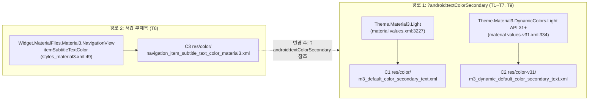

# HLD — Material 3 밝은 테마 보조 글자 대비 (이슈 #27)

| 항목 | 내용 |
|---|---|
| 상태 | 작성 중 |
| 근거 | SRS v1.2 (`docs/design/27-contrast/SRS.md`), 요구사항 정리 v2 |

## 1. 구조 개요

이 변경은 **색 자원 계층만** 건드린다. `provider/`(NIO2 백엔드)·ViewModel·LiveData·Kotlin 코드는 바뀌지 않는다. 보조 글자 색은 테마 속성 → 색 상태 목록(ColorStateList) 자원으로 풀리며, 대상 요소(SRS 2-1 T1~T9)는 모두 두 개의 경로 중 하나를 탄다.

- 앱은 업스트림 시절부터 라이브러리의 같은 이름 자원을 덮어써(C1·C2) 보조 글자를 `outline`(톤 50)으로 바꿔 두었다(SRS 1-1). 이번 변경은 **이 덮어쓰기 파일의 기본(활성) 항목 한 줄씩**을 오너가 고른 색으로 바꾸는 것이다.
- 서랍 부제목(C3)은 `?colorOutline`을 직접 쓰므로 경로 1을 바꿔도 따라오지 않는다. C3의 기본 항목을 `?android:textColorSecondary` 참조로 바꿔 경로 1에 합친다(5장 결정 D2). `colorOutline` 속성 값은 바꾸지 않는다(SRS REQ-27-05).
- 어두운 테마용 자원(`res/color/m3_dark_default_color_secondary_text.xml`, `res/color-v31/m3_dynamic_dark_default_color_secondary_text.xml`)과 Material 3 끔 테마(`res/values/themes.xml`)는 건드리지 않는다.

## 2. 구성요소

| 구성요소 | 위치(패키지·파일) | 책임 | 추적 REQ |
|---|---|---|---|
| C1 정적 보조 글자 색 | `app/src/main/res/color/m3_default_color_secondary_text.xml:13` (기본 항목). `:12` 비활성 항목은 그대로 | API 23~30(동적 색 없음)에서 Material 3 밝은 테마 `?android:textColorSecondary`의 값. 오너가 고른 후보의 **정적** 색을 가리킨다 | REQ-27-01, 02, 03, 04, 06, 07, 10 |
| C2 동적 보조 글자 색 | `app/src/main/res/color-v31/m3_dynamic_default_color_secondary_text.xml:13` (기본 항목). `:12`는 그대로 | API 31+에서 같은 값. 오너가 고른 후보의 **동적** 색을 가리킨다 | REQ-27-01, 02, 03, 04, 06, 07, 10 |
| C3 서랍 부제목 색 | `app/src/main/res/color/navigation_item_subtitle_text_color_material3.xml:14` (기본 항목). `:12` 비활성, `:13` 선택(`state_checked`) 항목은 그대로 | 기본 항목을 `?colorOutline` → `?android:textColorSecondary`로 바꿔 C1·C2를 따르게 한다 | REQ-27-09, 05, 06 |
| C4 측정 기록 | 구현 PR 본문 표 (+ 측정 스크립트는 `_workspace/`, 저장소 밖) | 변경 전·후 화소값·대비 기록 | REQ-27-08, 05 |
| (불변) 어두운·Material 3 끔·몰입 테마 자원 | `res/color/m3_dark_default_color_secondary_text.xml`, `res/color-v31/m3_dynamic_dark_default_color_secondary_text.xml`, `res/values/themes.xml`, `res/values/themes_material3.xml`, `res/values-night/themes_material3.xml` | 바꾸지 않는다 — diff 0 줄 | REQ-27-05 |

새 Kotlin 클래스·새 모듈 경계는 없다. 대상 요소의 레이아웃·코드(T1~T7, T9의 `파일:줄`)도 바꾸지 않는다 — 모두 `?android:textColorSecondary`를 실행 시점에 풀기 때문에 C1·C2만 바꾸면 따라온다(`BreadcrumbLayout.kt:31-38`, `ThemedSpeedDialView.kt:159`, `StandardDirectoryListPreferenceFragment.kt:49`은 `getColorByAttr`로 활성 기본색을 읽는다).

## 3. 데이터 흐름·상태

1. 액티비티 생성 시 `CustomThemeHelper.apply`(`java/.../theme/custom/CustomThemeHelper.kt:40-45`)가 설정 `MATERIAL_DESIGN_3`이면 `Theme.MaterialFiles.Material3` 계열을 고른다(`:69-73`).
2. 밝은 모드에서 그 부모 `Theme.Material3.DynamicColors.DayNight.NoActionBar`(`themes_material3.xml:10`)는 API 31+에서 `m3_dynamic_default_color_secondary_text`(C2), 그 아래에서 `m3_default_color_secondary_text`(C1)를 `android:textColorSecondary`로 쓴다. 앱 자원이 라이브러리 같은 이름 자원을 덮는다.
3. 서랍 어댑터가 `itemSubtitleTextColor`(C3)를 읽어 부제목에 건다(`NavigationListAdapter.kt:114,198`). C3 기본 항목이 `?android:textColorSecondary`를 가리키면 그 테마 속성의 색 상태 목록의 기본색으로 풀린다(같은 방식의 선례: 비 Material 3 서랍 `res/color/navigation_item_subtitle_text_color.xml:11`).
4. 테마 전환(밝음↔어두움, Material 3 켬↔끔)은 기존처럼 액티비티 재생성으로 반영된다(`CustomThemeHelper.kt:48-63`). 새 상태·스레드·수명주기 없음. 오류 전파 경로 없음(자원 해석 실패는 빌드 시 aapt 오류).

### 3-1. C3 변경이 어두운 테마를 바꾸지 않는 근거 (REQ-27-05)
- Material 3 어두운 테마에서 `?colorOutline` = `m3_sys_color_dark_outline`(정적) / `m3_sys_color_dynamic_dark_outline`(API 31+)이다(material 1.14.0).
- 같은 테마에서 `?android:textColorSecondary`의 기본색은 앱 자원 `m3_dark_default_color_secondary_text.xml:13` = `m3_sys_color_dark_outline`, `m3_dynamic_dark_default_color_secondary_text.xml:13` = `m3_sys_color_dynamic_dark_outline`이다.
- 따라서 어두운 테마(검은 밤 모드 포함 — `.Black`은 `colorSurface`만 바꾼다, `res/values-night/themes_material3.xml:9-20`)에서 C3의 기본색은 변경 전과 같은 자원으로 풀린다. 구현 검수에서 변경 전·후 실측으로 확인한다(4-2).

## 4. 외부 인터페이스

- Intent·Provider·AIDL·권한·설정 키·파일 포맷: 변경 없음.
- 라이브러리 비공개 자원 참조: C1·C2는 이미 `tools:ignore="PrivateResource"`로 material 라이브러리의 비공개 색 자원(`m3_sys_color_*`, `m3_ref_palette_*`)을 가리킨다. 후보 B는 `m3_ref_palette_neutral_variant40`·`m3_ref_palette_dynamic_neutral_variant40`을 새로 가리킨다 — 라이브러리 업데이트 때 이름이 바뀌면 빌드가 깨진다(6장 위험 R2).

### 4-1. 색 후보 (오너 결정 — REQ-27-07)

대비는 WCAG 2.x 상대 휘도로 계산했다. "톤 계산"은 Material 3 HCT 톤(= L\*)에서 휘도를 구한 값으로, 배경화면(색상)과 무관하게 동적 색에도 그대로 적용된다(SRS 1-1 검산: 톤50/톤98 = 4.27 대 실측 4.24). "정적"은 API 23~30에서 쓰는 material 1.14.0 기본 팔레트 16진 값이다. 서랍 배경은 `colorSurface`에 고도 덧칠이 얹혀 실제 값은 측정으로 정하며(REQ-27-09), 표의 값은 `colorPrimary` 12~15% 덧칠을 가정한 **추정**이다.

| 후보 | C1 (정적) | C2 (동적, API 31+) | 정적 색 | 앱바 평소 (톤98 / `#FEF7FF`) | 앱바 떠오름 (톤94 / `#F3EDF7`) | 대화상자 (톤92 / `#ECE6F0`) | 서랍 추정 (`#ECE4F2`~`#E7DFEE`) | 기본 글자(톤10)와의 대비 (위계) |
|---|---|---|---|---|---|---|---|---|
| (현재) outline 톤 50 | `m3_sys_color_light_outline` | `m3_sys_color_dynamic_light_outline` | `#79747E` | 4.27 / 4.33 | 3.85 / 3.96 | 3.66 / 3.72 | 3.67~3.51 | 3.8 |
| **A** onSurfaceVariant 톤 30 (라이브러리 원래 값으로 되돌림) | `m3_sys_color_light_on_surface_variant` | `m3_sys_color_dynamic_light_on_surface_variant` | `#49454F` | 8.89 / 8.88 | 8.03 / 8.13 | 7.63 / 7.63 | 7.5~7.2 | 1.8 |
| **B** neutral variant 톤 40 | `m3_ref_palette_neutral_variant40` | `m3_ref_palette_dynamic_neutral_variant40` (= `system_neutral2_600`) | `#605D66` | 6.15 / 6.13 | 5.55 / 5.61 | 5.27 / 5.27 | 5.2~5.0 | 2.6 |
| **C** 고정 회색 (배경화면 무관) | 새 색 자원 `#616161` | 같은 `#616161` | `#616161` | — / 5.89 | — / 5.39 | — / 5.06 | 5.0~4.8 | 2.8 |

(C는 고정색이라 톤 계산 대신 정적 배경 16진 값으로만 계산했다. 동적 배경에서도 배경 톤이 같으면 대비는 거의 같다.)

후보별 성질:

| | A (톤 30) | B (톤 40) | C (`#616161`) |
|---|---|---|---|
| 최저 대비(대화상자·서랍) | 약 7.2 — 여유 큼 | 약 5.0 — 여유 있음 | 약 4.8 — 서랍 추정에서 여유 적음 |
| 보조/기본 글자 구별 | 가장 약함(기본 글자와 1.8:1) | 중간 | 중간 |
| 지금 화면과의 차이 | 가장 큼(눈에 띄게 진해짐) | 중간 | 중간, 배경화면 색조가 빠짐 |
| Material 3 역할 의미 | 규격 역할(`onSurfaceVariant`), 라이브러리 기본값 | 역할 아님(팔레트 톤 직접) | 역할 아님, 동적 색 아님 |
| Android 14+ 시스템 "대비" 설정 | 따른다(`system_on_surface_variant_light`, material `values-v34.xml:51`) | 따르지 않는다(팔레트 톤 고정) | 따르지 않는다 |
| 업스트림 동기화 | 가장 단순(라이브러리 값으로 되돌림) | 덮어쓰기 유지, 한 줄 차이 | 새 색 자원 추가 |

**설계팀 권고: B.** 지금 모양(연한 보조 글자)을 가장 적게 바꾸면서 모든 배경에서 5:1 안팎의 여유를 둔다. A는 대비 여유와 시스템 대비 설정 대응이 가장 좋지만 보조 글자가 기본 글자에 가까워진다. **최종 선택은 오너가 한다**(SRS REQ-27-07, 요구사항 정리 v1·v2 "확인이 필요한 점"). 오너 결정 전에는 구현에 들어가지 않는다.

### 4-2. 재측정 방법 (REQ-27-08, 05, 09, 10)
1. 같은 에뮬레이터 `Medium_Phone_API_36`, 같은 기본 배경화면, 시스템 대비 "표준"에서 **변경 전 빌드(develop)**와 **변경 후 빌드(feature)**를 각각 설치한다. 오너 기기에는 설치하지 않는다.
2. 설정 → Material Design 3 켬, 밝은 테마. 화면마다 `adb exec-out screencap -p > <파일>.png`로 캡처한다: 파일 목록 맨 위(T1·T2·T3), 스크롤 후(T1·T2 떠오름), 항목 하나 선택(T3 선택), 빠른 동작 펼침(T6), 권한 또는 충돌 대화상자(T5), 설정 화면(T7), 서랍 열기(T8), 툴바 더보기 메뉴(T9).
3. 각 대상에서 글자 획 안쪽 화소의 대표값(안티에일리어싱 테두리 제외)과 주변 배경 최빈값을 뽑아 WCAG 대비를 계산한다. 계산 스크립트는 프로젝트 venv 파이썬으로 `_workspace/`에 두고(저장소에 넣지 않음), 대신 Accessibility Scanner를 써도 된다.
4. REQ-27-05: Material 3 어두운 테마, Material 3 끔 밝은 테마에서 부제목(T1)과 서랍 부제목(T8)을 변경 전·후 모두 재어 화소값이 같은지 본다. 자원 diff로 어두운·Material 3 끔 파일이 0줄 변경인지도 확인한다.
5. 정적 팔레트(API 23~30, REQ-27-04): API 30 이하 에뮬레이터가 있으면 같은 절차로 T1 하나 이상을 잰다. 없으면 4-1의 정적 16진 계산값을 근거로 두고 "미측정"으로 기록한다.
6. 결과는 구현 PR 본문에 표(대상, 상태, 글자 색, 배경 색, 변경 전 대비, 변경 후 대비, 판정)로 남긴다.

## 5. 설계 결정

| 결정 | 대안 | 고른 이유 |
|---|---|---|
| D1 C1·C2의 기본 항목만 바꾼다 | (a) 테마(`themes_material3.xml`)에 `android:textColorSecondary`를 새로 지정 (b) 각 레이아웃·코드의 색을 바꿈 | 값의 출처가 이미 이 두 파일이다(SRS 1-1). 한 곳을 바꾸면 T1~T7, T9가 모두 따라오고, 어두운 테마 파일은 별개라 REQ-27-05가 구조적으로 지켜진다. (a)는 같은 이름 자원 덮어쓰기와 테마 속성이 이중으로 남아 출처가 둘이 된다. (b)는 사용처가 20곳 가까이이고 라이브러리 레이아웃(T7)은 고칠 수 없다 |
| D2 C3 기본 항목을 `?android:textColorSecondary` 참조로 바꾼다 | (a) C3에 후보 색을 직접 넣음 (b) `colorOutline` 값을 바꿈 | 보조 글자와 서랍 부제목이 같은 색을 쓰게 되어 오너 결정이 한 번으로 끝나고(요구사항 v2 지시), 어두운 테마에서는 두 값이 같은 자원이라(3-1) 바뀌지 않는다. (a)는 밝음/어두움·정적/동적별로 파일이 4개 더 필요하다. (b)는 스위치 틴트 등 다른 사용처를 바꿔 REQ-27-05 위반 |
| D3 비활성·선택 항목은 그대로 둔다 | 함께 조정 | 비활성 글자는 대비 기준 예외이고 REQ-27-06이 불변을 요구한다. 서랍 선택 항목은 `colorOnSecondaryContainer`로 이미 다른 역할이다 |
| D4 색은 후보 A·B·C 중 오너가 고른다(권고 B) | 설계팀이 정함 | 사용자에게 보이는 변경이라 오너 결정 대상(요구사항 정리 "확인이 필요한 점") |
| D5 측정은 에뮬레이터 실측 + 톤 계산 병행 | 실측만, 계산만 | 동적 색은 배경화면마다 달라 실측만으로는 모든 경우를 덮지 못하고, 서랍·선택 상태 배경은 덧칠이 있어 계산만으로는 정확하지 않다 |

## 6. 위험과 미결 사항

| ID | 내용 | 대응 |
|---|---|---|
| R1 | 서랍 배경(고도 덧칠)의 실제 값이 미측정이다. 후보 C는 추정 하한이 4.8로 여유가 적다 | 구현 시 REQ-27-09 실측. C가 선택되고 4.5 미만이면 구현을 멈추고 설계팀·PM에 보고 |
| R2 | 후보 B는 라이브러리 비공개 팔레트 자원 이름(`m3_ref_palette_*neutral_variant40`)에 기대므로 material 업데이트 때 이름이 바뀌면 빌드가 깨진다 | 빌드 실패로 바로 드러난다. 현재 C1·C2도 같은 종류 자원(`m3_sys_color_*`)에 기대고 있어 새 위험 종류는 아니다 |
| R3 | C1·C2·C3는 업스트림 작성자 파일이다. 업스트림 동기화(`feature/sync-upstream-*`) 때 충돌할 수 있다 | 한 줄 변경이라 충돌 해결은 간단하다. 구현 커밋 메시지에 #27을 남겨 동기화 때 식별하게 한다 |
| R4 | Material 3 어두운 테마 대화상자(톤 17 추정) 위 보조 글자는 톤 60/톤 17 ≈ 4.5로 경계값이다(계산, 미측정). 범위 밖(통과 테마 불변, REQ-27-05)이지만 미달일 수 있다 | 이번에는 바꾸지 않는다. 구현 측정 때 어두운 대화상자도 한 번 재서 미달이면 별도 이슈로 등록한다 |
| R5 | 고정 서랍(sw600dp 가로)은 태블릿 에뮬레이터가 없으면 미측정으로 남는다 | 같은 C3 자원·같은 `?colorSurface` 배경이라 휴대폰 측정으로 갈음하고 "미측정"으로 기록(SRS REQ-27-09) |
| Q1 | 색 후보 선택 | **오너 결정 대기** (4-1) |

## 7. 변경 이력
| 일자 | 버전 | 변경 | 사유 | 요청자 |
|---|---|---|---|---|
| 2026-11-19 | v1.0 | 최초 작성 | SRS v1.2 | PM |
