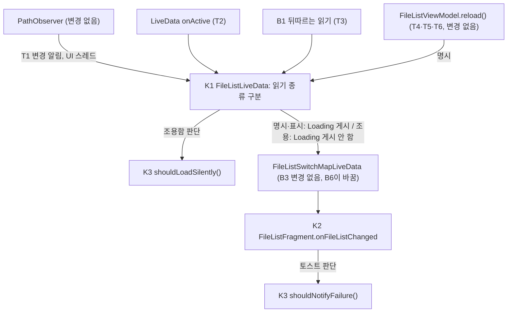
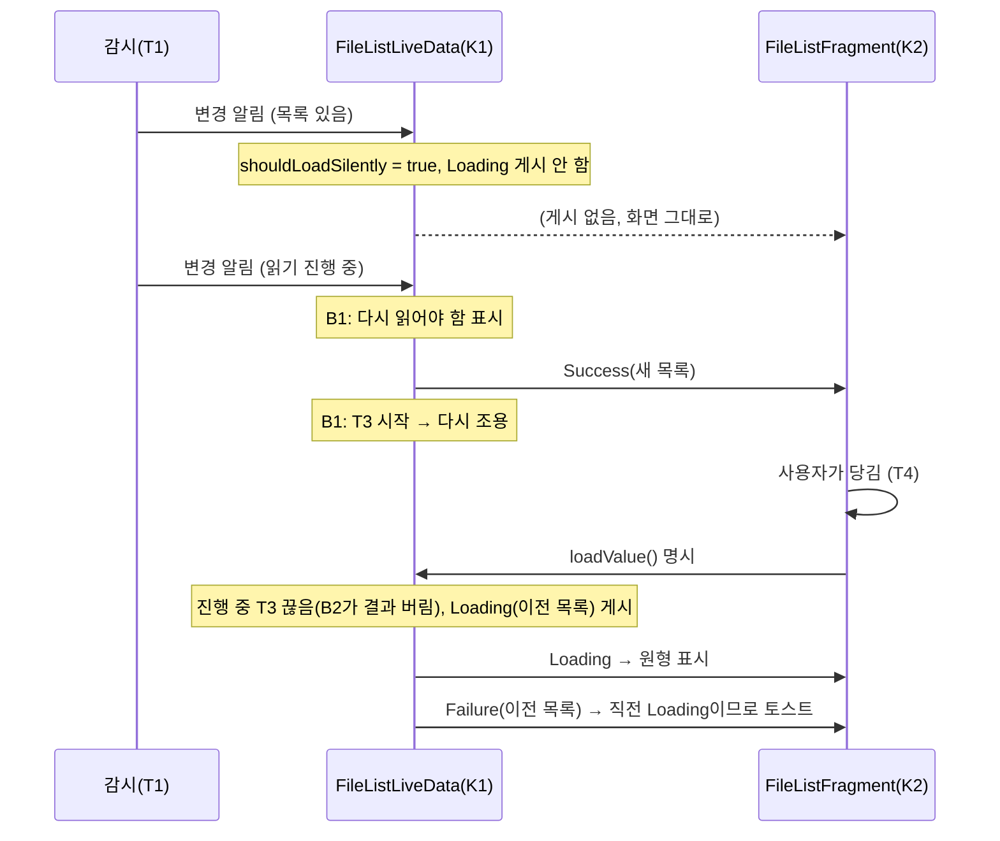

# HLD — 파일 목록 자동 새로 고침의 조용한 갱신 (이슈 #29, B3)

| 항목 | 내용 |
|---|---|
| 상태 | 검수 중(v1.1) — v1 조건부 통과(경미 h1~h3 반영) |
| 근거 | SRS v1.1 (`docs/design/29-list-refresh/SRS.md`) |
| 기준 코드 | `origin/develop` 4437e43. 줄 번호는 모두 이 커밋 기준이다. 결함 수정 B1·B2·B6(`feature/29-sftp-list-reload`)은 이 HLD 작성 시점에 원격에 없어 그 코드의 줄은 인용하지 않는다 |

## 1. 구조 개요

### 1.1 지금 구조
- 창(`FileListFragment`)마다 `FileListViewModel`이 있고, 목록 상태는 `FileListSwitchMapLiveData`(`FileListViewModel.kt:230-271`)가 현재 경로·검색 상태에 따라 `FileListLiveData` 또는 `SearchFileListLiveData`를 원천으로 바꿔 끼운다(`updateSource`, `:241-255`). 경로가 바뀌면 새 `FileListLiveData`가 생기고, 생성자가 첫 읽기를 시작한다(`FileListLiveData.kt:32-35`).
- 다시 읽기는 모두 `FileListLiveData.loadValue()`(`:37-62`) 하나로 간다. 진입점은 넷이다: 생성자(`:33`), 변경 감시 알림(`onChangeObserved`, `:64-70` — `PathObserver`가 UI 스레드로 넘김, `PathObserver.kt:42`), 비활성 중 변경 뒤 활성화(`onActive`, `:72-77`), 명시 새로 고침(`FileListViewModel.reload()` `:71-77` → `FileListSwitchMapLiveData.reload()` `:257-262`; 호출은 당겨서 새로 고침 `FileListFragment.kt:227`, 메뉴 `:503-505`, 권한 허용 뒤 `FileListHostFragment.kt:250-252`).
- `loadValue()`는 어느 진입점이든 진행 중인 읽기를 끊고(`:38`) `Loading(이전 목록)`을 내보낸 뒤(`:39`) 작업 스레드에서 읽어 `Success` 또는 `Failure(이전 목록, e)`를 보낸다(`:40-61`).
- 화면은 `onFileListChanged`(`FileListFragment.kt:707-739`) 한 곳에서 상태를 그린다: 부제목(`:710-714`), 원형 표시(`:716`), 가운데 진행 표시(`:717`), 가운데 오류 글(`:718`, `:726`), 토스트(`:723-724`).
- 그래서 "자동인지 명시인지"는 `loadValue()` 안에서 구분되지 않고, `Loading`을 받으면 화면은 항상 로딩 표시를 낸다. 바꿀 곳은 이 구분 하나와, 실패 토스트의 반복이다.

### 1.2 새 구조
기존 모듈 경계(`filelist/`의 LiveData ↔ Fragment)는 그대로 둔다. `provider/`·`filejob/`·`util/Stateful.kt`는 바꾸지 않는다. 판단 규칙 두 개를 순수 함수로 떼어 새 파일에 둔다(D3 — 단위 시험과 상위 동기화 충돌 최소화, SRS C-2).

## 2. 구성요소

| 구성요소 | 위치(패키지·파일) | 책임 | 추적 REQ |
|---|---|---|---|
| K1 읽기 종류 구분 | `filelist/FileListLiveData.kt` (기존, 상위 코드) | 다시 읽기를 **명시**(생성자 첫 읽기, 공개 `loadValue()` — `FileListViewModel`이 부르는 경로)와 **자동**(T1 `onChangeObserved`, T2 `onActive`, T3 B1 뒤따르는 읽기)으로 나눠 시작한다. 자동이면 시작 순간 K3 `shouldLoadSilently`로 조용함을 정한다. 조용하면 `Loading`을 게시하지 않고 현재 값(`Success` 또는 `Failure(이전 목록)`)을 그대로 둔 채 읽기만 시작한다. 그 밖은 지금처럼 `Loading(이전 목록)`을 게시한다. 읽기 결과 게시(`Success`/`Failure(valueCompat.value, e)`, `:55-60`)와 B2의 "대체된 읽기는 게시 안 함"은 그대로 쓴다. 명시 읽기는 진행 중인 읽기(조용한 것 포함)를 지금처럼 끊고 새로 시작한다(`:38`). B1 작업지시서는 읽기 로직을 새 `filelist/FileListLoader.kt`로 옮긴다 — 자동/명시 구분을 넘기는 호출 위치(어느 파일·함수에서 K3를 부르는지)는 LLD에서 B1 구현에 맞춰 확정한다. | REQ-29-01, 03, 04, 05, 08, 09, 11 |
| K2 실패 토스트 반복 억제 | `filelist/FileListFragment.kt` `onFileListChanged`(`:707-739`, 기존, 상위 코드) | 직전에 이 화면(뷰)이 받은 목록 상태를 기억하고, 토스트를 띄울지 K3 `shouldNotifyFailure`로 정한다. 부제목·원형·가운데 진행·오류 글의 기존 분기(`:710-718`)는 바꾸지 않는다 — 조용한 읽기는 `Loading`을 게시하지 않으므로 이 분기만으로 REQ-29-01의 "표시 없음"이 된다. | REQ-29-02, 06, 07, 10, 13 |
| K3 표시 판단 함수 | `filelist/FileListRefreshPolicy.kt` (새 파일, 이 저장소 코드 — 이름은 LLD에서 바꿀 수 있음) | 안드로이드 의존 없는 순수 함수 둘. `shouldLoadSilently(isAutomatic, current: Stateful<List<FileItem>>?)` = 자동이고 `current?.value != null`이면 참. `shouldNotifyFailure(previous: Stateful<…>?, current: Stateful<…>)` = `current`가 `Failure`이고, 그 목록에 항목이 있고(빈 목록·`null`이면 가운데 오류 글이 대신함, `FileListFragment.kt:723-726`), `previous`가 `Failure`가 아니면 참(`previous == null`, 즉 뷰가 새로 만들어진 직후는 참 — SRS REQ-29-06 재생성 허용). 숨김 파일 거르기 뒤의 "항목 있음" 판단은 지금 코드처럼 거르기 전 목록 기준(`:715`)이다. | REQ-29-01, 03, 06, 07, 09 |
| K4 명시 새로 고침 경로 | `filelist/FileListViewModel.kt` `reload()`(`:71-77`), `FileListSwitchMapLiveData.reload()`(`:257-262`), `FileListHostFragment.refreshPanes()`(`:250-252`) | **B3은 바꾸지 않는다**(B6 작업지시서는 `FileListSwitchMapLiveData`를 바꾼다 — 그 변경은 B6 범위). 공개 `FileListLiveData.loadValue()`를 명시 읽기로 부르는 유일한 경로임을 유지한다. 압축 파일 안의 `archiveRefresh()`(`:73-75`)도 그대로. | REQ-29-04 |
| K5 감시 | `filelist/PathObserver.kt`, `provider/common/LocalWatchService.kt`, 각 `provider/*/…FileSystemProvider.observe()` | **변경 없음.** 알림 빈도·간격(1000ms, `PathObserver.kt:61`)은 B4 범위 밖. 감시 미지원(압축, `ArchiveFileSystemProvider.kt:279-281`)이면 T1~T3이 생기지 않는다. | REQ-29-11 |
| K6 검색 목록 | `filelist/SearchFileListLiveData.kt` | **변경 없음**(SRS 1.3 범위 밖, T9). | — |
| K7 숨긴 창 정지 (B6) | `filelist/FileListHostFragment.kt`·`DualPaneLayout.kt`(B6 구현 위치는 개발팀) | **B3이 바꾸지 않는다.** B6이 숨긴 창의 관찰을 비활성으로 만들면 그동안의 알림은 `isChangedWhileInactive`(`FileListLiveData.kt:68`)로 쌓이고, 다시 보일 때 `onActive`가 T2 자동 읽기로 K1에 들어온다. | REQ-29-01(T2), 10 |
| K8 정렬·보기·숨김 설정 | `FileListFragment.kt:794-797`, `:852-863` | **변경 없음.** 다시 읽지 않고 어댑터만 다시 정렬·거른다. | REQ-29-12 |

## 3. 데이터 흐름·상태

### 3.1 읽기 종류별 흐름

| 진입 | 종류 | 시작 순간 게시 | 진행 중 화면 | 끝나면 게시 |
|---|---|---|---|---|
| 생성자(T7, 첫 읽기) | 명시 | `Loading(null)` | 부제목 "Loading…", 가운데 진행 | `Success` / `Failure(null, e)` |
| `loadValue()` 공개(T4~T6) | 명시 | `Loading(이전 목록)` | 부제목 "Loading…", 항목 있으면 원형·없으면 가운데 진행 | `Success` / `Failure(이전 목록, e)` |
| T1·T2·T3, 표시 중인 목록 있음 | 자동·조용 | **없음** | 직전 그대로(목록, 부제목 항목 수 또는 "Error") | `Success` / `Failure(이전 목록, e)` |
| T1·T2·T3, 표시 중인 목록 없음 | 자동·표시 | `Loading(null)` | 첫 읽기와 같음 | `Success` / `Failure(null, e)` |

- "이전 목록"은 지금처럼 끝나는 순간의 `valueCompat.value`(`FileListLiveData.kt:58`)다. 조용한 읽기 중에는 값이 `Success`/`Failure` 그대로라 이것이 표시 중인 목록이다.
- 조용한 읽기 동안 `fileListStateful`이 `Success`로 남으므로 이름 중복 검사(`FileListFragment.kt:1472-1478`의 `getFileWithName`이 `Success`일 때만 동작)가 지금(조용하지 않을 때 `Loading`이라 `null`)보다 끊기지 않는다. 부작용으로 보지 않는다.

### 3.2 토스트 판단 (K2·K3)

| 직전 상태(이 뷰가 받은 것) | 새 상태 | 토스트 | 근거 |
|---|---|---|---|
| 없음(뷰 생성 직후) | `Failure`(항목 있음) | 띄움 | 지금 동작(재생성 뒤 다시 알림 허용, REQ-29-06) |
| `Success` | `Failure`(항목 있음) | 띄움 — 조용한 읽기의 첫 실패 | REQ-29-06(d) |
| `Loading` | `Failure`(항목 있음) | 띄움 — 명시 새로 고침 또는 표시한 자동 읽기의 실패 | REQ-29-07 |
| `Failure` | `Failure`(항목 있음) | **안 띄움** — 실패 상태에서 다시 실패한 조용한 읽기 | REQ-29-06(d) |
| 아무것 | `Failure`(빈 목록·`null`) | 안 띄움, 가운데 오류 글 | 지금 동작(`:723-726`) |

명시 새로 고침은 항상 `Loading`을 먼저 게시하므로 그 실패는 표의 셋째 줄이 되어 늘 토스트가 뜬다. 별도 플래그가 필요 없다. "직전 상태"는 화면(뷰) 단위로 기억하고 창마다 따로다(창마다 `FileListFragment`가 따로, REQ-29-10).

### 3.3 겹침 (B1·B2와의 관계)
- **조용한 읽기 중 명시 새로 고침(REQ-29-08)**: K1이 지금처럼 진행 중 읽기를 끊고 `Loading(이전 목록)`을 게시 → 원형 표시. 끊긴 조용한 읽기의 결과는 B2가 버린다. 원형 표시는 새 읽기 결과가 게시될 때 `onFileListChanged`의 기존 분기(`:716`)로 걷힌다.
- **명시·첫 읽기 중 변경 알림(REQ-29-09)**: B1이 "다시 읽어야 함"을 기억하고 진행 중 읽기가 끝난 뒤 T3을 시작한다. T3은 자동이므로 K3이 그 순간 표시 중인 목록 유무로 조용함을 정한다. 앞 읽기의 결과 게시로 로딩 표시는 이미 걷혔다.
- **조용한 읽기 중 변경 알림**: B1대로 끝난 뒤 T3 한 번. 조용하므로 화면 변화는 결과뿐이다.

### 3.4 스레드·수명주기·오류 전파
- 조용함 판단(K3 `shouldLoadSilently`)은 `loadValue` 진입과 같은 UI 스레드에서 한다 — T1은 `PathObserver.kt:42`가 UI 스레드로 넘기고, T2(`onActive`)·명시 경로도 UI 스레드다. T3의 시작을 UI 스레드에서 할지 작업 스레드 끝에서 할지는 B1 구현을 따르되, 판단에 쓰는 현재 값은 게시(`postValue`)가 반영된 뒤의 값이어야 한다(P4). 이 맞춤은 LLD에서 B1 코드에 맞춰 정한다.
- 읽기 자체는 지금처럼 `AsyncTask.THREAD_POOL_EXECUTOR`(`FileListLiveData.kt:40`). UI 스레드 일은 늘지 않는다(`Stability_ANR`).
- 오류 전파는 지금과 같다 — 작업 스레드의 예외는 `Failure`로 게시되고(`:57-58`), 화면은 부제목·오류 글·토스트로 보인다. 조용한 읽기의 실패도 같은 길이다.
- 화면 재생성(회전): `FileListLiveData`는 ViewModel에 있어 유지된다. 관찰자가 잠시 떨어진 동안의 알림은 `onActive` T2로 들어와 조용하다. K2의 "직전 상태"는 뷰와 함께 사라져 재생성 뒤 첫 `Failure`는 다시 알린다(3.2 첫 줄).

## 4. 외부 인터페이스
- 새 Intent·Provider·AIDL·권한·설정 키·문구·리소스 없음. 기존 문구 `R.string.loading`·`R.string.error`(`res/values/strings.xml:25`, `:21`)만 쓴다.
- 공개 API 의미: `FileListLiveData.loadValue()`(공개)는 "명시 새로 고침"을 뜻하게 된다. 자동 읽기는 클래스 안의 비공개 진입점으로만 시작한다. 지금 이 메서드의 외부 호출자는 `FileListSwitchMapLiveData.reload()`(`FileListViewModel.kt:259`) 하나다.
- B1과의 접점: B1이 "읽기 진행 중"을 `value is Loading`으로 판단하면 조용한 읽기(`Loading`을 게시하지 않음) 중에 틀린다. 진행 여부는 `future`(또는 B1이 둔 별도 상태)로 판단해야 한다. LLD에서 확인한다(R1).

## 5. 설계 결정

| 결정 | 대안 | 고른 이유 |
|---|---|---|
| D1 조용한 읽기는 `Loading`을 게시하지 않는다 | (가) `Loading`에 `isSilent` 필드 추가 (나) `Stateful`에 새 하위형 `Refreshing` 추가 | `util/Stateful.kt`는 파일 속성 등 다른 화면도 쓰는 공용 형이라 바꾸지 않는다. 화면의 표시 분기(`FileListFragment.kt:710-718`)를 그대로 둘 수 있어 상위 코드 변경이 가장 작다(SRS C-2). 화면은 "조용한 읽기가 진행 중"임을 알 필요가 없다(SRS가 진행 중 표시를 요구하지 않음). |
| D2 토스트 반복 억제는 화면에서 "직전 상태가 `Failure`인가"로 정한다 | (가) LiveData가 "알렸음" 플래그를 들고 다님 (나) ViewModel에 마지막으로 알린 실패를 저장 | 명시 새로 고침은 항상 `Loading`을 거치므로 플래그 없이 규칙이 나온다(3.2). (나)는 재생성 뒤 중복 토스트도 막지만 SRS가 재생성 뒤 다시 알림을 허용했고 상태가 늘어난다. |
| D3 판단을 새 파일의 순수 함수로 둔다 | 각 클래스 안에 조건식으로 둠 | 안드로이드 없이 JVM 단위 시험 가능(SRS REQ-29-01·03·06~09의 단위 시험, 승인된 JUnit 4.13.2 — 2-dual-pane SRS C-3). 상위 파일의 변경 줄이 줄어든다. |
| D4 조용한 읽기 중 명시 새로 고침은 진행 중 읽기를 끊고 새로 읽는다 | 진행 중 읽기를 명시로 "승격"해 그 결과를 기다림 | 지금 동작과 같고(`FileListLiveData.kt:38`), 사용자가 당긴 이후의 내용을 보장한다. 승격은 시작 시점이 당기기 전이라 그 사이 변경을 놓칠 수 있다(SRS Q2). |
| D5 조용한 성공은 화면 낭독에 알리지 않는다 | live region·`announceForAccessibility` | 작업 중 초마다 갱신되어 낭독이 끼어든다(SRS REQ-29-13). 실패는 기존 토스트로 알린다. |

## 6. 위험과 미결 사항
| ID | 내용 | 대응 |
|---|---|---|
| R1 | B1·B2·B6 코드가 아직 원격에 없다. B1이 진행 여부를 `value is Loading`으로 보거나 명시 새로 고침도 기다리게 하면 이 HLD와 어긋난다. | LLD 작성 때 B1 코드와 맞춘다(4장 접점). 어긋나면 설계팀에 문의 — 다시 설계가 필요하면 PM에게 올린다. |
| R2 | 느린 원격 폴더에서 조용한 읽기가 오래 걸리면 그동안 목록이 오래된 채 진행 표시도 없다. | 오너가 고른 동작(B3). 사용자는 당겨서 새로 고침으로 표시와 함께 다시 읽을 수 있다. |
| R3 | 실패 상태가 부제목 "Error"뿐이면 놓치기 쉽다(SRS Q3). | 첫 실패 때 토스트 한 번. 더 눈에 띄는 표시는 오너 결정 시 별도 이슈. |
| R4 | 조용한 갱신으로 어댑터 목록을 바꿀 때 TalkBack 초점이 옮겨질 수 있다(`adapter.replaceListAndIsSearching`, `FileListFragment.kt:862`). 지금 다시 읽기와 같은 길이라 나빠지지는 않는다고 보지만 미확인. | SRS REQ-29-13 수동 확인(V4). 나빠지면 별도 이슈. |
| R6 | 뷰가 비활성(중지된 창, 예: 숨긴 창이나 백그라운드에서 `refreshPanes`)일 때 명시 새로 고침의 `Loading` 직후 `Failure`가 오면 LiveData는 마지막 값만 전달하므로 뷰는 `Loading`을 받지 못한다. 직전 상태가 `Failure`였으면 K2가 토스트를 억제해 REQ-29-07(명시 실패는 늘 토스트)을 어길 수 있다. 드문 경우다. | LLD에서 처리 방법(예: 명시 읽기 시작을 뷰가 받지 못해도 알 수 있는 표식)을 정하고 시험 항목에 넣는다(비활성 중 명시 새로 고침 → 실패 → 다시 보일 때 토스트). |
| R5 | `FileListLiveData.kt`·`FileListFragment.kt`는 상위 코드라 동기화 충돌 가능. | 판단은 K3 새 파일로, 상위 파일은 분기 호출만(D3). |

## 7. 변경 이력
| 일자 | 버전 | 변경 | 사유 | 요청자 |
|---|---|---|---|---|
| 2026-11-03 | v1 | 최초 작성 | SRS v1.1(검수 1회차 조건부 통과) | PM |
| 2026-11-03 | v1.1 | 1.2 그림·K4의 `FileListSwitchMapLiveData` 변경 범위를 B6과 구분, K1에 B1 `FileListLoader.kt` 호출 위치는 LLD에서 확정, 6장 R6(비활성 뷰의 명시 실패 토스트 억제 위험) | HLD 1회차 검수 h1~h3 (PR #31) | 검수팀 |
