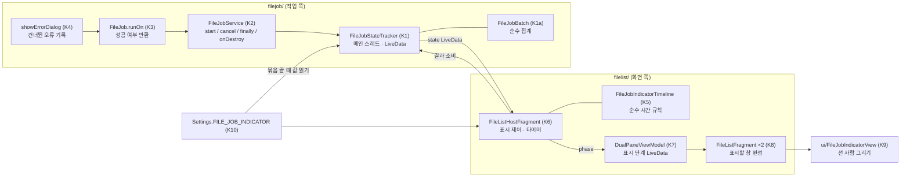

# HLD — 파일 작업 표시(달리는 선 사람) (이슈 #30)

| 항목 | 내용 |
|---|---|
| 상태 | 검수 통과(v1.1, PR #32 2회차 조건부 — n1은 v1.2에서 반영), v1.2 오너 결정 반영, v1.3 LLD 피드백 FB-1~FB-5 반영, v1.4 #38 요구사항 변경 반영 — PR #41 1회차 조건부 통과(치명·중요 0, 경미 2는 PM 판단)(검수 범위: K9·K11, 3.4 "모션 줄이기"·"멈춤", 3.4.1, 3.6, 4장 시스템 방송 줄, D9, R9·R11) |
| 근거 | SRS v1.4 (v1.1 검수 통과 + 4.3 Q1~Q3 오너 결정 2026-11-04 + 1.4 "모션 줄이기" 정의 확장, LLD FB-1 + 절전 모드, 이슈 #38 요구사항 정리 v1) |
| 기준 코드 | `origin/develop` 4437e43 — 줄 번호는 이 커밋 기준. 단 K11, 3.4.1, R11의 v1.4 인용은 #30 구현이 들어간 `origin/develop` a1a8a3e 기준 |

## 1. 구조 개요

### 1.1 지금 구조
- **작업 실행(`filejob/`)**: 화면은 `FileJobService`의 companion 시작 함수(`FileJobService.kt:115-196`)를 부른다. companion `startJob`(`:104-113`, 메인 스레드)은 서비스가 있으면 바로 넘기고, 없으면 `pendingJobs`에 쌓은 뒤 서비스를 시작한다(서비스 `onCreate`가 비움, `:42-44`). 서비스의 `startJob`(`:54-67`)은 캐시 스레드 풀에 `job.runOn(this)` 뒤 `runningJobs.remove(job)`을 실행하는 일을 넘긴다. 취소는 알림 버튼 → `FileJobReceiver`(`FileJobReceiver.kt:16-18`) → companion `cancelJob`(`FileJobService.kt:198-202`) → 서비스 `cancelJob`(`:69-74`, `Future.cancel(true)`로 끼어들기). 서비스가 끝나면 남은 작업을 모두 취소한다(`:76-87`).
- **작업 끝**: `FileJob.runOn`(`FileJob.kt:19-33`)이 `run()`을 부르고 `InterruptedIOException`(취소)과 `Exception`(실패, 토스트)을 잡아 삼킨다. 결과를 밖으로 돌려주지 않는다. 바깥에 드러난 상태는 메인 스레드에서 읽는 개수 `runningJobCount`(`FileJobService.kt:100-102`)뿐이고 관찰할 수 없다.
- **오류 창**: 작업 본문은 오류 때 `showErrorDialog`(`FileJobs.kt:499-526`)로 창을 띄워 답을 기다리고, 답에 따라 다시 시도·건너뛰기·취소한다.
- **화면(`filelist/`)**: `FileListHostFragment`가 창(`FileListFragment`) 한두 개와 두 창 상태(`DualPaneViewModel` — 활성 창 `:10-31`, 창 모드 `:40-51`)를 가진다. 툴바는 창마다 앱바 안에 있다(`res/layout/file_list_fragment_app_bar_include.xml:27-36`, 두 배치 모두 이 include를 쓴다: `res/layout/file_list_fragment_include.xml:21`, `res/layout-sw600dp-land/file_list_fragment_include.xml:22`). 툴바는 지원 액션바가 아니라 창별 메뉴 호스트다(`FileListFragment.kt:199-201`). 창은 부모의 `DualPaneViewModel`을 공유한다(`FileListFragment.kt:144`).
- **설정(`settings/`)**: 불리언 설정은 `Settings`의 `BooleanSettingLiveData`(예: `FILE_LIST_ANIMATION`, `Settings.kt:124-127`) + `res/values/donottranslate_prefs.xml`의 키·기본값(`:52-53`) + `res/xml/settings.xml`의 `SwitchPreferenceCompat`(`:44-47`) 세 곳으로 만든다.

### 1.2 새 구조

- 작업 쪽은 **알리기만** 한다: 시작(K2, 메인 스레드)·끝(K2 `finally`, 메인 스레드로 넘김)·취소(K2). 작업 본문의 분기·반환값은 그대로다(SRS C-1).
- 화면 쪽은 관찰한 상태로 **표시 단계**(숨김·달리기·만세·넘어짐)를 시간 규칙(K5)에 따라 정해 화면 하나에 하나만 그린다.
- 새 경계: `FileJobStateTracker`(K1)는 `filejob/`에 둔다. 상태의 주인이 작업 쪽이고, 화면 쪽(`filelist/`)은 지금처럼 `filejob/`의 공개 API만 부른다(지금도 `FileListFragment`가 `FileJobService`를 부른다). K1은 묶음이 끝나는 순간 표시 설정(K10)을 읽는다 — `filejob/`이 `settings/`를 참조하는 첫 자리다. 화면이 멈춘 동안(설정 화면은 다른 액티비티) 끈 설정은 화면 쪽(K6)이 볼 수 없어서, 결과를 만들 때 버려야 SRS A7을 지킬 수 있기 때문이다(LLD FB-2). 반대 방향(`settings/` → `filejob/`)은 이미 있다(`settings/RootStrategyPreference.kt:35`가 `FileJobService.runningJobCount`를 읽음). 그래서 두 패키지가 서로 참조하게 되지만 같은 모듈 안이고, 클래스 사이 순환은 없다 — `Settings`(`settings/Settings.kt`)는 `filejob/`을 참조하지 않고, K1이 읽는 것은 `Settings.FILE_JOB_INDICATOR`의 메모리 값뿐이다. 그림 뷰(K9)는 툴바 안 범용 위젯이라 기존 툴바 위젯들(`ui/CrossfadeSubtitleToolbar.kt`, `ui/OverlayToolbar.kt`)과 같은 `ui/`에 둔다.

## 2. 구성요소

| 구성요소 | 위치(패키지·파일) | 책임 | 추적 REQ |
|---|---|---|---|
| K1 상태 통로 | `filejob/FileJobStateTracker.kt` (새 파일, `object`) | 메인 스레드 전용. `onJobStarted(id)`, `onJobFinished(id, isSuccessful)`, `consumeResult(seq)`를 받아 K1a로 집계하고(`onJobFinished`는 그 순간의 `Settings.FILE_JOB_INDICATOR` 값을 K1a에 "결과를 남길지"로 넘긴다 — 꺼져 있으면 끝난 묶음의 결과를 만들지 않음, SRS A7), `stateLiveData: LiveData<FileJobState>`로 내보낸다. 모든 변경은 `setValue`(메인)라 순서가 보존되고 합쳐지지 않는다. | REQ-30-01, 04, 11, 15 |
| K1a 묶음 집계 | `filejob/FileJobBatch.kt` (새 파일, 안드로이드 의존 없음) | 진행 중 작업 id 집합, 이번 묶음의 실패 여부, 끝난 묶음 결과 `FinishedBatch(seq, isSuccessful)?`. 규칙: 모르는 id·이미 끝난 id의 끝 보고는 무시(중복 무시), 집합이 비면 결과를 만들고(K1이 넘긴 "결과를 남길지"가 거짓이면 결과 없음, SRS A7) seq를 1 올림(앞 결과는 덮어씀 — SRS A8 "마지막 묶음만"), 새 시작이 오면 남은 결과를 지움(REQ-30-08), `consume(seq)`는 seq가 같을 때만 결과를 지움. 상태 값 `FileJobState(runningCount, finished: FinishedBatch?)`. | REQ-30-01, 04, 08, 11, 15 |
| K2 서비스 연결 | `filejob/FileJobService.kt` (기존) | ① companion `startJob`(`:104-113`) 처음에 `onJobStarted(job.id)` ② 실행기 작업(`:57-63`)을 `try { isSuccessful = job.runOn(this) } finally { runningJobs 정리·잠금 갱신(`:59-62`를 여기로 옮김, #34); 메인으로 넘겨 onJobFinished(job.id, isSuccessful) }`로 감싼다 — `isSuccessful` 기본값 `false`라 `Throwable`로 끝나도 실패로 보고되고 `runningJobs`에서도 지워지며(#34 해소), 예외는 지금처럼 그대로 위로 나간다(잡지 않음) ③ companion `cancelJob`(`:198-202`)에서 대기 목록에서 지운 작업, 서비스 `cancelJob`(`:69-74`)·`onDestroy`(`:76-87`)에서 지운 작업마다 `onJobFinished(id, false)`. 메인으로 넘기기는 기존 `mainExecutorCompat`(`compat/ContextCompat.kt:48`). `runningJobs`·잠금 처리는 ②의 `finally` 이동(#34) 외에는 바꾸지 않는다(6장 R5). | REQ-30-01, 04, 16 |
| K3 결과 반환 | `filejob/FileJob.kt` `runOn` (기존, `:19-33`) | 반환형을 `Boolean`(성공 여부)으로: `run()`이 끝나고 K4 기록이 없으면 `true`, `InterruptedIOException`·`Exception` 경로는 `false`. 잡는 범위·토스트·`finally`의 알림 지우기는 그대로. 기록용 필드 `hasUnresolvedError`(K4가 씀)를 둔다. | REQ-30-04, 16 |
| K4 건너뛴 오류 기록 (SRS Q2 오너 결정) | `filejob/FileJobs.kt` `showErrorDialog` (기존, `:499-526`) | 답을 받은 뒤, 고른 답이 **"다시 시도"가 아니면** `hasUnresolvedError = true`. "다시 시도"는 `action == POSITIVE`이고 그 창의 양성 버튼 글이 `getString(R.string.retry)`인 경우로 판정한다 — 양성 버튼이 늘 다시 시도인 것은 아니기 때문이다: "자기 안으로 복사·이동" 창(`:1201-1224`)과 "자기 위로 복사·이동" 창(`:1241-1264`)은 양성 버튼이 "건너뛰기"(`getString(R.string.skip)`)이고 POSITIVE가 그 파일을 건너뛴다(`:1217-1224`). 판정에 쓰는 값(`positiveButtonText`)은 이미 이 함수의 인자라 호출부를 바꾸지 않는다. 반환값·예외는 그대로다. 작업 본문의 호출부(`:1021-1055`, `:1201-1231`, `:1241-1271`, `:1392-1431`, `:2293-2310` 등)는 바꾸지 않는다. 오류 창 하나의 함수라 모든 작업에 같이 적용된다. 충돌 창(`showConflictDialog`)은 기록하지 않는다(충돌 "건너뛰기" = 성공, Q2 결정). | REQ-30-04, 16 |
| K5 표시 시간 규칙 | `filelist/FileJobIndicatorTimeline.kt` (새 파일, 안드로이드 의존 없음) | 입력: 현재 시각(ms, 주입), 설정 켬 여부, `FileJobState`. 출력: 표시 단계 `FileJobIndicatorPhase`(`HIDDEN`·`RUNNING`·`SUCCEEDED`·`FAILED`), 다음에 다시 계산할 시각, 소비할 seq. 규칙은 3.3. 상수 `MIN_RUNNING_MILLIS = 1000`, `RESULT_MILLIS = 1500`(SRS A4). | REQ-30-05, 06, 07, 08, 10, 11, 15 |
| K6 표시 제어 | `filelist/FileListHostFragment.kt` (기존, `onActivityCreated` `:103-` 의 관찰 등록 자리) | 뷰 수명 동안 K5 인스턴스 하나를 가진다(화면 단위 — 창 이동에도 시간이 이어짐, 화면 재생성 시 새로, SRS REQ-30-07). `FileJobStateTracker.stateLiveData`와 `Settings.FILE_JOB_INDICATOR`를 `viewLifecycleOwner`로 관찰하고(시작됨 상태일 때만 받음 = "화면이 보일 때"), K5 결과를 K7에 쓴다. 다음 시각은 뷰의 `postDelayed`로 예약하고 멈춤 때 지운다. K5가 결과 단계로 들어가면 `consumeResult(seq)`, 설정이 꺼진 채 결과를 받으면 바로 `consumeResult(seq)` — 설정이 켜진 채 끝났지만 아직 보이지 않은 결과를 화면이 시작된 상태에서 끈 경우(다중 창 등)다. 꺼진 동안 끝난 묶음은 K1이 결과를 만들지 않으므로(SRS A7) K6가 받지 않는다. | REQ-30-03, 07, 11, 15 |
| K7 표시 단계 전달 | `filelist/DualPaneViewModel.kt` (기존) | `fileJobIndicatorPhaseLiveData: LiveData<FileJobIndicatorPhase>`(초기 `HIDDEN`)와 설정 함수. 두 창이 같은 값을 본다. 기존 활성 창·창 모드 LiveData와 같은 방식(`:10-51`). | REQ-30-03 |
| K8 표시할 창 | `filelist/FileJobIndicator.kt` (새 파일, 순수 함수) + `filelist/FileListFragment.kt` (기존, `onActivityCreated` 끝 `:382` 뒤에서 부르는 새 관찰 등록 함수 — 4.1) | `getFileJobIndicatorPaneIndex(isDualPaneEnabled, isDualPane, activePane)` = 두 창 모드면 `1`(끝 쪽 창), 아니면 `activePane`(보이는 창). 선택 모드(창 2 없음)는 `0`. 각 창은 K7 단계·창 모드·활성 창을 관찰해 `자기 index == 판정값`이면 그 단계를, 아니면 `HIDDEN`을 자기 K9에 준다. 기존 창 표시 갱신(`schedulePaneIndicatorUpdate`, `:598-`)과 같은 LiveData를 관찰하되, 그 관찰 블록(`:348-358`)에 끼우지 않고 별도 함수로 등록한다 — #29 구현이 그 블록 안 줄을 바꾸기 때문이다(4.1, LLD FB-5). | REQ-30-02, 03, 14 |
| K9 선 사람 뷰 | `ui/FileJobIndicatorView.kt` (새 파일) + 자세 계산 `ui/StickFigurePose.kt` (새 파일, 순수 함수) | `phase`를 받아 그린다. 3.4·3.5. `HIDDEN`이면 `GONE`(자리 없음). 누르기·초점 없음, 상태 설명과 알림 영역(live region). 창에 붙어 있는 동안 절전 모드 전환을 받아 그림을 바꾼다(3.4.1). | REQ-30-02, 05, 06, 09, 10, 12, 13, 14 |
| K9a 툴바 배치 | `res/layout/file_list_fragment_app_bar_include.xml` (기존, `toolbar` `:27-36`) | `toolbar`의 자식으로 K9를 `layout_gravity="end"`, 기본 `visibility="gone"`으로 둔다. `Toolbar`는 끝 쪽 정렬 자식을 메뉴 보기의 시작 쪽에 놓아 메뉴 항목을 가리지 않는다(R1에서 LLD가 확인). `overlayToolbar`(`:38-47`)에는 두지 않는다(SRS A1·Q3). | REQ-30-02, 14 |
| K10 설정 | `settings/Settings.kt`(`FILE_LIST_ANIMATION` 뒤, `:124-127`), `res/values/donottranslate_prefs.xml`(`:52-53` 뒤), `res/xml/settings.xml`(인터페이스 분류, `:44-47` 뒤), `res/values/strings.xml`·`res/values-ko/strings.xml` | `FILE_JOB_INDICATOR: SettingLiveData<Boolean>` = `BooleanSettingLiveData(R.string.pref_key_file_job_indicator, R.bool.pref_default_value_file_job_indicator)`, 키 `key_file_job_indicator`, 기본 `true`. 설정 화면 `SwitchPreferenceCompat` 제목 "파일 작업 표시"·요약 "파일 작업 중 툴바에 달리는 사람을 표시"(문구 LLD 확정). | REQ-30-11 |
| K11 모션 줄이기 판정 | `util/AnimatorScale.kt` (기존, `Context.isReducedMotion()` `:16-25`) | SRS 1.4 ①②③ 중 하나면 참: `powerManager.isPowerSaveMode`(`app/SystemServices.kt:54`, 모든 API, ③)가 참이거나, 기존 경로 — API 26 이상 `ValueAnimator.areAnimatorsEnabled()`의 반대(①②), 미만은 `Settings.Global.ANIMATOR_DURATION_SCALE`를 읽어(기본 1) 0이면 참(①). 순수 부분: 기존 `isReducedMotion(animatorDurationScale)`(`:27`)에 더해 "절전 모드 켬 또는 Animator 꺼짐"을 합치는 순수 함수를 둬(이름 LLD) 네 조합을 단위 테스트한다(`app/src/test/.../util/AnimatorScaleTest.kt`). K9가 3.4.1의 시점에 부른다(SRS REQ-30-10). | REQ-30-10 |
| K12 문자열 | `res/values/strings.xml`, `res/values-ko/strings.xml` | 낭독 문구 셋("File operation in progress"/"파일 작업 진행 중", "File operation finished"/"파일 작업 완료", "File operation failed or canceled"/"파일 작업 실패 또는 취소됨"), 설정 제목·요약. | REQ-30-11, 12 |

### 2.1 하위 이슈 분배
나누지 않는다. 바뀌는 곳이 작업 쪽 세 파일(K2~K4)과 화면 쪽 여섯 곳으로 작고, 상태 통로와 화면이 함께 있어야 수동 확인이 된다. LLD 하나, feature PR 하나(`feature/30-job-runner`)로 한다.

## 3. 데이터 흐름·상태

### 3.1 작업 하나의 일생 (스레드)
| 순간 | 스레드 | 부르는 곳 | K1 보고 |
|---|---|---|---|
| 시작 함수 호출 | 메인(`@MainThread`, `FileJobService.kt:104`) | K2 ① | `onJobStarted(id)` |
| 대기 중 취소 | 메인(`:198-200`) | K2 ③ | `onJobFinished(id, false)` |
| 실행 중 취소 | 메인(`FileJobReceiver`는 메인에서 받음) | K2 ③ | `onJobFinished(id, false)` — 즉시. 끼어들기 뒤 스레드가 늦게 끝나며 보내는 보고는 중복이라 무시(K1a) |
| 본문 끝(성공·실패·취소·`Throwable`) | 작업 스레드 | K2 ② `finally` | 메인으로 넘겨 `onJobFinished(id, isSuccessful)` |
| 서비스 끝 | 메인(`onDestroy`) | K2 ③ | 남은 작업마다 `onJobFinished(id, false)` |

- `id`는 `FileJob.id`(`FileJob.kt:14`, `Random().nextInt()`)다. 같은 순간 두 작업의 id가 겹칠 확률은 무시할 만하지만 겹치면 집계가 하나로 합쳐진다(R4).
- 작업 스레드는 시작·끝에 한 번씩 메인으로 넘길 뿐이다(SRS 3.2). 진행률은 다루지 않는다.
- **먼저 온 보고가 이긴다**(K1a). 취소와 정상 끝이 거의 같이 일어나면 — 작업 스레드가 끝났지만 그 보고가 아직 메인에 닿기 전에 취소가 메인에서 처리되면(`FileJobService.kt:57-63`의 `remove` 전에 `:69-74`가 먼저 지움) — 취소(실패)로 판정된다. 사용자가 취소를 누른 경우라 넘어짐이 맞다고 본다. 반대로 끝 보고가 먼저면 뒤의 취소 보고는 모르는 id라 무시된다.

### 3.2 결과 판정 (SRS REQ-30-04 ↔ 코드)
| 끝난 길 | `runOn` 반환(K3) | 판정 |
|---|---|---|
| `run()` 정상 반환, `hasUnresolvedError == false` | `true` | 성공 |
| `run()` 정상 반환, `hasUnresolvedError == true`(오류 창에서 건너뛰기·닫기 — "자기 안·위로 복사·이동" 창의 양성 버튼 "건너뛰기" 포함 `FileJobs.kt:1217-1224`·`:1257-1264`, 텍스트 저장의 오류 창 취소 `FileJobs.kt:2309`) | `false` | 실패(Q2 오너 결정) |
| `InterruptedIOException`(`FileJob.kt:24`) — 알림 취소, 오류·충돌 창 "취소" | `false` | 취소 |
| 그 밖의 `Exception`(`FileJob.kt:27`) | `false` | 실패 |
| `Throwable`(`Exception` 아님) — `runOn` 밖으로 나감 | 반환 없음 → K2의 기본값 `false` | 실패 |
| 실행 전·중 취소, 서비스 끝 | (K2 ③이 직접 보고) | 취소 |
충돌 창의 "건너뛰기"(`FileJobs.kt:1350`)는 `showConflictDialog`라 K4에 걸리지 않아 성공으로 남는다(SRS Q2). 묶음 판정은 K1a: 묶음 안 하나라도 `false`면 실패.

### 3.3 표시 시간 규칙 (K5)
상태: `phase`, `runningSince`(이 화면에서 달리기를 보이기 시작한 시각), `resultUntil`, `shownSeq`.

| 지금 | 입력 | 다음 |
|---|---|---|
| 아무 단계 | 설정 꺼짐 | `HIDDEN`, 받은 결과는 소비(A7) |
| `HIDDEN`·`SUCCEEDED`·`FAILED` | `runningCount > 0` | `RUNNING`, `runningSince = now`(결과 중단, REQ-30-08) |
| `RUNNING` | `runningCount > 0` | 그대로 |
| `HIDDEN` | `runningCount == 0`, `finished != null`, `finished.seq != shownSeq` | `RUNNING`, `runningSince = now`(화면 밖에서 끝난 결과도 달리기부터, REQ-30-15) |
| `RUNNING` | `runningCount == 0`, `finished != null`, `now - runningSince < 1000` | 그대로, `runningSince + 1000`에 다시 계산(REQ-30-07) |
| `RUNNING` | `runningCount == 0`, `finished != null`, 1초 지남 | `SUCCEEDED`/`FAILED`, `resultUntil = now + 1500`, `shownSeq = seq`, `consume(seq)` |
| `RUNNING` | `runningCount == 0`, `finished == null`(다른 화면이 이미 소비, A3) | `HIDDEN` |
| `SUCCEEDED`·`FAILED` | `runningCount == 0`, `finished != null`, `finished.seq != shownSeq`(멈춘 동안 새 묶음이 시작·끝남) | `RUNNING`, `runningSince = now`(앞 결과 중단 — REQ-30-08·15의 연장, LLD FB-4) |
| `SUCCEEDED`·`FAILED` | `now >= resultUntil` | `HIDDEN`, 같은 계산에서 `HIDDEN` 행을 다시 본다 |
| `SUCCEEDED`·`FAILED` | 소비 뒤 상태가 `finished == null`로 바뀜 | 그대로(자기 소비이므로 `resultUntil`까지 유지) |
- 화면 단위: K5는 K6(호스트 뷰 수명)에 있다. 창 모드·보이는 창이 바뀌면 K8이 그리는 창만 바뀌고 K5 상태는 이어진다(REQ-30-03·07). 회전은 뷰를 새로 만들므로 새 K5 — 진행 중이면 다시 1초부터, 이미 소비된 결과는 다시 나오지 않는다(REQ-30-15).
- 화면이 멈추면(LiveData 관찰 중지) K6가 예약을 지운다. 다시 시작되면(K6가 K5에 "다시 시작" 입력을 준다) 받은 최신 상태로 K5를 다시 계산한다:
  - `RUNNING`에서 멈췄다 돌아오면 `runningSince = now`로 다시 센다 — 멈춘 동안 묶음이 끝났어도 돌아와서 달리기 1초를 보인 뒤 결과(REQ-30-07·15). 멈춘 동안의 시간은 "보인 달리기"로 치지 않는다.
  - 결과 단계에서 멈췄다 돌아오면: 멈춘 동안 새 묶음이 끝나 있으면(`finished.seq != shownSeq`) 달리기부터, 진행 중이면 달리기, 아니면 `resultUntil`이 지났으면 `HIDDEN`, 남았으면 남은 시간만큼 유지(자기 결과는 이미 소비됨).
  - `HIDDEN`에서 돌아오면 표의 규칙 그대로.
- 시간은 `SystemClock.uptimeMillis()`(K6가 주입). Animator 길이 배율은 시간 규칙에 쓰지 않는다(SRS A4).

### 3.4 그리기 (K9)
- **방식**: `View`를 상속한 직접 그리기. 머리(원)와 몸·팔 둘·다리 둘(선 다섯)을 `Canvas.drawCircle`·`drawLine`으로 그린다. 자세는 관절 좌표(단위 상자 0~1)를 돌려주는 순수 함수 `StickFigurePose`(`running(t)`, `cheering(t)`, `fallen(t)`, `t`는 0~1 위상)로 계산한다. 애니메이션은 `ValueAnimator`(달리기는 약 600ms 주기 무한 반복, 만세는 팔 올리기 약 300ms 뒤 정지, 넘어짐은 약 400ms 동안 몸을 눕힘 뒤 정지)로 위상을 바꾸고 `invalidate()`. 사라질 때 약 150ms 서서히 사라짐(모션 줄이기면 없음).
- **모션 줄이기**(K11 참, SRS 1.4 ①②③): 애니메이터를 돌리지 않고 정지 자세(`running(0.25)`·`cheering(1)`·`fallen(1)`)를 한 번 그린다. 사라짐 효과 없음. 시간 규칙(K5)은 같다. 절전 모드가 켜져 있으면 달리기 정지 → 만세(또는 넘어짐) 정지 → 바로 사라짐이다. 재판정과 전환은 3.4.1.
- **크기**: 그림 24dp, 뷰는 너비 32dp × 툴바 높이(세로 가운데). 선 굵기 2dp, 끝 둥글게.
- **색**: 뷰의 테마(앱바 `?actionBarTheme`)에서 `colorControlNormal`을 읽는다 = `?android:textColorPrimary`(`res/values/styles.xml:61-64`) — 툴바 아이콘과 같다(REQ-30-13). 색 상태 목록이면 기본 상태 색.
- **RTL**: `layoutDirection`이 RTL이면 그리기 전에 가로 반전(`canvas.scale(-1, 1, 중심)`) — 끝 쪽을 향해 달림(SRS 3.5, `RTL-2`).
- **멈춤**: 애니메이터는 `phase != HIDDEN` + 모션 줄이기 아님 + 붙어 있음 + `isShown`일 때만 돈다. 붙음·떼어짐과 자기·조상·창의 보임 변화(`onAttachedToWindow`·`onDetachedFromWindow`·`onVisibilityChanged`·`onWindowVisibilityChanged`)마다 조건을 다시 보아 멈추거나 다시 돌린다(SRS 3.2). `onVisibilityAggregated`는 API 24부터라 minSdk 23(`app/build.gradle:34`)에서 쓰지 않는다(LLD FB-3). 툴바가 위로 밀려 가려진 경우(A2)는 뷰가 붙어 보이는 상태라 계속 돈다 — 작은 뷰라 비용은 작다(R3). 분리 시 애니메이터를 조건과 무관하게 취소한다(#40).

### 3.4.1 모션 줄이기 재판정과 절전 모드 전환 (SRS REQ-30-10, #38 요구사항 3)
- **재판정 시점**: (가) 단계가 바뀔 때·나타날 때(기존, `ui/FileJobIndicatorView.kt:54-100`) (나) `PowerManager.ACTION_POWER_SAVE_MODE_CHANGED`를 받을 때 (다) `onAttachedToWindow`. 모두 K11을 불러 결과를 K9의 `isReducedMotion` 필드(`:49`)와 견주고, 값이 그대로면 아무것도 하지 않는다. (나)·(다)에서 값이 바뀌면 아래 표대로 한다((가)는 기존대로 새 단계를 처음부터 그린다).
- **수신기**: 기존 `util/RuntimeBroadcastReceiver.kt:14-27`(기본 `RECEIVER_NOT_EXPORTED`)을 쓴다. 시스템 방송을 같은 도우미로 받는 선례는 `ftpserver/FtpServerUrl.kt:32-39`, 붙음·떼어짐에 맞춰 등록·해제하는 선례는 `ftpserver/FtpServerUrlPreference.kt:52-68`이다. 이 방송은 실행 중 등록한 수신기에만 온다(android-35 `android/os/PowerManager.java:3059-3064`). `onAttachedToWindow`(`FileJobIndicatorView.kt:165-169`)에서 등록하고 `onDetachedFromWindow`(`:171-175`)에서 해제한다. 뷰가 붙어 있으면 `GONE`이거나 화면이 멈춘 동안에도 등록된 채다 — 받아서 하는 일은 필드 갱신과 정지 그림 다시 그리기뿐이고, 두 창 모드면 뷰 둘이 각자 받는다(`HIDDEN`인 쪽은 필드만 갱신).
- **분리 중 변화**: 수신기가 없는 동안(떼어짐) 바뀐 상태는 (다)가 잡는다. `onAttachedToWindow`에서는 **수신기를 먼저 등록한 뒤** K11을 읽어 그 사이의 전환을 놓치지 않고, 그 결과를 표대로 반영한 뒤 기존 `updatePoseAnimator(false)`를 부른다.
- **전환 동작**(K11 값이 바뀌었을 때):

| 지금 단계 | 거짓 → 참 (절전 모드 켜짐) | 참 → 거짓 (절전 모드 꺼짐) |
|---|---|---|
| `RUNNING` | 애니메이터 취소, 위상을 정지 값(`running(0.25)`)으로 두고 다시 그림. 기존 `updatePoseAnimator`의 정지 분기(`:127-133`)는 결과 단계만 위상을 고치므로 달리기 위상은 따로 정해야 한다 | 애니메이터를 다시 시작(`updatePoseAnimator`, 위상은 처음부터 — 붙음·보임 조건이 안 맞으면 맞을 때 돈다) |
| `SUCCEEDED`·`FAILED` | 애니메이터 취소, 위상 1로 끝 자세(`cheering(1)`·`fallen(1)`)를 다시 그림 | 아무것도 하지 않음 — 정지 그림 유지. 위상이 1인 결과는 다시 움직이지 않는 기존 분기(`:138-141`) 그대로 |
| `HIDDEN`, 서서히 사라지는 중(`:72-78`) | 사라짐을 취소하고 바로 `GONE`, `alpha = 1`(`:69-70`과 같음 — 취소하면 `withEndAction`이 돌지 않으므로 직접 처리) | 해당 없음 — 사라지는 중이면 값이 이미 거짓이다 |
| `HIDDEN`, `GONE` | 필드만 갱신 | 필드만 갱신 |

- 전환은 `phase`와 `contentDescription`을 바꾸지 않는다 — 낭독이 다시 나오지 않고(REQ-30-12, 3.5), K5·K6·K7은 전환을 모른다(시간 규칙 불변, 3.3).
- 절전 모드가 꺼져도 ①②가 해당하면 K11이 참이라 정지 그대로다. 절전 모드가 Animator를 끄는 기기에서는 꺼짐 방송이 Animator 복구보다 먼저 올 수 있어(R11), 방송을 받았을 때 절전 모드는 꺼졌는데 K11이 아직 참이면 짧은 지연(약 500ms, 값은 LLD) 뒤 한 번 더 재판정한다. 그 예약은 떼어질 때와 다음 방송을 받을 때 지운다.

### 3.5 접근성 (K9, SRS REQ-30-09·12)
- `isClickable = false`, `isFocusable = false`(누름 효과·키보드 초점 없음, REQ-30-09). 화면 낭독기는 설명이 있는 뷰에 탐색 초점을 줄 수 있으므로 `importantForAccessibility = yes`.
- 설명: 단계마다 K12 문구를 `contentDescription`으로. 역할 말("버튼"·"그림") 없음. 클릭 동작을 노출하지 않으므로 "두 번 눌러 활성화" 안내가 없다.
- 알림: `View.accessibilityLiveRegion = POLITE`(API 19부터 있는 `View` 속성이라 `ViewCompat` 불필요). 설명은 단계가 바뀔 때만 바꾼다 — 같은 단계의 반복 설정은 건너뛴다(반복 낭독 없음). 나타날 때는 뷰를 보이게 한 **뒤** 설명을 넣고, 숨길 때 바로 설명을 지운다(R8). `View.announceForAccessibility`는 API 36에서 사용 중단이라 쓰지 않는다. 창 이동(K8)으로 뷰가 바뀌면 새 뷰가 나타나며 같은 문구를 한 번 더 읽을 수 있다(R2).
- 가려짐(A1·A2) 중에도 단계 변화 알림은 뷰가 붙어 있으면 난다 — 선택 모드에서 `overlayToolbar`는 위에 겹쳐 보이고 아래 `toolbar`는 그대로 두며 입력 초점만 막는다(`ui/OverlayToolbarActionMode.kt:22-38` — `descendantFocusability`만 바꿈). 검색이 펼쳐진 동안 `Toolbar`가 일반 자식을 잠시 떼는 경우는 알림이 나지 않을 수 있다(R2).

### 3.6 수명주기·오류 전파
- K1은 프로세스 메모리에만 있다(SRS A5). 서비스가 다시 만들어져도 K1은 그대로다.
- K9의 절전 모드 수신기는 붙음·떼어짐과 짝을 이뤄 등록·해제한다(3.4.1). 화면이 다시 만들어지면 옛 뷰가 떼어질 때 해제되고 새 뷰가 붙을 때 등록·재판정한다.
- K1·K5·K8·K11은 예외를 던지지 않는다. K2의 `finally` 보고가 실패하는 경우는 없다(메인 실행기에 넣기만 함). 작업 본문의 예외 전파는 지금과 같다 — K2는 잡지 않는다.

## 4. 외부 인터페이스
- **설정 키**: `key_file_job_indicator`(불리언, 기본 `true`) — 새 SharedPreferences 항목. 백업·이전 버전 영향 없음(없으면 기본값).
- **새 공개 API**(앱 내부): `FileJobStateTracker.stateLiveData`, `FileJobState`, `FileJobBatch`, `FileJobIndicatorPhase`, `getFileJobIndicatorPaneIndex`.
- **바뀌는 시그니처**: `FileJob.runOn(service): Unit` → `Boolean`. 부르는 곳은 `FileJobService.kt:58` 하나다.
- **시스템 방송 수신**: `PowerManager.ACTION_POWER_SAVE_MODE_CHANGED`를 실행 중 등록으로 받는다(K9, 3.4.1). 새 권한·매니페스트 변경 없음.
- 그 밖의 Intent·Provider·권한·파일 포맷: 없음.
- **추적표**: `docs/STANDARDS_TRACEABILITY.md` 4장에 #30 행(SRS 5장 조항, REQ-30-01~16)을 **feature PR에서** 추가한다 — #29 설계 PR #31이 같은 표의 머리 상태 줄·4장 끝·5장 이력을 고치는 중이라 지금 넣으면 충돌한다(부록 S "결과 로직을 바꾸는 PR은 같은 PR에서"는 feature PR이 충족).

### 4.1 #29와의 조율점
| 파일 | #29(PR #31 HLD)가 바꾸는 곳 | 이 설계가 바꾸는 곳 | 판단 |
|---|---|---|---|
| `filelist/FileListLiveData.kt` | 적재 로직 | 없음 | 겹침 없음 |
| `filelist/FileListFragment.kt` | `onFileListChanged`(`:707-739`) — 툴바 부제목 포함 | `onActivityCreated` 끝(`:382` 뒤)에서 부르는 새 관찰 등록 함수(`onActivityCreated`와 `menuProvider` `:385` 사이)와 K9 바인딩 필드(`Binding`, `:1617-1660`) | 같은 파일, 다른 자리. #29 구현(`origin/feature/29-sftp-list-reload`)은 `onActivityCreated`의 창 표시 관찰 블록(`:348-358`) 안과 `:365` 근처를 바꾸므로 그 블록에는 끼우지 않는다(LLD FB-5). 나중에 머지되는 쪽이 다시 맞춘다. 부제목은 건드리지 않는다. |
| `res/layout/file_list_fragment_app_bar_include.xml` | 없음(#29 HLD는 레이아웃을 바꾸지 않음) | `toolbar`에 자식 추가 | 겹침 없음 |
| `docs/STANDARDS_TRACEABILITY.md` | v0.7, 4장 #29 행 | feature PR에서 #30 행 | 순서대로(#29 먼저면 v0.8) |
- 진행 중 제목이 줄 때 #29의 부제목("Loading…"·항목 수)도 같은 너비 안에서 줄임표 처리된다(Toolbar 기본). 부제목 문자열·애니메이션(`ui/CrossfadeSubtitleToolbar.kt`)은 그대로다.

## 5. 설계 결정
| 결정 | 대안 | 고른 이유 |
|---|---|---|
| D1 상태 통로는 메인 스레드 전용 `object` + `LiveData`(K1), 작업 스레드는 메인으로 넘겨 보고 | (가) `runningJobs`를 `MutableLiveData`로 바꾸기 (나) `StateFlow` (다) `postValue` | (가)는 서비스가 없을 때(대기 중) 관찰할 수 없고 서비스 수명에 묶인다. (다)는 값이 합쳐져 짧은 작업의 시작·끝이 사라진다. (나)는 가능하나 화면 쪽이 모두 LiveData라(`DualPaneViewModel`, `Settings`) 맞춘다. 메인 전용이라 잠금이 필요 없다. |
| D2 결과는 `runOn`의 반환값(K3) + `finally` 기본값 실패(K2) | `FileJob`에 결과 필드를 두고 서비스가 읽기 | 반환값이면 결과를 빠뜨릴 수 없다. `finally`+기본값이면 `Throwable`도 실패로 끝나고 예외 전파는 지금과 같다(SRS REQ-30-04). |
| D3 건너뛴 오류는 `showErrorDialog` 한 곳에서 기록(K4), "다시 시도" 판정은 양성 버튼 글로 | (가) 호출부마다 기록 (나) `showErrorDialog`에 "양성이 다시 시도인가" 인자를 더해 두 호출부(`:1201`, `:1241`)에서 `false`를 넘김 | (가)는 호출부가 열 곳 이상이고 작업 본문을 바꾸지 않는다는 제약(SRS C-1)에 어긋난다. (나)도 호출부를 고친다. 버튼 글은 같은 함수 안에서 같은 서비스 문맥의 같은 문자열 자원으로 만들어지므로(`getString(R.string.retry)`) 비교가 언어와 무관하게 맞는다. 한 곳이면 Q2 결정에 따라 넣고 빼기 쉽다. LLD가 (나)를 더 낫다고 보면 설계팀과 협의해 바꿀 수 있다(결과는 같다). |
| D4 그리기는 직접 그리는 `View` + 순수 자세 함수(K9) | (가) `AnimatedVectorDrawable` 경로 변형 (나) Lottie | 정지 자세 셋(모션 줄이기)을 같은 함수로 그대로 얻고, 자세를 단위 테스트할 수 있다. (가)는 경로 변형용 경로를 손으로 맞춰야 하고 배율 0에서 끝 프레임으로 건너뛰어 정지 자세를 따로 만들어야 한다. (나)는 새 의존성(PROCESS_ROLES 10장)이고 이 크기·자세 수에 비해 크다. 새 의존성 없음(SRS C-3). |
| D5 시간 규칙은 호스트(K6)에, 그리기는 창(K8·K9)에 | 창마다 자기 시간 규칙 | 화면에 하나(REQ-30-03)이고 창 이동 시 1초가 이어져야 한다(REQ-30-07). 시간 규칙을 순수 클래스로 떼어 단위 테스트한다(SRS C-5). |
| D6 툴바 자식(K9a) | (가) 메뉴 항목 `actionLayout` (나) 호스트 위 겹침 뷰 | (가)는 창마다 메뉴 갱신(`FileListFragment.kt:380-` `menuProvider`)과 묶이고 더 보기 메뉴로 밀려 들어갈 수 있다. (나)는 끝 쪽 메뉴 항목을 가린다(REQ-30-02 위반). 툴바 자식은 `GONE`이면 자리가 없다(REQ-30-14). |
| D7 두 창 모드는 창 2, 한 창 모드는 보이는 창(K8) | 활성 창의 툴바 | 요구사항 "우측 상단" = 화면 끝 쪽. 활성 창을 따라가면 두 창 모드에서 왼쪽으로 옮겨 다닌다. 창 2는 LTR·RTL 모두 끝 쪽이다(#2 SRS A2). |
| D8 결과 소비는 결과 단계 진입 때(K6) | 결과 단계가 끝날 때 | 진입 때 소비해야 회전·다른 화면에서 다시 보이지 않는다(REQ-30-15, A3). 진입 뒤 회전하면 결과가 잘리는데, 다시 보이는 것보다 낫다고 본다. |
| D9 절전 모드 전환은 K9가 붙어 있는 동안 등록한 수신기로 받는다(3.4.1) | (가) 수신기 없이 기존 재판정 시점만 (나) 프로세스 공용 LiveData로 받아 K6·K7을 거쳐 전달 (다) 주기적으로 `isPowerSaveMode` 읽기 (라) 앱 수명 내내 등록한 수신기 (마) API 33의 `ValueAnimator.registerDurationScaleChangeListener` | (가)는 빠른 설정 내림창으로 켜면 창이 그대로라 단계 변경·나타남이 일어나지 않아 달리는 그림이 멈추지 않는다(#38 요구사항 3). (나)는 K5·K6가 쓰지 않는 값을 지나가게 하고, 그림 일은 K9 안에서 끝난다. (다)는 전기를 아끼려는 요구와 반대다. (라)는 선 사람이 없는 동안에도 받고, 해제할 자리가 없다. (마)는 API 33부터이고 Animator를 끄지 않는 기기(오너 태블릿)에서는 신호가 오지 않는다. |

## 6. 위험과 미결 사항
| ID | 내용 | 대응 |
|---|---|---|
| R1 | `Toolbar`가 `layout_gravity="end"` 자식을 메뉴 보기의 시작 쪽에 놓는지(androidx `Toolbar.onLayout`), 검색이 펼쳐질 때 일반 자식을 떼는지는 이 저장소에 소스가 없어 확인하지 않았다(미확인). | LLD에서 androidx 소스로 확인. 다르면 `toolbar`를 감싸는 배치로 바꾸되 메뉴를 가리지 않는다는 REQ-30-02는 유지. |
| R2 | 알림 영역: 창 이동으로 새 뷰가 나타날 때 같은 문구를 한 번 더 읽을 수 있다. 검색 펼침 중에는 알림이 빠질 수 있다. | 창 이동은 사용자의 조작 직후라 한 번 더 읽어도 반복 낭독(같은 상태에서 계속)은 아니라고 본다. TalkBack 수동 확인(REQ-30-12)으로 확인하고, 문제면 LLD에서 창 이동 시 새 뷰의 알림 영역을 한 프레임 늦게 켠다. |
| R3 | 폰에서 툴바가 위로 밀려 가려져도 애니메이터가 돈다(3.4). | 24dp 선 다섯 개라 비용이 작다. 필요하면 LLD에서 앱바 오프셋으로 멈춘다. |
| R4 | `FileJob.id`가 `Random().nextInt()`라 동시에 도는 두 작업의 id가 겹칠 수 있다(알림 id도 같은 값을 쓰는 기존 동작). | 겹치면 두 작업이 하나로 세어져 먼저 끝난 쪽에서 묶음이 끝날 수 있다. 확률이 무시할 만하고 기존 알림도 같은 가정이라 받아들인다. |
| R5 | 기존 결함 #34: 작업이 `Throwable`로 끝나면 `runningJobs.remove`·잠금 갱신이 건너뛰어진다(`FileJobService.kt:57-63`이 `finally`가 아님). | **이 기능에서 함께 고친다**(PM 결정, #34를 #30에 흡수): K2 ②의 `finally`로 옮긴다. 예외 전파·작업 본문은 그대로다. feature PR 본문에 #34를 적는다. |
| R6 | (닫힘) SRS Q1~Q3. | 오너 결정(2026-11-04)으로 v1.1 설계 그대로 확정: Q1 모두 포함(K2 ①에 작업 종류 제외 없음), Q2 오류 건너뛰기는 실패·충돌 건너뛰기는 성공(K4 유지), Q3 선택 모드·검색 중 가려짐 허용(K9a `overlayToolbar`에 두지 않음). |
| R7 | #29와 같은 파일(`FileListFragment.kt`) 수정. | 4.1 조율점. |
| R8 | 낭독 중복 방지(3.5): 같은 단계 반복 설정을 건너뛰려면 `HIDDEN`이 될 때 마지막 설명을 지워야 다음 묶음의 "진행 중"이 다시 낭독된다. (v1.3 정정) 설명은 뷰를 보이게 한 **뒤** 설정한다 — 보이지 않는 뷰의 접근성 이벤트는 버려지므로(android-35 `View.java:9032-9034` `sendAccessibilityEventUncheckedInternal`의 `isShown()` 검사) 보이기 전에 넣으면 나타날 때의 낭독이 사라진다. 나타날 때 옛 설명을 읽지 않는 것은 `HIDDEN`이 될 때 바로 설명을 지우는 것(첫 문장)으로 지킨다. | (해소) LLD 0.2 R8·2.12 `phase` 설정자(LLD FB-3). |
| R9 | K11의 `ValueAnimator.areAnimatorsEnabled()`는 시스템 설정 배율 0 말고도 절전 모드 등으로 애니메이터가 꺼진 경우 거짓일 수 있다고 알려져 있다(미확인). 그러면 SRS 용어(배율 0)보다 넓고, API 23~25 경로(설정값 읽기)와 판정이 다를 수 있다. | (해소, v1.4 정정) API 문서(android-35 `ValueAnimator.java:396-411`)는 배율 0 "또는 절전 모드"에서 거짓이라고 쓰지만 실제는 기기 정책을 따른다: 오너 태블릿(Android 11)은 `low_power=1`이어도 `dumpsys power`의 `animation_disabled=false`라 애니메이터가 켜져 있었다(이슈 #38). 그래서 `areAnimatorsEnabled()`만으로는 절전 모드를 판정할 수 없다. K11이 `isPowerSaveMode()`를 따로 읽어 모든 API에서 같게 판정한다(SRS 1.4 ③, v1.3의 "API 23~25는 절전 모드 미반영"은 없어짐). 애니메이터가 꺼진 경우(①②)를 넓게 판정해 정지 자세를 쓰는 것은 그대로다. |
| R10 | K6가 상태 관찰 콜백 안에서 `consumeResult`를 부르면 같은 LiveData가 콜백 안에서 다시 통지된다(재진입). | K5·K6는 재진입해도 같은 결과가 되게 만든다(소비 뒤 `finished == null`은 3.3 표의 "자기 소비" 행으로 처리). LLD에서 명시. |
| R11 | 절전 모드가 Animator를 끄는 기기에서 꺼짐 방송과 Animator 복구의 순서가 보장되는지 미확인. 앱의 Animator 배율은 방송이 아니라 창 세션 콜백으로 따로 바뀐다(android-35 `android/view/WindowManagerGlobal.java:238-239`, 시스템 서버 쪽 순서는 이 저장소·SDK 소스에 없음). 방송이 먼저 오면 K11이 아직 참이라 다시 달리지 않는다. | 3.4.1의 지연 재판정 1회. 그래도 복구가 더 늦으면 다음 재판정 시점(단계 변경·다시 붙음)까지 정지로 남는다 — 그림이 멈출 뿐이고 시간 규칙은 맞다. 오너 태블릿은 `animation_disabled=false`라 해당하지 않는다. Animator를 끄는 기기가 있으면 REQ-30-10 수동(③ 전환)으로 확인. |

## 7. 변경 이력
| 일자 | 버전 | 변경 | 사유 | 요청자 |
|---|---|---|---|---|
| 2026-11-03 | v1 | 초안 | SRS v1.1 검수 통과 | 설계팀 |
| 2026-11-04 | v1.1 | K4 "다시 시도" 판정을 양성 버튼 글로(자기 안·위로 복사·이동 창의 양성 = 건너뛰기), K4 추적에 REQ-30-16, 3.1 먼저 온 보고가 이김, 3.3 멈춤에서 돌아올 때 규칙, D3 대안, R8~R10 | HLD 검수 1회차 M1·m1~m6 (PR #32) | 검수팀 |
| 2026-11-04 | v1.2 | 3.1 표 가운데의 문단을 표 아래로 옮김(표 분리 해소). SRS Q1~Q3 결정 반영(K4 제목·설명, 3.2, R6 닫음). K2 ②의 `finally`에 `runningJobs` 정리·잠금 갱신을 옮겨 #34 해소, R5 갱신 | HLD 검수 2회차 경미 n1, 오너 결정(이슈 #30 issuecomment-6617754053, 2026-11-04), #34 흡수(PM 결정) | 검수팀·오너·PM |
| 2026-11-04 | v1.3 | 1.2 그림·새 경계에 K1→설정 참조와 이유, K1·K1a 묶음 끝 때 설정 꺼짐이면 결과 없음, K6 소비 규칙 범위 한정(FB-2). 3.3 표에 결과 단계 중 새 결과(`shownSeq` 다름) 행과 `HIDDEN` 행의 `shownSeq` 조건, 멈춤 복귀 규칙(FB-4). 3.4 멈춤 콜백을 API 23 호환으로, 3.5 `View.accessibilityLiveRegion`·설명 순서, R8 정정·해소(FB-3). K11·R9 해소(FB-1). K8·4.1 관찰 등록 위치를 `onActivityCreated` 끝 별도 함수로(FB-5) | LLD v1 설계 피드백 FB-1~FB-5 (커밋 8aec196) | 개발팀 |
| 2026-11-04 | v1.4 | K11에 `isPowerSaveMode()`(모든 API), 3.4 모션 줄이기·멈춤 갱신, 3.4.1 새 절(재판정 시점, 수신기, 분리 중 변화, 전환 동작), K9·3.6·4장에 수신기, D9, R9 정정, R11 | 이슈 #38 요구사항 정리 v1(오너 결정 2026-11-04), SRS v1.4 | 오너·PM |
