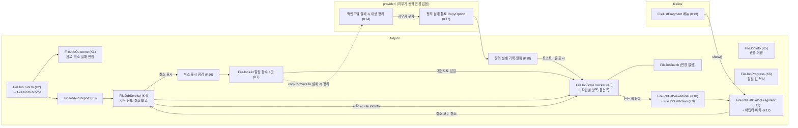

# HLD — 앱 안 파일 작업 목록과 취소 (이슈 #36)

| 항목 | 내용 |
|---|---|
| 상태 | 검수 통과(v1.3, PR #37 4회차 a5a1183) |
| 근거 | SRS v2.2 (요구사항 v4) |
| 기준 코드 | `origin/develop` a1a8a3e(#30 PR #35 머지 커밋) — 줄 번호는 이 커밋 기준 |
| 브랜치 | `design/36-job-list` — #35가 이미 develop에 머지되어 있어 develop에서 분기했다(PM 지시의 `feature/30-job-runner` 분기·대상은 머지 전 전제였음). 설계 PR #37은 develop 대상. |

## 1. 구조 개요

### 1.1 지금 구조 (#30 이후)
- **실행**: 화면이 `FileJobService` companion 시작 함수(`FileJobService.kt:134-215`)를 부르면 companion `startJob`(`:123-132`, 메인)이 `FileJobStateTracker.onJobStarted(id)`를 부르고 서비스로 넘기거나 `pendingJobs`(`:116`)에 쌓는다. 서비스 `startJob`(`:55-74`)은 캐시 스레드 풀(`:32`)에 `runJobAndReport({ job.runOn(this) }) { isSuccessful -> … onJobFinished(id, isSuccessful) }`(`:61-69`, `:231-238`)를 넘긴다.
- **취소**: 알림 버튼 → `FileJobReceiver` → companion `cancelJob`(`:218-223`, 메인) → 대기 목록에서 지우거나 서비스 `cancelJob`(`:76-88`)이 `Future.cancel(true)`(`:80`)로 끼어들고 곧바로 `onJobFinished(id, false)`(`:86`). 스레드가 나중에 보내는 끝 보고는 무시된다(`FileJobBatch.kt:37-40`). 서비스가 끝날 때도 같다(`:90-105`).
- **끝 판정**: `FileJob.runOn`(`FileJob.kt:24-41`)이 정상 끝이면 `!hasUnresolvedError`, `InterruptedIOException`(`:30-33`)·`Exception`(`:34-37`, 토스트)이면 `false`. 취소와 실패를 가르지 않는다.
- **상태 통로**: `FileJobStateTracker`(`FileJobStateTracker.kt:18-47`, 메인 전용 `object`)가 `FileJobBatch`로 진행 중 개수와 묶음 결과만 집계해 `stateLiveData`로 낸다. 작업별 정보(종류·이름·진행률)는 어디에도 없다.
- **진행률**: 작업 본문의 알림 함수 네 곳이 값을 만든다 — 훑기 `postScanNotification`(`FileJobs.kt:302-310`, `ScanInfo` `:312-338`), 크기 `postTransferSizeNotification`(`:340-388`), 개수 `postTransferCountNotification`(`:390-424`), 쓰기 `postWriteNotification`(`:2325-2341`). 모두 `shouldPostNotification()`(`:328-337`, `:472-480`, 0.5초 `:154`)으로 거른 뒤 `postNotification`(`:120-150`)을 부른다. 값(`TransferInfo` `:426-481`)은 파일 안 `private`이다.
- **파일 목록 메뉴**: `FileListFragment`가 툴바 메뉴(`res/menu/file_list.xml`)를 `MenuBinding`(`FileListFragment.kt:1717-`)으로 묶고(`:420`), 고르기 모드에서 항목을 숨기며(`updateSelectAllMenuItem` `:975-981`, `onPickOptionsChanged` `:954-973`), 선택을 `onToolbarMenuItemSelected`(`:480-`)에서 처리한다.
- **목록형 대화상자**: `PermissionListDialogFragment`(`fileproperties/apk/PermissionListDialogFragment.kt:32-93`)가 `AppCompatDialogFragment` + `MaterialAlertDialogBuilder` + `RecyclerView` + 프래그먼트 범위 `viewModels`(`util/FragmentViewModelLazy.kt:15`) 꼴이다. 닫히지 않는 대화상자 버튼은 `setOnShowListener`에서 `getButton(...).setOnClickListener`로 바꾼다(`colorpicker/ColorPreferenceDialogFragment.kt:83-84`).

### 1.2 새 구조

- 작업 쪽은 **알리기만** 더한다: 시작 때 정보(K4·K5), 알림을 만들 때 같은 값(K6·K7), 끝 때 끝난 방식(K1~K4).
- 상태의 주인은 #30과 같이 `filejob/`의 `FileJobStateTracker`다(K8). 목록 화면도 작업을 다루는 화면이라 `filejob/`에 둔다 — 기존 오류·충돌 창(`FileJobErrorDialogFragment`·`FileJobConflictDialogFragment`)과 같은 자리다. 파일 목록(`filelist/`)은 메뉴에서 그 화면을 여는 일만 한다(지금도 `FileListFragment`가 `filejob/`의 `FileJobService`를 부른다, `:78`).
- **새 경계 없음**. 백엔드(`provider/`)의 지우기 동작은 바꾸지 않고, 실패를 밖으로 알리는 복사 옵션 하나만 더한다(K14·K17, 5장 D5·D10).

## 2. 구성요소

| 구성요소 | 위치(패키지·파일) | 책임 | 추적 REQ |
|---|---|---|---|
| K1 끝난 방식 | `filejob/FileJobOutcome.kt` (새 파일, 안드로이드 의존 없음) | `enum class FileJobOutcome { SUCCEEDED, CANCELED, FAILED }`와 순수 판정 함수 하나: 입력(본문이 정상 끝났는가 / 던진 것, 건너뛴 오류 여부) → 결과. 규칙: 정상 끝 + 건너뛴 오류 없음 → `SUCCEEDED`, 정상 끝 + 건너뛴 오류 → `FAILED`, `InterruptedIOException`이면서 `java.net.SocketTimeoutException`이 아님 → `CANCELED`, 그 밖 → `FAILED`. | REQ-36-08 |
| K2 결과 반환 | `filejob/FileJob.kt` `runOn` (기존, `:24-41`) | 반환형 `Boolean` → `FileJobOutcome`. 각 `catch`의 부수 효과(스택 출력, `Exception`의 토스트, `finally`의 알림 지우기)는 그대로 두고 반환값만 K1로 정한다. `SocketTimeoutException`은 지금처럼 `InterruptedIOException` 가지에서 잡혀 토스트 없이 끝나며(부수 효과 불변) 반환만 `FAILED`다. | REQ-36-08, 13 |
| K3 보고 감싸기 | `filejob/FileJobService.kt` `runJobAndReport` (기존, `:231-238`) | 형을 `(run: () -> FileJobOutcome, onFinished: (FileJobOutcome) -> Unit)`로. 기본값 `FAILED` — 본문이 `Throwable`로 끝나도 실패로 한 번 보고하고 그대로 다시 던진다(#30 규칙 유지). | REQ-36-08 |
| K4 서비스 연결 | `filejob/FileJobService.kt` (기존) | ① companion 시작 함수(`:134-215`)마다 K5의 `FileJobInfo`를 만들어 companion `startJob`(`:123-132`)에 넘기고, `startJob`이 `onJobStarted(job.id, info)`를 부른다. ② `:61-69`의 보고를 `onJobFinished(job.id, outcome)`로. ③ 취소 보고 세 곳(`:86`, `:104`, `:220`)을 `CANCELED`로. 그 밖(`runningJobs`·잠금·`Future.cancel(true)`)은 바꾸지 않는다. "모두 취소"용 새 서비스 함수는 두지 않는다 — 화면이 줄마다 companion `cancelJob`을 부른다(K10). | REQ-36-03, 05, 06, 08 |
| K5 작업 정보 | `filejob/FileJobInfo.kt` (새 파일) | `FileJobInfo(type: FileJobType, subjectName: String, subjectCount: Int, destinationName: String?)`와 `enum class FileJobType`(SRS REQ-36-03의 16개). 경로 목록에서 정보를 만드는 순수 함수: 이름 = 경로의 마지막 이름, 루트면 구분자(`FileJobs.kt:168-173` `getFileName`과 같은 규칙), 압축 파일의 루트 경로면 압축 파일 이름(`:175-186` `getTargetFileName`과 같은 규칙). `copy`의 종류는 `sources.all { it.isArchivePath }`면 압축 풀기(`:744`와 같은 식). 경로 객체만 보고 입출력은 하지 않는다(메인 스레드). 글로 바꾸기(문자열 자원)는 K12가 한다. | REQ-36-03 |
| K6 진행 값 | `filejob/FileJobProgress.kt` (새 파일, 안드로이드 의존 없음) | 알림이 쓰는 값을 그대로 담는 불변 값: `kind`(`SCANNING`·`SIZE`·`COUNT`), `fileCount`, `transferredFileCount`, `size`, `transferredSize`. 표시 규칙(SRS REQ-36-04)을 순수 함수로: 백분율 = `SIZE`면 `transferredSize·100/size`, `COUNT`면 `transferredFileCount·100/fileCount`(`Long`으로 계산, 0~100으로 자름, 분모 0이면 불확정), `COUNT`이면서 `fileCount == 1`이면 불확정(알림 `:405-410`과 같음), `SCANNING`은 불확정 + 찾은 수·크기. 크기 글은 알림과 같은 `FileSize.formatHumanReadable`(`file/FileSize.kt:23`)로 K12에서 만든다. | REQ-36-04 |
| K7 진행 값 알리기 | `filejob/FileJobs.kt` 알림 함수 네 곳 (기존 `:302-310`, `:340-388`, `:390-424`, `:2325-2341`) | 각 함수에서 `shouldPostNotification()` 거르기를 통과한 뒤, `postNotification` 호출 **앞에** 한 줄로 K6 값을 만들어 메인으로 넘긴다(`service.mainExecutorCompat.execute { FileJobStateTracker.onJobProgress(id, progress) }` — 같은 파일의 `showToast`가 쓰는 방식 `:156-160`). 알림 값 계산·호출·인자는 그대로다. 알림이 실제로 보이는지와 무관하게 이 함수들은 불린다(알림 권한·채널 상태를 보지 않음). | REQ-36-04, 12, 13 |
| K8 상태 통로 확장 | `filejob/FileJobStateTracker.kt` (기존) | 메인 전용 그대로. ① `onJobStarted(id, info)`: 기존 묶음 집계 + 진행 중 항목 표(`LinkedHashMap<Int, FileJobEntry>`, 시작 순서 유지)에 추가. 같은 id가 이미 있으면 무시(`FileJobBatch.start`의 충돌 규칙 `FileJobBatch.kt:23-27`과 같음). ② `onJobProgress(id, progress)`: 표에 있는 id만 값 갱신, 없으면 무시(끝난 뒤 늦게 온 값). ③ `onJobFinished(id, outcome)`: `batch.finish(id, outcome == SUCCEEDED, …)`(#30 집계·`stateLiveData` 불변, REQ-36-09), 표에서 지움. 표에 없던 id는 무시(먼저 온 보고가 이김). ④ 듣는 쪽: `addListener`/`removeListener`, 콜백 `onStarted(entry)`·`onProgress(id, progress)`·`onFinished(id, outcome)`·`onCleanupFailed(id)`(K18의 `onJobCleanupFailed`가 부름, 표에 없는 id도 넘김), 그리고 `runningEntries: List<FileJobEntry>`(연 순간 목록용). `FileJobEntry(id, info, progress: FileJobProgress?, isPending)`. ⑤ `onJobRunning(id)`: 대기 중 표시를 끈다. `onJobStarted`의 대기 중 여부는 K4가 넘긴다(서비스가 없으면 `true`), 서비스 `onCreate`가 대기 목록에서 꺼낼 때(`FileJobService.kt:43-45`, 메인) ⑤를 부른다. | REQ-36-02, 04, 07, 08, 09, 12, 16 |
| K9 줄 목록 규칙 | `filejob/FileJobListRows.kt` (새 파일, 안드로이드 의존 없음) | 목록 화면 한 번 열림의 줄을 다루는 순수 상태: 시작(연 순간 `runningEntries`로), 줄 추가(시작 순서 끝에), 진행 갱신(진행 중 줄만), 끝(줄 유지 + `outcome` 기록, 진행 갱신 멈춤, 이미 끝난 줄은 무시), `activeIds`(진행 중·대기 중 줄의 id, "모두 취소" 대상·활성 여부), 정리 실패 표시(끝난 줄에도 늦게 올 수 있음, 없는 id는 무시). | REQ-36-02, 06, 07, 15, 16 |
| K10 목록 뷰모델 | `filejob/FileJobListViewModel.kt` (새 파일) | 만들어질 때 K8의 `runningEntries`로 K9를 시작하고 K8에 듣는 쪽을 등록, `onCleared`에서 해제. 줄 목록을 `LiveData<List<FileJobRow>>`로 낸다(메인에서 `setValue`). `cancel(id)` → `FileJobService.cancelJob(id)`. `cancelAll()` → 그 순간 `activeIds` 각각에 `cancelJob`. 취소는 K4가 같은 호출 안에서 `CANCELED`를 메인으로 보고하므로(`FileJobService.kt:86`·`:220`) 줄이 곧바로 "취소됨"이 된다. 프래그먼트 범위 `viewModels`라 회전에도 살아남는다. | REQ-36-02, 05, 06, 07, 14 |
| K11 목록 화면 | `filejob/FileJobListDialogFragment.kt` (새 파일) | `AppCompatDialogFragment` + `MaterialAlertDialogBuilder` + `RecyclerView`(`PermissionListDialogFragment.kt:41-63`과 같은 꼴). 제목 "파일 작업". 버튼: 긍정 = "닫기"(`R.string.close`, `res/values/strings.xml:12`), 중립 = "모두 취소" — `setOnShowListener`에서 클릭을 바꿔 창을 닫지 않게(`ColorPreferenceDialogFragment.kt:83-84`), `activeIds`가 비면 비활성. 빈 목록 글(`permission_list_dialog.xml`의 `emptyView`와 같은 꼴). 뒤로 가기·창 밖 누르기로 닫힌다(대화상자 기본). `companion fun show(fragment: Fragment)`. | REQ-36-01, 02, 06, 14, 15 |
| K12 줄 어댑터·배치 | `filejob/FileJobListAdapter.kt`, `res/layout/file_job_list_dialog.xml`, `res/layout/file_job_list_item.xml`, `res/values/strings.xml`·`res/values-ko/strings.xml` (새·기존) | 줄: 1행 = 종류 · 대상 이름(K5 → 문자열 자원, "a.txt 외 2개", "→ 목적지"), 2행 = 진행 글(K6) 또는 끝난 방식 글, 진행 막대 `LinearProgressIndicator`(Material, 이미 씀 `res/layout/add_lan_smb_server_fragment.xml:33`; 불확정/확정 전환), 끝 쪽 취소 `ImageButton`(닫기 아이콘, 48dp, 설명 "<대상 이름> 취소", 끝난 줄은 비활성). 끝난 방식 글은 진행 글과 다른 `TextView`에 두고 그 뷰에만 `accessibilityLiveRegion="polite"`를 준다 — 진행 갱신은 낭독하지 않고 끝날 때 한 번만 낭독(SRS 3.3). 배치는 start/end. 끝난 줄에 정리 실패 표시가 있으면 끝난 방식 글에 "일부 파일을 지우지 못함"을 덧붙인다(K18). 문자열은 기본(영어)과 한국어를 함께 넣는다. | REQ-36-03, 04, 05, 07, 16 |
| K13 메뉴 항목 | `res/menu/file_list.xml` (기존, `action_refresh` `:89-94` 근처), `filelist/FileListFragment.kt` (기존) | 더 보기 메뉴에 `action_file_jobs`("파일 작업", `showAsAction="never"`). `MenuBinding`(`:1717-`)에 항목을 더하고, `onToolbarMenuItemSelected`(`:480-`)에서 `FileJobListDialogFragment.show(this)`. 고르기 모드에서 숨김: `updateSelectAllMenuItem`(`:975-981`)과 같은 자리·같은 방식으로 `isVisible = viewModel.pickOptions == null`, 메뉴를 만들 때(`:425`)와 고르기 상태가 바뀔 때(`:969`) 부른다. 두 창의 `FileListFragment` 각각에 같은 항목이 생긴다. | REQ-36-01 |
| K14 대상 파일 정리 | `provider/` 각 백엔드 (기존, **지우기 동작 변경 없음**) | 취소된 작업의 깨진 대상 파일은 백엔드 복사 함수의 실패 정리가 지운다(3.3 표). 이 설계는 그 정리가 모든 취소 경로에서 작업 스레드 위에서 끝까지 돈다는 것을 근거로 하고(3.3), 작업 쪽에 별도 지우기를 더하지 않는다(5장 D5). 지우기 호출·조건·순서는 그대로다. 검증은 3.6의 수동 시험과 코드 검수. | REQ-36-10, 11 |
| K15 추적표 | `docs/STANDARDS_TRACEABILITY.md` 4장 (기존) | #36 행 추가(SRS 5장 조항, REQ-36-01~16, 새 권한·편차 없음). 구현 PR에서 개발팀이 고친다(#30과 같은 방식, 추적표 v0.8 이력). | REQ-36-12, 13(규격 근거 추적) |
| K16 취소 표시 점검 | `filejob/FileJob.kt`(기존), `filejob/FileJobService.kt`(기존 `:76-88`, `:90-105`), `filejob/FileJobs.kt`(기존 `throwIfInterrupted` `:230-234`, `showUserAction` `:485`, `showErrorDialog` `:500`, `showConflictDialog` `:555`) | `FileJob`에 `@Volatile internal var isCanceled`. 서비스가 `Future.cancel(true)` **앞에** 켠다(`:80`, `:99`). `throwIfInterrupted`는 `Thread.interrupted() \|\| isCanceled`이면 던지고, 창을 띄우는 세 함수는 맨 앞에서 `isCanceled`면 `InterruptedIOException`을 던진다. 이미 취소된 작업에서만 달라진다(C-1). 끼어들기 방식 자체는 그대로다. | REQ-36-05, 13 |
| K17 정리 실패 통로 | `provider/common/CleanupFailureCopyOption.kt` (새 파일), `provider/common/CopyOptions.kt`(기존), 각 백엔드의 정리 `catch`(기존, 3.3.1 표) | `ProgressCopyOption`(`provider/common/ProgressCopyOption.kt:19-37`)과 같은 꼴의 `CopyOption` + `Parcelable`: 듣는 함수 `() -> Unit`을 `RemoteCallback`으로 감싸 프로세스를 넘긴다. 인자가 없다 — 어느 파일인지는 부른 쪽(K18)이 안다. `ParcelableCopyOptions`는 `Parcelable` 옵션을 그대로 넘기므로(`provider/remote/ParcelableCopyOptions.kt:33-37`) 원격 쪽 변경이 없다. `CopyOptions`에 필드를 더하고(`toArray`·`toCopyOptions` `:20-38`·`:41-71`), 옵션을 다시 만드는 여섯 곳(`ForeignCopyMove.kt:138`, `LinuxCopyMove.kt:285`, `SftpCopyMove.kt:276`, `SmbCopyMove.kt:220`, `WebDavCopyMove.kt:166`, `FtpCopyMove.kt:161`)이 그 필드를 넘긴다. 각 백엔드는 정리 `catch`에서 기존 기록에 더해 이 함수를 한 번 부른다. 대상이 이미 없다는 오류는 실패로 치지 않는다(각 백엔드의 기존 변환 함수로 가림, 예: `SftpCopyMove.kt:81-84`. FTP 제외, 3.3.1). | REQ-36-16 |
| K18 정리 실패 기록·알림 | `filejob/FileJob.kt`, `filejob/FileJobs.kt`(기존 `copyOrMove` 옵션 `:1287-1299`, 압축 정리 `:647-653`), `filejob/FileJobStateTracker.kt`, K9·K12 | `FileJob`에 `synchronized` 경로 기록을 둔다. 규칙: ① 실패 보고가 오면 `isCanceled`(K16)면 바로 알리고, 아니면 기록한다. ② `copyOrMove`가 같은 대상 파일을 끝까지 쓰면 기록에서 지운다(오류 뒤 다시 시도). ③ `runOn`이 끝날 때 `CANCELED`이거나 `isCanceled`이면 기록을 알린다(오류 창의 "취소"는 `isCanceled`가 꺼져 있고, 서비스 취소와 본문의 정상 마무리가 겹치면 `CANCELED`가 아닐 수 있다). 그 밖에는 버린다(REQ-36-13). 알린 경로는 기록에서 지우고 다시 알리지 않는다(①과 ③이 겹쳐도 한 번). 알리기 = 메인으로 넘겨 토스트(`showToast` `FileJobs.kt:162-166`, 길게, 이름·폴더 이름은 입출력 없음 `:168-173`) + `FileJobStateTracker.onJobCleanupFailed(id)` → 듣는 쪽 → K9가 그 줄에 표시, K12가 끝난 방식 글에 덧붙임. 진행 중 항목 표에 없는 id도 듣는 쪽에 넘긴다(끝난 줄에 늦게 오는 보고, 3.3.1). 압축은 작업 안의 정리라 `:649`·`:651`의 `catch`에서 같은 기록을 부른다. | REQ-36-16 |

## 3. 데이터 흐름·상태

### 3.1 시작·진행·끝 (메인 / 작업 스레드)
1. 화면이 시작 함수를 부른다(메인). K4가 `FileJobInfo`를 만들고 `onJobStarted(id, info)` → K8이 항목 추가, 듣는 쪽에 `onStarted`.
2. 작업 스레드가 알림 함수를 지날 때(0.5초에 한 번 이하) K7이 `FileJobProgress`를 만들어 메인으로 넘긴다 → K8이 항목 갱신, `onProgress`.
3. 작업 스레드가 끝나면 `runJobAndReport`가 결과(K1~K3)를 메인으로 넘긴다(`FileJobService.kt:66`) → K8 `onJobFinished(id, outcome)` → `onFinished`.
- **순서**: 2와 3은 같은 작업 스레드에서 같은 메인 실행기(`mainExecutorCompat`)로 넘기므로 메인에서 보낸 순서대로 돈다. 그래서 같은 작업의 진행 값이 끝 뒤에 오는 일은 없다. 취소(3.2)는 메인에서 바로 끝을 보고하므로 그 뒤 도착하는 진행 값·스레드의 끝 보고는 "표에 없는 id"로 무시된다(K8 ②③).
- 메인에서는 입출력이 없다: K5는 경로 이름만, K8~K12는 메모리 값만 다룬다.

### 3.2 취소 흐름
- 줄의 취소 → K10 `cancel(id)` → companion `cancelJob`(`:218-223`) → 대기 목록에서 지우고 `CANCELED` 보고, 또는 서비스 `cancelJob`(`:76-88`)이 `Future.cancel(true)` 뒤 `CANCELED` 보고 → K8 → K9 줄이 "취소됨"·버튼 비활성. 확인 창 없음.
- "모두 취소" → K10이 그 순간의 `activeIds`를 복사해 각각 위와 같이. 도중에 끝난 작업은 `cancelJob`이 아무것도 찾지 못해 보고하지 않는다(`:85`) — 그 줄은 자기 끝 보고대로 남는다.
- **멈춤 보장(K16)**: 끼어들기 표시는 한 번 소비되면 사라진다. 원격 백엔드에서는 라이브러리 안에서 소비되어 평범한 입출력 오류로 나올 수 있다(6장 R8). 그래서 서비스가 먼저 켠 `isCanceled`를 본문의 점검 지점과 창 띄우기 앞에서 함께 본다.
- 끼어든 작업 스레드는 계속 돌아 본문의 `InterruptedIOException`을 위로 올리며 백엔드의 `finally` 정리(3.3)를 지나고, `runOn`이 끝난다. 이 스레드의 끝 보고는 무시된다.
- 알림의 취소, 오류·충돌 창의 "취소"도 같은 결과다: 알림은 같은 `cancelJob`, 창의 "취소"는 본문이 `InterruptedIOException`을 던져 K1이 `CANCELED`로 판정(`FileJobs.kt:727-728`·`:1238`·`:1375`·`:1439`·`:2318`).

### 3.3 깨진 대상 파일이 지워지는 경로 (SRS 1.5 확정)
`Future.cancel(true)`는 스레드를 멈추지 않고 끼어들기 표시만 켠다. 본문과 백엔드는 복사 고리마다 표시를 보고 `InterruptedIOException`을 던진다(`provider/common/InputStreamExtensions.kt:30`, `provider/linux/LinuxCopyMove.kt:99`). 던지는 곳은 모두 대상 파일을 연 뒤의 `try` 안이고, 그 `finally`가 같은 스레드에서 대상 파일을 지운다.

| 작업·백엔드 | 쓰던 파일을 지우는 곳 | 비고 |
|---|---|---|
| 복사·압축 풀기·이동(같은 공급자, 로컬) | `LinuxCopyMove.kt:83-123`(`successful`이 아니면 `Syscall.remove(target)` `:116-122`) | 같은 저장소 이동은 `rename` 한 번(`:266`)이라 조각 없음. 저장소가 다른 로컬 이동은 `:290`에서 위 복사를 거친 뒤에야 원본을 지운다(`:292`) — 복사가 끼어들면 원본은 그대로(REQ-36-11). |
| 공급자가 다른 복사·이동(압축 풀기 포함) | `ForeignCopyMove.kt:55-76` | 분기 `PathExtensions.kt:48-55`·`:115-122`. 이동은 복사가 끝난 뒤에만 원본을 지운다(`ForeignCopyMove.kt:143-145`). |
| SFTP | `SftpCopyMove.kt:101-118` | |
| SMB | `smb/client/Client.kt:373-408`(`deleteOnClose`) | 같은 세션의 서버 복사(`:389` `serverCopy`)가 끼어들기에 반응하는지는 미확인(6장 R2). 반응하지 않으면 끝까지 복사된 온전한 파일이 남는다(깨진 파일 아님). |
| FTP·WebDAV | `FtpCopyMove.kt:70-87`, `WebDavCopyMove.kt:75-92` | |
| 문서 공급자(SAF) | `DocumentResolver.kt:154-169`(직접 복사) | 공급자 복사(`:106-107`)는 끼어들 수 없어 끝까지 간다(SRS A7). |
| 루트 모드 | 원격 프로세스에서 위 로컬 경로가 돈다 | 앱 쪽 끼어들기 → `RemoteFileSystemProvider.kt:145-146`이 원격 콜백으로 알림 → 원격 `RemoteFileSystemProviderInterface.kt:91-98`의 `future.cancel(true)`가 원격 스레드에 끼어들어 `LinuxCopyMove`의 정리가 원격에서 돈다. 앱 쪽은 원격 정리를 기다리지 않고 바로 끝난다(정리는 뒤따라 끝남). |
| 압축 | `FileJobs.kt:645-655`(압축 파일 전체 삭제) | 압축 파일은 `CREATE_NEW`로 열어(`:629-631`) 기존 파일을 덮지 않는다. |
| 저장 | 복사와 같음(`FileJobs.kt:1731` → `copyOrMove`) | 늘 바꾸기(`:1730`) — 기존 파일 선삭제(SRS L1, #42). |
| 쓰기 | 지우지 않음 | `:2283`. 잘린 파일이 남는다(요구사항 v4 6, SRS L5). |

- 덮어쓰기("바꾸기")에서 기존 파일은 백엔드가 쓰기 **전에** 지운다. 따라서 쓰기가 시작된 뒤 취소되면 그 자리에 남는 것은 이번 작업이 쓴 조각이고, 위 정리가 그것을 지운다. 기존 파일은 남지 않는다 — 알려진 한계이고 #42에서 다룬다(SRS L1). 이 설계는 다루지 않는다.
- 폴더(`LinuxCopyMove.kt:142-147`, `ForeignCopyMove.kt:79-85`)와 끝까지 쓴 파일은 남는다(요구사항 v4 6).

### 3.3.1 정리 실패를 알 수 있는 곳 (REQ-36-16)
지금은 모두 실패를 기록만 하고 삼킨다. K17은 이 `catch`에 듣는 함수 호출 한 줄만 더한다.

| 백엔드 | 실패가 삼켜지는 곳 | 알릴 수 있나 | 비고 |
|---|---|---|---|
| 로컬 | `LinuxCopyMove.kt:117-121` | 예 | 이미 없음: `errno == ENOENT` |
| 공급자 간(압축 풀기, 저장소 간 이동) | `ForeignCopyMove.kt:66-74` | 예 | `deleteIfExists`라 이미 없으면 실패 아님. `UnsupportedOperationException`도 실패로 알림 |
| SFTP | `SftpCopyMove.kt:115-119` | 예 | 이미 없음: `toFileSystemException`이 `NoSuchFileException`(`:81-84`와 같은 꼴) |
| SMB | `smb/client/Client.kt:403-407` | 일부 | 이미 없음은 해당 없음(파일을 연 채 표시). `deleteOnClose`(`:404`)의 실패만 안다. 닫기(`targetFile.use`)에서의 실패는 알 수 없다(SRS L4). `Client.copyFile`에 인자 하나 추가, 호출 `SmbCopyMove.kt:85-88` |
| FTP·WebDAV | `FtpCopyMove.kt:84-88`, `WebDavCopyMove.kt:89-93` | 예 | 이미 없음: WebDAV는 `NoSuchFileException`(`webdav/DavExceptionExtensions.kt:23`). FTP는 구별하지 않는다: 응답 550이 `NoSuchFileException`으로 바뀌지만(`provider/ftp/client/NegativeReplyCodeException.kt:19`) 550은 파일 없음과 접근 거부를 함께 뜻해(RFC 959 4.2.2, 설계 판단 근거이며 추적표 조항은 아님) 진짜 실패를 삼킬 수 있다. 그래서 FTP는 모든 실패를 알린다 — 이미 없는 파일을 지우지 못했다고 잘못 알릴 수는 있어도 남은 조각을 놓치지 않는 쪽을 고른다 |
| SAF 직접 복사 | `DocumentResolver.kt:163-168`(`addSuppressed`) | 예 | 이미 없음: `toFileSystemException`이 `NoSuchFileException`(`:358`과 같은 꼴). `copy`·`copyApi24`·`copyManually`·`move`·`moveByCopy`와 `DocumentCopyMove.kt:44`·`:76`에 인자 추가 |
| 압축 | `FileJobs.kt:647-653` | 예 | 작업 안의 정리, K18이 직접 기록 |
| 루트 모드 | 원격 프로세스의 위 로컬 경로 | 조건부 | 원격이 살아 있으면 `RemoteCallback`으로 온다. 앱은 원격 끝을 기다리지 않으므로(`RemoteFileSystemProvider.kt:145-147`) **작업이 끝난 뒤 늦게** 올 수 있다 — `isCanceled`가 이미 켜져 있어 규칙 ①로 바로 알린다. 원격이 죽으면 오지 않는다(SRS L2) |
| 서비스·프로세스 종료 | — | 아니오 | 정리 자체가 돌지 못할 수 있다(SRS L3) |

- 원격 연결이 끊긴 채 멈춰 있으면 정리 호출이 라이브러리 시간 제한까지 걸려 알림이 늦을 수 있다. 줄은 그 전에 이미 "취소됨"이다(3.2). 시간 제한 값은 미확인.
- 다시 시도: 정리가 실패한 조각이 남은 채 "다시 시도"를 고르는 흐름은 기존 동작이다(충돌 창이 뜰 수 있음). 끝까지 쓰면 K18 ②로 기록에서 지운다.

### 3.4 수명주기
- K8은 프로세스 전역 `object`이고 진행 중 항목만 가진다. 끝난 항목은 즉시 지운다(이력 없음).
- K10은 목록 화면 하나의 범위다. 회전·다중 창 크기 바꾸기에서는 프래그먼트가 다시 만들어지고 뷰모델은 그대로라 끝난 줄이 남는다(REQ-36-14). 닫으면 `onCleared` → 듣는 쪽 해제 → 끝난 줄 버림.
- 프로세스가 끝난 뒤 시스템이 대화상자를 되살리면 뷰모델이 새로 만들어져 그 순간의 진행 중 작업(보통 없음)만 보인다(SRS v1.2 REQ-36-14).
- 듣는 쪽 콜백은 메인에서만 불리므로 화면이 멈춘 동안(다른 앱에 있는 동안)에도 K9 상태는 갱신되고, 돌아오면 최신 줄을 그린다. `LiveData`는 멈춘 동안 마지막 값만 넘기면 되므로(줄 목록 전체가 값) 합쳐져도 잃는 것이 없다.

### 3.5 오류 전파
- 진행 값 넘기기(K7)는 실패하지 않는 메모리 일이다. 작업 본문의 예외 흐름은 그대로다(C-1).
- 깨진 파일 정리의 실패는 작업의 예외 흐름에 넣지 않는다. 옆길(K17)로 K18에 보고만 하고, 작업은 원래 예외로 끝난다. 끝난 방식은 그대로 "취소됨"이다.

### 3.6 수동 시험 항목 (구현 PR)
| 항목 | 절차 | 확인 | 추적 |
|---|---|---|---|
| T1 깨진 파일 | 로컬·루트·SFTP·SMB(같은 공유 안·다른 공유 간) 각각 큰 파일 복사·이동·압축 풀기·압축 중 취소 | 쓰던 파일 없음, 끝난 파일·폴더 남음, 이동 원본 온전 | REQ-36-10, 11 |
| T2 SFTP·SMB 여러 파일 취소 | 작은 파일 수백 개를 SFTP·SMB로 복사(원격 → 같은 공급자 원격 포함) 중 줄 취소, 모두 취소, 알림 취소 각각. sshj·smbj의 끼어들기 소비 여부를 여기서 확인한다 | 목적지 파일 수가 더 늘지 않음, 오류·충돌 창 없음, 줄 "취소됨" | REQ-36-05 |
| T3 정리 실패 알림 | SFTP 큰 파일 복사 중 대상 폴더의 쓰기 권한만 서버에서 제거(열린 파일 쓰기는 계속됨, 지우기만 실패) 후 취소. 다른 원격 백엔드는 가능한 범위에서 같게. 로컬은 쓰기를 막지 않고 지우기만 막는 절차가 없어 단위 테스트(듣는 함수 호출)로 대신한다 | 토스트에 파일 이름, 줄에 "일부 파일을 지우지 못함" | REQ-36-16 |
| T4 TalkBack 낭독(K12) | TalkBack 켬, 목록을 연 채 큰 복사 | 진행 중 반복 낭독 없음, 끝날 때 끝난 방식 한 번 낭독, 취소 버튼에 "<대상 이름> 취소". `accessibilityLiveRegion`이 한 번만 읽히는지는 코드로 확인할 수 없어 이 시험이 근거다 | REQ-36-07, SRS 3.3 |
| T5 알림 꺼짐 | 앱 알림 끈 상태에서 T1·T3 일부 | 목록 진행률·취소 동작, 토스트 표시 여부 기록(미확인 항목 R9) | REQ-36-12, 16 |
| T6 취소 안 한 작업 불변 | 쓰기 금지 폴더로 복사 후 오류 창 선택지 각각 | 이 기능 이전과 같음 | REQ-36-13 |

## 4. 외부 인터페이스
- 매니페스트: 새 구성요소 없음(대화상자 프래그먼트). 새 권한 없음.
- 메뉴: `res/menu/file_list.xml`에 `@+id/action_file_jobs`.
- 복사 옵션(새, 앱 프로세스↔루트 프로세스): `CleanupFailureCopyOption`(K17). 같은 APK라 판 차이가 없다.
- 문자열(새): 지우지 못함 토스트, "일부 파일을 지우지 못함", 메뉴·제목 "파일 작업", "모두 취소", 줄 취소 설명 "%1$s 취소", 종류 16개, "%1$s 외 %2$d개"(복수형), 목적지 표기, 진행 글(크기 "%1$s / %2$s", 개수 "%1$d / %2$d", 항목 위치), "준비 중"·"진행 중"·"대기 중", 끝난 방식 "완료"·"취소됨"·"실패", 빈 목록 글. 기존 "닫기"(`R.string.close`) 재사용. 영어 기본 + 한국어.
- 내부 API 변화(같은 모듈): `FileJob.runOn(): FileJobOutcome`, `runJobAndReport`의 형, `FileJobStateTracker.onJobStarted(id, info)`·`onJobProgress`·`onJobFinished(id, outcome)`·듣는 쪽. 호출부는 `FileJobService`뿐이다(`grep` 결과: `FileJobService.kt:61·67·86·104·124·220`). 기존 단위 테스트(`app/src/test/.../filejob/FileJobBatchTest.kt`, `FileJobServiceTest.kt`)는 형 변경에 맞춰 고치되 #30의 기대값은 그대로다(REQ-36-09).
- 설정 키: 없음.

## 5. 설계 결정
| ID | 결정 | 대안 | 고른 이유 |
|---|---|---|---|
| D1 | 목록 화면 = `AppCompatDialogFragment` 대화상자 | 하단 시트(`BottomSheetDialogFragment`), 새 액티비티 | 같은 꼴의 목록 대화상자가 이미 있다(`PermissionListDialogFragment.kt:32-93`). 하단 시트는 이 앱에 쓰는 곳이 없어 새 꼴이 된다. 액티비티는 매니페스트 구성요소가 늘고(`Component_Export` 확인 대상), 파일 목록 밖에서 열릴 길이 생긴다(SRS 1.3). 대화상자는 띄운 `FileListFragment`에서만 열리고, 뒤로 가기로 닫히며(`Back_Button_Nav`), 회전에도 프래그먼트 관리자가 되살린다. 새 의존성 없음. |
| D2 | 끝난 방식 = 새 `enum` 3값, `runOn`이 직접 반환 | `Boolean` 유지 + 서비스가 "취소했음" 집합으로 구분 | 오류·충돌 창의 "취소"는 서비스를 거치지 않고 본문 안에서 끝난다(`FileJobs.kt:1375` 등) — 서비스 쪽 집합으로는 알 수 없다. 본문이 끝나는 곳(`runOn`)이 유일하게 모든 경로를 본다. #30의 묶음 집계는 `outcome == SUCCEEDED`로 바꿔 부르면 그대로다(REQ-36-09). |
| D3 | `SocketTimeoutException`은 실패 | 모든 `InterruptedIOException`을 취소 | 시간 초과는 `InterruptedIOException`의 하위 종류지만 사용자가 취소한 것이 아니다(SRS REQ-36-08). |
| D4 | 진행 값 = 알림 함수 네 곳에서 거르기 뒤 같은 값을 복사 | `postNotification` 한 곳에서 이미 만든 글·막대 값을 넘김 / `TransferInfo`를 밖으로 공개 | `postNotification`은 이미 글로 만든 값(제목·본문)과 `Int`로 줄인 막대 값(`:372-386`)만 받아 크기·개수를 다시 알 수 없다. `TransferInfo`를 공개하면 작업 스레드에서 바뀌는 가변 객체를 메인과 나누게 된다. 네 곳에서 불변 값을 만들면 알림과 같은 시점·같은 값이고(REQ-36-04), 알림 코드는 한 줄도 바뀌지 않는다(REQ-36-13). |
| D5 | 깨진 파일 지우기는 백엔드의 기존 정리에 맡긴다(작업 쪽 새 지우기 없음) | `copyOrMove`에서 `copyTo`/`moveTo`가 `InterruptedIOException`으로 끝나면 대상 파일을 한 번 더 `deleteIfExists` | 3.3대로 모든 백엔드가 같은 스레드에서 이미 지운다. 작업 쪽에서 한 번 더 지우면 위험하다: ① 루트 모드에서는 앱 쪽이 원격 작업 끝을 기다리지 않고 바로 `InterruptedIOException`을 던지므로(`RemoteFileSystemProvider.kt:145-147`) 원격 **이동**이 막 끝나 원본이 지워진 순간 앱이 목적지를 지우면 자료를 잃는다. ② 바꾸기 모드에서 백엔드가 기존 파일을 지우기 전에 끼어들면(예: 대상 확인 중) 그 자리 파일은 이번 작업의 조각이 아니라 기존 파일이다 — 밖에서는 구분할 수 없다. |
| D6 | 듣는 쪽(리스너) + 연 순간 목록 | `LiveData<List<FileJobEntry>>` 하나 | 끝난 방식은 "끝 사건"이고 목록 화면이 열린 동안에만 필요하다. 진행 중 목록만 담는 `LiveData`로는 사라진 항목의 끝난 방식을 알 수 없고, 끝난 항목을 통로에 남기면 이력 보관이 된다(범위 밖). 리스너는 메인에서 동기로 불려 사건이 합쳐지지 않는다. |
| D7 | "모두 취소" = 화면이 `cancelJob`을 줄마다 | 서비스에 `cancelAll` 추가 | SRS REQ-36-06은 "그 순간 목록의 줄"이 대상이다(창을 연 뒤 다른 화면에서 시작된 작업도 목록에 있으므로 사실상 같지만, 기준을 목록에 둔다). 서비스 API를 늘리지 않는다. |
| D8 | 화면 쪽 파일 위치 = `filejob/` | `filelist/` | 작업 쪽 화면(오류·충돌 창)이 이미 `filejob/`에 있고, 목록 화면이 다루는 것은 작업이다. `filelist/`는 여는 일만 한다. |
| D9 | 취소된 작업의 멈춤 = `FileJob.isCanceled`를 점검 지점에서 함께 봄(K16) | ① 그대로 둠 ② `copyOrMove`에서 `ClosedByInterruptException`만 `InterruptedIOException`으로 바꿈 ③ 백엔드마다 끼어들기 예외 변환 | 오너 승인(요구사항 v4 3). ①은 취소 뒤에도 작업이 이어지거나 오류 창이 떠 REQ-36-05를 못 지킨다(R8). ②는 쓰기 경로 하나만 막고 속성·연결 호출에서 소비된 경우를 놓친다. ③은 백엔드 전체를 고쳐야 한다. K16은 한 곳이고 취소된 작업에만 작용한다. |
| D10 | 정리 실패 알리기 = 복사 옵션의 듣는 함수(K17) | ① 작업 쪽에서 실패 뒤 대상 파일이 있는지 확인 ② 예외에 실어 보냄(`addSuppressed`·새 예외 형) ③ 스레드 지역 변수 | ①은 틀리게 알린다: 바꾸기에서 기존 파일이 아직 있으면 조각으로 보이고, 루트 모드는 원격 정리가 끝나기 전에 확인하게 되며(D5 ①과 같은 이유), 연결이 끊기면 확인 자체가 실패한다. ②는 정리가 `finally` 안이라 이미 날아가는 예외를 잡아야 하고, 루트 모드에서는 앱이 원격 결과를 읽지 않아 전달되지 않는다. ③은 프로세스를 넘지 못한다. 옵션은 진행 값과 같은 통로라 이미 프로세스를 넘고, 지우기 조건·순서를 건드리지 않아 D5의 안전 근거가 그대로다. 대가는 백엔드 파일 여러 개에 한 줄씩 변경이 생기는 것이다(R10). |

## 6. 위험과 미결 사항
| ID | 내용 | 대응 |
|---|---|---|
| R1 | 오류·충돌 창이 떠 있는 작업을 목록에서 취소하면 그 창(별도 액티비티)이 남을 수 있다. 지금 알림 취소와 같은 동작이다. | 범위 밖(엔진 동작). 구현 단계 수동 시험에서 관찰해 기록한다. 바꿀 필요가 보이면 이슈로. |
| R2 | 백엔드 정리의 실기 확인: SMB 서버 복사(`Client.kt:389`)의 끼어들기 반응, 루트 모드 원격 정리 완료 여부는 코드로 확정하지 못했다(미확인). | 3.6 T1로 확인한다. 깨진 파일이 남는 백엔드가 나오면 그 백엔드의 정리 결함으로 따로 설계 피드백. |
| R3 | 서비스가 끝나며 취소하는 경우(`FileJobService.kt:90-105`) 프로세스가 곧 끝나면 작업 스레드의 정리가 끝나기 전에 멈출 수 있다. | 지금도 같다. 사용자 취소 경로(목록·알림)에는 해당 없음. 기록만. |
| R4 | 지금 `copyOrMove`는 `InterruptedIOException`을 오류 창 없이 다시 던진다(`FileJobs.kt:1384-1385`). 백엔드가 `SocketTimeoutException`을 그대로 올리면(예: `SmbCopyMove.kt:90`이 원인을 그대로 던짐) 오류 창 없이 작업이 끝난다. 이 기능은 그것을 "실패"로 표시하지만 동작은 바꾸지 않는다. | 범위 밖 기존 동작. #39로 등록했다(재현 미확인). |
| R5 | `FileJob.id`는 무작위 `Int`(`FileJob.kt:14`)라 드물게 겹칠 수 있다. | #30 규칙(겹치면 하나로 셈)을 K8 항목 표에도 그대로 적용. 겹친 두 번째 작업은 목록에 줄이 없다. 기록만. |
| R6 | RTL에서 목적지 표기("→")의 방향. | 문자열 자원에 방향 기호를 넣고 RTL 강제로 확인(SRS 3.5). 구체 방식은 LLD. |
| R7 | (닫음) 오너 확인 전 질문 | 요구사항 v4로 모두 결정됐다(SRS 4.3). |
| R8 | 원격 백엔드에서 취소가 멈추지 않을 수 있다(코드 읽기로 찾음, 실행 미확인). ① 같은 공급자 복사의 스트림이 끼어들기 예외를 바꾸지 않는다: `SftpCopyMove.kt:86-100`·`smb/client/Client.kt:394-397`은 `Channels` 스트림을 그대로 쓰고, `ForeignCopyMove`가 쓰는 `Path.newOutputStream`만 바꿔 준다(`PathExtensions.kt:220-221`, `:272-275`). 그래서 `ClosedByInterruptException`(`sftp/client/FileByteChannel.kt:107-110`, `smb/client/FileByteChannel.kt:107`)이 일반 `IOException`으로 `FileJobs.kt:1386`에 닿아 취소 뒤 오류 창(다시 시도 포함)이 뜬다. ② 표시를 소비한 오류를 삼키는 곳이 있다(`ForeignCopyMove.kt:117-123`의 시간 설정). 그러면 `throwIfInterrupted`가 통과되어 다음 파일로 넘어간다. 이 스레드는 이미 `runningJobs`에서 빠져 다시 취소할 수 없다. 라이브러리(sshj·smbj)가 표시를 소비하는지는 소스를 읽지 못했고, 근거는 `InterruptedException`을 원인으로 찾는 위 분기다. | K16으로 막는다(오너 승인, 요구사항 v4 3). 알림 취소도 같은 경로라 함께 고쳐진다. 3.6 T2로 확인한다. |
| R9 | 토스트가 알림을 끈 기기나 앱이 뒤에 있을 때 항상 보이는지는 Android 판마다 다를 수 있어 미확인이다. 목록을 닫고 다른 앱에 있으면 토스트를 놓칠 수 있고, 다시 보여 줄 곳이 없다(이력 보관 없음). | 3.6 T5로 확인해 기록한다. 부족하면 PM에 올린다 — 알림·이력은 범위 밖이라 설계팀이 정하지 않는다. |
| R10 | K17은 `provider/` 약 12개 파일을 한 줄씩 고친다(PROCESS_ROLES 11-1의 5개 초과 → 범위를 미리 알림). 듣는 함수가 예외를 던지면 정리 `finally`의 흐름을 바꿀 수 있다. | 듣는 함수는 예외를 던지지 않게 한다(메인으로 넘기기와 `synchronized` 기록뿐, `RemoteCallback` 실패는 삼킨다). LLD·코드 검수 항목. |

## 7. 변경 이력
| 일자 | 버전 | 변경 | 사유 | 요청자 |
|---|---|---|---|---|
| 2026-11-04 | v1.0 | 첫 판 | SRS v1.2 | PM |
| 2026-11-04 | v1.1 | 요구사항 v4 반영: K16 승인 표기, K17·K18·D10·3.3.1(정리 실패 알림), 3.6 수동 시험(T2 SFTP·SMB 여러 파일, T4 TalkBack), L1·#42 연결, 2·5·6장 표 번호 정렬, 머리표 상태 | HLD 1회차 반려 → 오너 결정 v4 | PM·오너 |
| 2026-11-04 | v1.2 | K8·K9·K12 추적에 REQ-36-16, 3.3.1에 백엔드별 "이미 없음" 구별, K18 ③ 조건을 `CANCELED` 또는 `isCanceled`로 넓힘·한 번만 알림, T3 절차 | HLD 2회차 조건부 m1~m4 | 검수팀 |
| 2026-11-04 | v1.3 | K17에 FTP 예외, K18 한 번만 알리는 방법, FTP 근거를 RFC 959로 | HLD 3회차 조건부 N1·N2 | 검수팀 |
