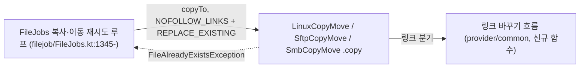

# HLD — 심볼릭 링크 '바꾸기' 복사가 성공 뒤에도 충돌로 되돌아가는 결함 (이슈 #47)

| 항목 | 내용 |
|---|---|
| 상태 | 검수 통과 |
| 근거 | SRS v1.2 |

## 1. 구조 개요
기존 경계를 그대로 쓴다. 충돌 처리는 `filejob/FileJobs.kt`, 실제 복사는 각 `provider/*/…CopyMove.kt`의 `copy`가 한다. 수정은 provider 쪽 링크 분기에서만 한다. `FileJobs.kt`는 바꾸지 않는다.

- `FileJobs.kt:1354`가 항상 `LinkOption.NOFOLLOW_LINKS`를 넘기므로 세 백엔드 모두 원본 링크를 링크로 읽고(`LinuxCopyMove.kt:33`, `SftpCopyMove.kt:32`, `SmbCopyMove.kt:32`) 링크 분기에 들어간다.
- 이동(`move`)은 영향이 없다. 세 백엔드 모두 '바꾸기'면 이름을 바꾸기 전에 대상을 먼저 지우고(`LinuxCopyMove.kt:261-265`, `SftpCopyMove.kt:260-264`, `SmbCopyMove.kt:194-198`), 그 뒤의 `copy` 대체 경로에는 대상이 없다.
- 결함은 업스트림 기준선부터 있었다(`git blame`: 세 분기 모두 `^4cd7710`). 최근 변경이 원인이 아니다.

## 2. 구성요소
| 구성요소 | 위치(패키지·파일) | 책임 | 추적 REQ |
|---|---|---|---|
| 링크 바꾸기 흐름(신규 공용 함수) | `provider/common/` (파일·함수 이름은 LLD) | 만들기 시도 → '이미 있음'이고 '바꾸기'면 지우기(없음 오류는 무시) → 다시 만들기 → **정상 반환**. 다시 만들기·지우기 실패는 첫 실패를 suppressed로 붙여 던진다. 되돌리기·추가 재시도 없음. 백엔드 호출은 인자(함수)로 받아 JVM에서 시험 가능하게 한다. | REQ-47-01, 02, 03, 04, 05 |
| 로컬 링크 분기 | `provider/linux/LinuxCopyMove.kt:152-181` | 링크 분기를 공용 흐름 호출로 바꾼다. '이미 있음' 판정은 지금처럼 `EEXIST`. `maybeThrowInvalidFileNameException` 처리는 유지. | REQ-47-01, 02 |
| SFTP 링크 분기 | `provider/sftp/SftpCopyMove.kt:158-188` | 공용 흐름 호출로 바꾼다. '이미 있음' 판정은 지금처럼 `FileAlreadyExistsException`(서버가 `FILE_ALREADY_EXISTS`를 명시적으로 돌려줄 때)만 — 설계 결정 D2. 일반 실패면 대상을 지우지 않고 그 오류를 알린다. | REQ-47-03, 02 |
| SMB 링크 분기 | `provider/smb/SmbCopyMove.kt:113-143` | 공용 흐름 호출로 바꾼다. '이미 있음' 판정은 지금처럼 `FileAlreadyExistsException`. `maybeThrowInvalidFileNameException` 유지. | REQ-47-04, 02 |
| 회귀 테스트 | `app/src/test/.../provider/common/` (JVM) | 공용 흐름을 가짜 호출로 시험(4절). | REQ-47-05 |

## 3. 데이터 흐름·상태
1. `FileJobs`가 처음엔 '바꾸기' 없이 `copyTo`를 부른다. 대상이 있으면 provider가 `FileAlreadyExistsException`을 던지고(`LinuxCopyMove.kt:51-53` 등) `FileJobs.kt:1377-`가 충돌 창 또는 '모두 적용'으로 `replaceExisting = true` 재시도를 한다(`FileJobs.kt:1391-1394`, `1416-1418`).
2. 재시도에서 링크 분기 → 공용 흐름: 만들기 실패('이미 있음') → 지우기 → 다시 만들기 성공 → **정상 반환** → 기존 성공 경로(진행량 보고 `LinuxCopyMove.kt:180`, `SftpCopyMove.kt:187`, `SmbCopyMove.kt:142`, 이어서 속성 단계)로 간다. `copyTo`가 정상 반환하므로 `FileJobs.kt:1374-1376`이 성공으로 센다. 충돌 반복이 끊긴다(REQ-47-01).
3. 다시 만들기 실패 → 그 실패(`FileSystemException` 계열)를 던진다. `FileAlreadyExistsException`이 아니면 `FileJobs`의 일반 오류 처리로 간다(REQ-47-02).
- 스레드·수명주기 변화 없음(파일 작업 서비스의 작업 스레드에서 동기 호출, 지금과 같음).

### 백엔드별 도달 가능성 (바꾸기 분기에 실제로 들어오는가)
| 백엔드 | 대상이 있을 때 첫 만들기의 오류 | 바꾸기 분기 도달 | 근거 |
|---|---|---|---|
| 로컬(Linux) | `symlink(2)`가 `EEXIST` → `FileAlreadyExistsException`(`provider/linux/syscall/SyscallException.kt:61`) | **도달**(코드·POSIX 기준. 실행 재현은 REQ-47-05에서) | `LinuxCopyMove.kt:159-161`, 앞선 `lstat`은 지우지 않음(`LinuxCopyMove.kt:54` 주석) |
| SMB | `createSymbolicLink`가 `SMB2CreateDisposition.FILE_CREATE`로 열기(`provider/smb/client/Client.kt:197`) → 이름이 있으면 `STATUS_OBJECT_NAME_COLLISION`(MS-SMB2/MS-FSA 규격) → `FileAlreadyExistsException`(`provider/smb/client/ClientException.kt:58-59`) | **도달 추정**(규격 기준). 실제 서버 동작은 **미확인** | `SmbCopyMove.kt:120-123` |
| SFTP | sshj는 SFTP v3까지만 협상한다(`SFTPEngine.MAX_SUPPORTED_VERSION = 3`, sshj 0.40.0 `javap`로 이번에 확인). v3 상태 코드에는 `FILE_ALREADY_EXISTS`가 없다. OpenSSH `sftp-server`는 `EEXIST`를 `SSH2_FX_FAILURE`로 돌려준다고 알려져 있다(외부 소스, 이번에 확인 안 함) → 일반 `FileSystemException`(`provider/sftp/client/ClientException.kt:46`) | **현재 코드로는 도달 안 함으로 추정**: 바꾸기 분기를 건너뛰고 `SftpCopyMove.kt:185`에서 일반 오류로 끝난다(충돌 반복 대신 오류 창). 실제 서버 동작은 **미확인** | `SftpCopyMove.kt:165-168`, `ClientException.kt:31-46` |

SFTP는 명시적 '이미 있음' 오류일 때만 바꾸기 분기에 들어간다(D2). v3 서버에서는 지금처럼 일반 오류로 끝나고 대상은 남는다(6절).

## 4. 외부 인터페이스
변경 없음(Intent·설정·문자열·권한·파일 형식). 검증 방법:

| 검증 | 실행 환경 | 내용 | REQ |
|---|---|---|---|
| 공용 흐름 단위 테스트 | JVM (`./gradlew testDebugUnitTest`) | 가짜 만들기·지우기로 ① '이미 있음' → 지우기 → 다시 만들기 성공이면 정상 반환, 호출 순서·횟수(만들기 2·지우기 1) ② 다시 만들기 실패면 그 실패가 던져지고 첫 실패가 suppressed, 추가 호출 없음 ③ 지우기가 '없음'이면 무시하고 다시 만들기 ④ '바꾸기' 아님이면 첫 실패를 그대로 던짐 ⑤ 지우기가 '없음'이 아닌 오류로 실패하면 그 오류가 던져지고(첫 실패 suppressed) 다시 만들기를 하지 않음 | 01–05 |
| 수정 전 실패 증명 | JVM | 1단계 커밋: 현재 동작(성공 뒤 첫 예외를 던짐)을 그대로 공용 함수로 옮긴 상태에서 ①이 실패함을 출력으로 남긴다. 2단계 커밋: 수정 후 통과. | 05 |
| 로컬 재현·확인 | 에뮬레이터(오너 기기 설치는 사전 승인 필요) | 수정 전 빌드로 링크 2개를 같은 이름이 있는 폴더로 복사 → '바꾸기' + '모두 적용' → 반복 확인. 수정 후 빌드로 작업이 끝나고 링크가 원본 대상을 가리키는지(`adb shell ls -l`) 확인 | 01, 05 |
| SFTP·SMB 실서버 | 서버 필요 | 서버가 있으면 같은 절차. 없으면 PR에 "미확인"으로 적는다 | 03, 04 |

`LinuxCopyMove`·`SftpCopyMove`·`SmbCopyMove` 자체는 JNI(`Syscall`)·네트워크 클라이언트 싱글턴에 묶여 JVM에서 직접 시험할 수 없어서 흐름을 공용 함수로 뽑는다(D1). 각 백엔드가 공용 함수에 넘기는 '이미 있음' 판정(Linux `EEXIST`, SFTP·SMB `FileAlreadyExistsException`)의 연결 줄은 JVM에서 시험되지 않는다(코드 검수로 확인).

## 5. 설계 결정
| 결정 | 대안 | 고른 이유 |
|---|---|---|
| D1. 세 분기의 흐름을 `provider/common`의 공용 함수 하나로 뽑고, 백엔드 호출·판정은 인자로 받는다 | (a) 각 분기에 `return`만 추가 | (a)는 세 곳을 고치지만 JVM 회귀 테스트를 둘 수 없다(`Syscall`은 JNI). 공용 함수는 세 곳의 같은 구조를 하나로 고치고 REQ-47-05를 JVM에서 만족한다. 새 경계가 아니라 기존 `provider/common`(백엔드 공용 도구가 있는 곳)에 넣는다 |
| D2. SFTP의 '이미 있음' 판정 = 명시적 `FileAlreadyExistsException`만(현행 판정 유지) — **오너 결정 2026-11-19** ([#47 코멘트](https://github.com/curtana/MaterialFiles/issues/47#issuecomment-6997322019)) | (가) 앞선 `lstat`에서 대상이 있었으면(`targetAttributes != null`) 일반 실패도 '이미 있음'으로 판정 (나) 대상이 있으면 만들기 전에 먼저 지우기 (다) `ClientException`에 상태 코드 접근자를 추가해 `FAILURE`일 때만 | SFTP v3는 실패 이유를 알려 주지 않으므로 (가)·(나)·(다)는 관계없는 이유(링크 미지원, 권한 거부 등)로 실패해도 대상을 지울 수 있다. 명시적 '이미 있음'일 때만 지우면 그런 손실이 없다. 사용자에게 묻는 방식은 #47에서 하지 않는다(#55로 옮김) |
| D3. 다시 만들기 실패 시 되돌리기·재시도 없음, 첫 실패는 suppressed | 지운 대상 복원 | 오너 결정(2026-11-04), REQ-47-02. suppressed는 현행 코드(`LinuxCopyMove.kt:173`)와 같다 |

## 6. 위험과 미결 사항
- **SFTP v3 서버의 한계(알려진 동작, 바꾸지 않음)**: OpenSSH 등 v3 서버에서는 링크 '바꾸기'가 지금처럼 일반 오류로 끝나고 대상은 그대로 남는다(3절, 실서버 미확인). 이번 수정은 서버가 `FILE_ALREADY_EXISTS`를 명시적으로 돌려줄 때의 충돌 반복만 고친다.
- **#55 이후 SFTP·SMB 링크 분기는 쓰이지 않을 것으로 예상**: #55에서 네트워크 복사가 링크를 만들지 않게 되면 `SftpCopyMove.kt:158-188`·`SmbCopyMove.kt:113-143`의 링크 분기에 들어올 일이 없어진다. 그 정리는 #55 범위이고 #47에서는 하지 않는다.
- SFTP·SMB가 실제로 어떤 오류를 돌려주는지는 서버 없이 **미확인**(3절 표).
- 다시 만들기가 경쟁 조건으로 또 '이미 있음'이면 `FileJobs`가 다시 충돌로 처리한다. 드문 경우이고 REQ-47-02("그 실패를 알린다")와 어긋나지 않아 따로 막지 않는다.
- 수정 파일 수: `LinuxCopyMove.kt`, `SftpCopyMove.kt`, `SmbCopyMove.kt`, 공용 함수 1, 테스트 1 = 5개(11-1의 5개 한도 안).

## 7. 변경 이력
| 일자 | 버전 | 변경 | 사유 | 요청자 |
|---|---|---|---|---|
| 2026-11-18 | v1 | 최초 작성 | SRS v1.1 | PM |
| 2026-11-18 | v1.1 | 3절 인용 줄 수정(46), 4절 테스트 ⑤⑥ 추가·SFTP 판정 함수 추출, 6절 D2 부작용 범위 확대·PM 확인 항목화 | HLD 검수 1차 지적(경미 3건) | reviewer |
| 2026-11-19 | v1.2 | D2를 대안 a(명시적 '이미 있음'만)로 바꿈. 2절 SFTP 행·3절 끝 문장·4절(테스트 ⑥과 SFTP 판정 함수 삭제)·5절 D2·6절(SFTP v3 한계, #55 이후 링크 분기 미사용 예상) 수정 | 오너 결정 (https://github.com/curtana/MaterialFiles/issues/47#issuecomment-6997322019) | 오너 |
