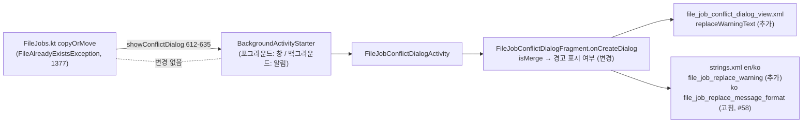

# HLD — 교체 충돌 창의 기존 파일 손실 경고 (이슈 #54)

| 항목 | 내용 |
|---|---|
| 상태 | 검수 통과(v1.1, 조건부 통과 경미 지적 반영) |
| 근거 | SRS v1.2(`docs/design/54-replace-warning/SRS.md`, 검수 통과) |
| 기준 코드 | `origin/develop` 7cf16b7. 경로는 `app/src/main/` 기준이다 |

## 1. 구조 개요
새 모듈·클래스·경계를 만들지 않는다. 바뀌는 곳은 `filejob/`의 충돌 창 한 곳과 그 레이아웃·문자열뿐이다. 백엔드(`provider/`)와 작업 흐름(`filejob/FileJobs.kt`)은 바꾸지 않는다.

- 창의 구성은 지금과 같다: 제목·메시지(`MaterialAlertDialogBuilder.setTitle/setMessage`, `filejob/FileJobConflictDialogFragment.kt:77-79`) 아래에, `onStart`가 창의 스크롤 안 `LinearLayout` 끝에 레이아웃 뷰를 붙인다(`FileJobConflictDialogFragment.kt:251-261`). 따라서 레이아웃 맨 위에 넣은 경고는 메시지 바로 아래, 기존·새 파일 줄 위에 보인다.
- 경고 표시 여부는 이미 창이 계산하는 `isMerge`(`FileJobConflictDialogFragment.kt:75`, 정의 310-314)로 정한다. `FileJobs.kt`의 판정(`FileJobs.kt:1380-1386`)과 같은 식이므로 창과 작업의 "교체/합치기" 판단이 어긋나지 않는다.

## 2. 구성요소
| 구성요소 | 위치(패키지·파일) | 책임 | 추적 REQ |
|---|---|---|---|
| C1 경고 글자 뷰 `replaceWarningText` | `res/layout/file_job_conflict_dialog_view.xml` 최상위 `LinearLayout`의 첫 자식(지금 15행의 대상 줄 앞) | 경고 문구를 보인다. 기본 `visibility="gone"`, 글자는 `@string/file_job_replace_warning`. 좌우 `?dialogPreferredPadding`, 위아래 여백은 메시지·아래 대상 줄(높이 고정 `two_line_list_item_height`, 17행)과 붙어 보이지 않게 LLD에서 정한다(수동 확인 항목), 글자 모양은 이 레이아웃의 다른 본문 글자와 같은 `?textAppearanceListItem`(201·239행), 글자색을 따로 지정하지 않는다(5장 E2) | REQ-54-01, REQ-54-02 |
| C2 표시 조건 | `filejob/FileJobConflictDialogFragment.kt` `onCreateDialog`의 `apply` 블록(81행 `inflate` 직후) | `binding.replaceWarningText.isVisible = !isMerge` 한 줄. 이름 입력 처리(`doAfterTextChanged`, 121-130)와 버튼 처리(`onDialogButtonClick`, 211-240)는 건드리지 않는다 | REQ-54-01, REQ-54-02, REQ-54-03, REQ-54-04 |
| C3 경고 문자열 | `res/values/strings.xml`·`res/values-ko/strings.xml`의 충돌 창 문자열 묶음(영어 234-245, 한국어 203-214) 안, `file_job_replace_source_name` 다음 | 새 키 `file_job_replace_warning` 하나씩. 문구는 4.2 | REQ-54-01, REQ-54-05 |
| C4 한국어 교체 메시지 고침 | `res/values-ko/strings.xml:204` `file_job_replace_message_format` | 첫 줄을 "“%1$s” 폴더에 …"로 고친다. 둘째 줄·키·인자 수는 그대로. 문구는 4.2 | REQ-54-07 |
| (변경 없음) 제목·메시지·알림 | `FileJobConflictDialogFragment.getTitle`·`getMessage`(283-308), `FileJobs.kt:612-635`, `app/BackgroundActivityStarter.kt:39-73` | 경고를 넣지 않는다. 백그라운드 알림 문구가 지금과 같게 유지된다 | REQ-54-06 |
| (변경 없음) 작업 흐름 | `filejob/FileJobs.kt` 1340-1440, 버튼 3개(138-140), `FileJobConflictAction` | 교체 승인은 지금처럼 긍정 버튼 한 번. 확인 창 없음 | REQ-54-03 |

## 3. 데이터 흐름·상태
1. 작업 스레드(`FileJobService`의 작업)가 `copyOrMove`에서 `FileAlreadyExistsException`을 받고, "모든 파일에 적용"으로 정해진 선택이 없으면 `showConflictDialog`로 창을 띄우고 결과를 기다린다(`FileJobs.kt:1377-1401`, 612-635). 이 흐름은 바뀌지 않는다.
2. UI 스레드에서 `onCreateDialog`가 `Args`(`sourceFile`, `targetFile`, `type`)로 `isMerge`를 계산하고(75행), C2가 경고 뷰의 표시를 정한다. 경고는 `Args`만으로 정해지는 정적 상태라 `State`(354-357)에 저장할 것이 없다.
3. 회전 등으로 창이 다시 만들어지면 `onCreateDialog`가 같은 `Args`로 다시 돌아 같은 결과를 낸다(REQ-54-04). 이름 입력으로 긍정 버튼 글자가 바뀌어도(129행) 경고 표시는 바뀌지 않는다(SRS D2).
4. 사용자가 고른 결과는 지금과 같은 `RemoteCallback` 경로로 작업에 돌아간다(318-352). 오류 전파도 지금과 같다.
5. 앱이 백그라운드이면 `BackgroundActivityStarter`가 `getTitle`·`getMessage`로 알림을 띄우고, 알림을 누르면 같은 `FileJobConflictDialogActivity`가 열려 1~4가 그대로 일어난다(SRS D3).

## 4. 외부 인터페이스

### 4.1 리소스
| 종류 | 이름 | 변경 |
|---|---|---|
| 레이아웃 id | `replaceWarningText`(`FileJobConflictDialogViewBinding`에 생김) | 추가 |
| 문자열 | `file_job_replace_warning`(en, ko) | 추가 |
| 문자열 | `file_job_replace_message_format`(ko만) | 문구 고침(#58) |
Intent·권한·설정 키·파일 형식·AIDL은 바뀌지 않는다.

### 4.2 문구(제안, 최종 문구는 LLD에서 확정)
| 키 | 영어 | 한국어 |
|---|---|---|
| `file_job_replace_warning` | Replacing deletes the existing file first. If the operation is interrupted, the existing file may be lost. | 교체하면 기존 파일을 먼저 지웁니다. 작업이 도중에 중단되면 기존 파일을 잃을 수 있습니다. |
| `file_job_replace_message_format`(ko 고침) | (그대로) Another file with the same name already exists in “%1$s”.\nReplacing it will overwrite its content. | “%1$s” 폴더에 같은 이름의 파일이 이미 있습니다.\n파일을 교체하면 대상 파일의 내용을 덮어씁니다. |

- "operation"·"작업"으로 쓴 것은 복사·이동·압축 풀기를 한 문구로 덮기 위해서다(REQ-54-01). 종류별 문구 셋을 두지 않는다(5장 E3).
- 한국어는 버튼 이름 "교체"(`res/values-ko/strings.xml:35`)와 같은 낱말을 쓴다(REQ-54-05).
- 대상이 폴더를 가리키는 심볼릭 링크면 폴더 판정이 링크를 따르지 않아(`FileJobConflictDialogFragment.kt:311-312`, `FileJobs.kt:1380-1381`) 교체 충돌로 보이고, 기존 문구와 같이 "파일"로 부른다. 이때 백엔드가 링크만 지우는지는 이 HLD에서 확인하지 않았다(미확인, LLD에서 확인).

## 5. 설계 결정
| 결정 | 대안 | 고른 이유 |
|---|---|---|
| E1 경고를 레이아웃의 별도 `TextView`로 둔다 | (a) `getMessage` 문자열에 덧붙인다 (b) `onCreateDialog`에서 `setMessage`에만 덧붙인다 | (a)는 백그라운드 알림 본문도 바꿔 REQ-54-06·SRS D3에 어긋난다. (b)는 가능하지만 메시지와 경고가 한 덩어리가 되어 표시 조건을 따로 다루기 어렵고, SRS 3장(접근성)이 레이아웃의 `TextView`로 정했다. 별도 뷰는 #55가 선택지를 더할 때 문구를 따로 고치기도 쉽다 |
| E2 글자 모양은 `?textAppearanceListItem`, 색 지정 없음(기본 본문 색). 경고 아이콘·오류 색 없음 | 오류 색(`?colorError`)이나 경고 아이콘으로 강조 | SRS 3장: 새 색을 정의하지 않고 #27(보조 글자 대비, `?android:textColorSecondary`)과 겹치지 않는다. 보조 글자색을 쓰지 않으므로 #27의 대비 결함(4.24:1)을 물려받지 않는다. 아이콘이 없으니 `Content_Description` 대상도 생기지 않는다. 강조가 필요하다고 오너가 보면 O3로 받는다 |
| E3 문구 하나(작업 종류 공통) | 복사·이동·압축 풀기별 문구 셋(합치기 메시지처럼, 299-303) | 경고의 뜻이 종류마다 같고, 문자열 수를 줄여 번역(#21) 부담을 줄인다 |
| E4 표시 조건은 `!isMerge` 하나 | 이름 입력 시 숨김(SRS D2의 대안) | SRS D2(제안, 오너 확인 O2). `doAfterTextChanged`를 건드리지 않아 변경이 한 줄로 끝난다. O2에서 오너가 숨김을 고르면 C2에 "새 이름이 있으면 숨김"을 더하고 `hasNewName()`(242-249)을 쓴다 — 구조는 같다 |
| E5 경고를 레이아웃 맨 위(메시지 바로 아래)에 둔다 | 버튼 바로 위(체크 상자 아래) | 메시지("내용을 덮어씁니다")와 이어 읽혀 뜻이 이어지고, TalkBack도 제목→메시지→경고 순으로 읽는다. 창이 스크롤 안이라 어느 위치든 잘리지 않는다 |

## 6. 위험과 미결 사항
- **오너 확인(SRS 2.2)**: O1(합치기 창에는 경고 없음), O2(이름 입력 중에도 경고 유지). 결과에 따라 C2 한 줄만 달라진다. O3(경고를 강조하지 않고 일반 본문 글자로 둠, E2)도 SRS 2.2에 함께 올렸다. 오너가 강조를 고르면 SRS 3장·5장의 접근성·대비 행(이미 "아이콘을 더하면" 조건부)과 C1을 고친다.
- **기존 문구와의 겹침**: 메시지 둘째 줄 "내용을 덮어씁니다"(en "overwrite its content")와 경고 "먼저 지웁니다"가 함께 보인다. 모순이 아니라 경고가 덮어쓰기의 방식을 구체화하는 것이며, 기존 문구는 SRS 1.3·REQ-54-07에 따라 고치지 않는다.
- **위험 자체는 남는다**: SRS 4장. `CHANGELOG.md:29`의 알려진 문제 문구는 다음 릴리스 문서 동기화에서 고친다.
- **#55와의 관계**: #55가 충돌 창에 선택지를 더하면 C1의 문구가 그 선택지와 맞는지 #55 설계에서 다시 본다(SRS 4장).
- **글자 크기·대비(미확인)**: `?textAppearanceListItem`은 Material 3에서 TitleMedium(약 16sp, 기본 본문 색, `styles_material3.xml:35-38`)이라 위쪽 창 메시지보다 크거나 진하게 보일 수 있다. 창 메시지의 실제 스타일은 Material 라이브러리 쪽이라 확인하지 못했다. LLD에서 밝은·어두운 테마 화면 캡처로 메시지와 어울리는지, 대비가 4.5:1 이상인지 확인하고, 어긋나면 기존 테마 속성 안에서 글자 모양만 바꾼다(새 색 금지는 유지).
- **확인 방법의 한계**: 표시 조건은 코드 검사와 수동 확인(영어·한국어, 밝은·어두운 테마, 파일→파일·폴더→파일·폴더→폴더, 회전, 이름 입력)으로 본다. 기존에 이 창의 계측 테스트가 없어 자동 시험은 두지 않는다. 기기 설치는 오너에게 미리 묻는다.

## 7. 변경 이력
| 일자 | 버전 | 변경 | 사유 | 요청자 |
|---|---|---|---|---|
| 2026-11-19 | v1.1 | HLD 검수 1회차 경미 지적 반영: 줄 번호 201·239, C1 위아래 여백을 LLD로, 링크 삭제 주장을 미확인으로 낮춤, 글자 크기·대비 확인을 6장에 추가, O3를 SRS 2.2로 모음 | 검수 m1~m4, O3 위치 | 검수팀 |
| 2026-11-19 | v1 | 최초 작성 | SRS v1.1 검수 통과 | PM |
