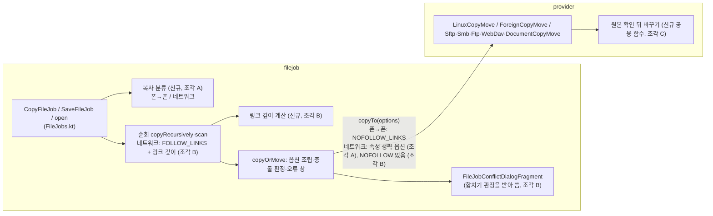

# HLD — 복사는 cp와 네트워크의 기본 동작을 따른다 (이슈 #55)

| 항목 | 내용 |
|---|---|
| 상태 | 검수 통과 (v1.3) |
| 근거 | SRS v1.4 (오너 결정 2026-11-19 반영) |
| 기준 코드 | `origin/develop` 0941fa7. 경로는 `app/src/main/java/me/zhanghai/android/files/` 기준 |
| 범위 | 조각 C → A → B (SRS 4절). 조각마다 LLD·PR을 따로 하며, 이 문서 2절이 조각별 경계다 |

## 1. 구조 개요
기존 경계를 그대로 쓴다. 작업 단위의 판단(어떤 복사인가, 링크를 따라가는가, 충돌을 어떻게 볼 것인가)은 `filejob/`이, 실제 쓰기 순서와 속성 단계는 각 `provider/*/…CopyMove.kt`가 한다. 둘 사이는 지금처럼 `CopyOption` 배열로만 이어진다(`FileJobs.kt:1353-1366` → `provider/common/PathExtensions.kt:47-54` → 각 제공자의 `copy` → `toCopyOptions()`, `provider/common/CopyOptions.kt:45-77`).



- 새 경계는 만들지 않는다. 새 파일은 세 개다: `filejob/`의 복사 분류와 링크 깊이 계산(작업 단위 판단이라 `filejob`), `provider/common/`의 원본 확인 뒤 바꾸기(백엔드 공용 도구가 있는 곳, #47의 `SymbolicLinkCopy.kt`와 같은 자리).
- 이동(`MoveFileJob`, `copyForMove`, `moveByCopy`)은 바꾸지 않는다(SRS Q4). 이동이 넘기는 옵션은 지금과 같고, 새 옵션을 받지 않으므로 백엔드의 이동 경로 동작도 같다. 단, 조각 C의 순서 변경은 백엔드 `copy` 안에 있으므로 이동이 `copy`로 대체될 때(`ForeignCopyMove.move` 150, 다른 백엔드의 이동 실패 시 복사)도 적용된다 — 순서만 바뀌고 성공 결과는 같다.

## 2. 구성요소 (조각별 경계)

### 2.1 조각 C — 바꾸기 전 원본 확인 (REQ-55-08, 09)
| 구성요소 | 위치 | 책임 | 추적 REQ |
|---|---|---|---|
| 원본 확인 뒤 바꾸기(신규 공용 함수) | `provider/common/` (이름은 LLD) | 순서를 강제한다: ① 원본 열기(일반 파일) 또는 원본 폴더 목록 열어 보기(폴더) → ② 대상이 있고 '바꾸기'면 대상 지우기(없음 오류 무시) → ③ 대상 만들고 쓰기. ①이 실패하면 ②·③을 하지 않고 ①의 예외를 그대로 던진다. 열기·지우기·쓰기는 인자(함수)로 받아 JVM에서 시험한다(#47 `createSymbolicLinkForCopy`와 같은 방식, `provider/common/SymbolicLinkCopy.kt:271-297`) | 08, 09 |
| 로컬·루트 | `provider/linux/LinuxCopyMove.kt:57-71`, 136-151 | 일반 파일: 원본 `open`(67-71)을 대상 `remove`(58-66) 앞으로. 폴더: 대상 `remove`(137-145) 전에 원본을 폴더로 열어 보고 닫는다. 링크 분기(153-177)는 이미 `readlink`가 먼저라 그대로 | 08 |
| 공급자 간 | `provider/common/ForeignCopyMove.kt:42-92` | 일반 파일: `newInputStream`(51)을 `deleteIfExists`(43-45) 앞으로. 폴더: `deleteIfExists`(87-89) 전에 원본 목록을 열어 보고 닫는다. 링크 분기(93-106)는 그대로 | 08 |
| 문서 제공자 | `provider/document/DocumentCopyMove.kt:32-51` | `DocumentResolver.remove`(38) 전에 원본을 열어 보고 닫는다(일반 파일: `DocumentResolver.openInputStream(source, "r")`, `document/resolver/DocumentResolver.kt:389`; 폴더: 자식 목록). 복사 자체는 제공자 쪽 `copyDocument`(같은 제공자, API 24+, `DocumentResolver.kt:85-87`, 109)가 원본을 다시 열므로 열린 스트림을 넘길 수 없다 — **열어 보고 닫기**로 확인한다(D4) | 08 |
| SFTP | `provider/sftp/SftpCopyMove.kt:76-158` | 일반 파일: 원본 `openByteChannel`(87-91)을 `remove`(77-86) 앞으로. 폴더: `remove`(142-151) 전에 원본 `scandir`로 열어 본다 | 08 |
| SMB | `provider/smb/SmbCopyMove.kt:74-113`, `provider/smb/client/Client.kt:318-` | 일반 파일: `Client.copyFile`은 원본을 먼저 열고(335-349) 대상은 `FILE_CREATE`로 연다(361-370). 대상 지우기(`SmbCopyMove.kt:75-84`)를 `copyFile` 안의 "원본 연 뒤, 대상 만들기 전"으로 옮긴다(인자로 지우기 함수를 받거나 '바꾸기' 여부를 받는다 — LLD). 폴더: `delete`(97-106) 전에 `openDirectoryIterator`(`Client.kt:89`)로 열어 본다 | 08 |
| FTP | `provider/ftp/FtpCopyMove.kt:33-103` | 대상 지우기(41-45)를 원본 종류 확인(56-57)과 원본 `retrieveFile`(59-63) 뒤로 옮긴다. FTP는 연결 풀이라 원본 전송 연결을 연 채로 다른 연결로 지울 수 있다(`ftp/client/Client.kt:41-76`, 222-228). 폴더: 지우기 전에 `listDirectory`(235)로 열어 본다 | 08, (#56) |
| WebDAV | `provider/webdav/WebDavCopyMove.kt:38-114` | 대상 지우기(46-50)를 원본 종류 확인(61-62)과 원본 `get`(64-68) 뒤로 옮긴다. 폴더: 지우기 전에 원본 목록(PROPFIND 깊이 1 — 제공자의 목록 호출)으로 열어 본다 | 08, (#56) |
| 회귀 테스트 | `app/src/test/.../provider/common/` | 공용 함수: ① 열기 실패면 지우기·쓰기 호출 없음 ② 열기 성공 + 대상 있음 + 바꾸기면 지우기 1회 후 쓰기 ③ 지우기가 '없음'이면 무시 ④ 바꾸기 아님이면 지우기 없음 ⑤ 지우기 실패면 쓰기 없음, 열린 원본은 닫힘 | 08, 09 |

**백엔드별 확인 가능 여부(REQ-55-09).** 확인할 수 없는 경로는 없다. REQ-55-09는 "확인 실패 = ①의 예외로 실패, 지우지 않음"으로 충족되고, 충돌·오류 창은 바꾸지 않는다(Q6 (나)).

| 경로 | 일반 파일 확인 | 폴더 확인 | 확인 가능 | 근거 |
|---|---|---|---|---|
| 로컬·루트 | 원본 `open` 뒤 지움(열린 fd로 복사) | 원본을 폴더로 열어 보고 닫음 | 가능 | `LinuxCopyMove.kt:67-71`, 136-151 |
| 공급자 간 | 원본 `newInputStream` 뒤 지움(열린 스트림으로 복사) | 원본 목록을 열어 보고 닫음 | 가능 | `ForeignCopyMove.kt:43-51`, 87-90 |
| 문서 제공자(같은 제공자) | 원본을 열어 보고 닫음(D4) | 자식 목록을 열어 보고 닫음 | 가능(틈 있음, 6절) | `DocumentCopyMove.kt:32-51`, `DocumentResolver.kt:85-87`, 109, 389 |
| SFTP | 원본 채널 연 뒤 지움 | `scandir`로 열어 봄 | 가능 | `SftpCopyMove.kt:77-91`, 142-151 |
| SMB | `copyFile` 안에서 원본 연 뒤(336-349) 지움, 그 뒤 대상 `FILE_CREATE`(368) | `openDirectoryIterator`로 열어 봄 | 가능 | `SmbCopyMove.kt:75-90`, `smb/client/Client.kt:89`, 318- |
| FTP | 원본 `RETR` 연 뒤 다른 연결로 지움 | `listDirectory`로 열어 봄 | 가능(서버 연결 수 제한 시 지우기 전에 실패, 6절) | `FtpCopyMove.kt:41-63`, `ftp/client/Client.kt:41-76`, 222-, 235 |
| WebDAV | 원본 `GET` 연 뒤 지움 | 원본 목록으로 열어 봄 | 가능 | `WebDavCopyMove.kt:46-68` |

원본 확인은 **대상이 있고 '바꾸기'일 때만** 추가 비용이 생긴다(폴더 목록 열어 보기, 문서 제공자 열어 보기). 일반 파일은 어차피 열 원본을 먼저 여는 것이라 비용이 없다.
- 문서 제공자는 '열어 보고 닫기'라 확인과 실제 복사 사이에 짧은 틈이 있다(6절).
- 원본이 일반 파일·폴더가 아닌 특수 파일이면 지금처럼 지우기 전에 실패한다(`LinuxCopyMove.kt:178-180`, `ForeignCopyMove.kt:34-37`).

**나눔.** 파일 수(11-1 한도 5)를 지키려고 C1·C2로 나눈다. C2는 C1의 공용 함수를 쓰므로 **C1 → C2** 순서다.
| 조각 | 파일 |
|---|---|
| C1 | 공용 함수(신규), `LinuxCopyMove.kt`, `ForeignCopyMove.kt`, `DocumentCopyMove.kt`, 테스트 |
| C2 | `SftpCopyMove.kt`, `SmbCopyMove.kt`, `smb/client/Client.kt`, `FtpCopyMove.kt`, `WebDavCopyMove.kt` (테스트는 C1의 공용 함수 테스트를 쓴다) |

### 2.2 조각 A — 분류 + 네트워크 속성 규칙 (REQ-55-01, 03)
| 구성요소 | 위치 | 책임 | 추적 REQ |
|---|---|---|---|
| 복사 분류(신규) | `filejob/` (이름은 LLD) | 경로 하나를 '폰'/'네트워크'로 판정하고, (원본, 대상 폴더) 쌍을 폰→폰/네트워크로 정한다(SRS 2.1 안 A). 판정 규칙: Linux 경로(`provider/linux/LinuxPath.kt:185` `isLinuxPath`, 루트 포함) → 폰. 압축 파일 안(`isArchivePath`, `provider/archive/ArchivePath.kt:110`) → `archiveFile`(`PathArchiveExtensions.kt:16`)로 다시 판정. 문서 제공자(`isDocumentPath`) → `DocumentResolver.isLocal`(`DocumentResolver.kt:269-272`)이 참이고 MTP(`DocumentResolver.kt:49`)가 아니면 폰. 그 밖(content·SFTP·SMB·FTP·WebDAV) → 네트워크. 경로 종류 → 판정 규칙은 순수 함수로 떼어 JVM에서 시험한다 | 01 |
| 속성 생략 옵션(신규) | `provider/common/CopyOptions.kt` | 새 `CopyOption` 하나와 `CopyOptions`의 필드 하나. `toCopyOptions()`(45-77)가 알아보고 `toArray()`(21-44)가 되돌린다. 지금의 `ProgressCopyOption`·`CleanupFailureCopyOption`처럼 `Parcelable`로 둔다(루트 원격 호출로 넘어가도 깨지지 않게, D2) | 03 |
| 옵션 조립 | `filejob/FileJobs.kt:949-959`(`copy`), 1255-(`copyOrMove`), 804-(`CopyFileJob`), 1794-1799(`save`), 1583-1603(`open`) | 복사 시작 항목마다 분류를 한 번 하고(SRS D1) 하위 항목에 물려준다. 네트워크면 옵션 배열(1353-1366)에 속성 생략 옵션을 더한다. 폰→폰은 지금과 같은 옵션 | 01, 03 |
| 공급자 간 속성 단계 | `provider/common/ForeignCopyMove.kt:109-130` | 속성 생략이면 `setTimes`를 하지 않는다. 대상 파일·폴더는 지금도 권한 없이 만든다(`newOutputStream`·`createDirectory`) | 03 |
| SFTP 속성 단계 | `provider/sftp/SftpCopyMove.kt:68-74`, 98, 153, 186-217 | 속성 생략이면 만들 때 `FileAttributes.EMPTY`(Q5 안 B)이고 `setstat`을 하지 않는다 | 03 |
| SMB 속성 단계 | `provider/smb/SmbCopyMove.kt:146-156` | 속성 생략이면 `setFileInformation`을 하지 않는다. 만들 때 속성은 이미 `FILE_ATTRIBUTE_NORMAL`(67-73) | 03 |
| FTP 속성 단계 | `provider/ftp/FtpCopyMove.kt:104-115` | 속성 생략이면 `setLastModifiedTime`을 하지 않는다 | 03 |
| WebDAV 속성 단계 | `provider/webdav/WebDavCopyMove.kt:115-126` | 속성 생략이면 `setLastModifiedTime`을 하지 않는다 | 03 |
| 회귀 테스트 | `app/src/test/.../filejob/` (파일 1개) | 분류 규칙 표 전체(SRS 2.1 안 A 열 × 원본·대상), 옵션 왕복(`toArray` ↔ `toCopyOptions`, 공개 API라 같은 테스트 파일에서 시험) | 01, 03 |

- `LinuxCopyMove`·`DocumentCopyMove`는 바꾸지 않는다. Linux→Linux는 언제나 폰→폰이라 옵션을 받지 않는다. 문서 제공자 안의 복사는 속성 단계가 없다(`DocumentCopyMove.kt:43-51`). 클라우드 SAF와 폰 사이 복사는 `ForeignCopyMove`를 지난다.

**나눔.**
| 조각 | 파일 | 머지 뒤 상태 |
|---|---|---|
| A1 | 복사 분류(신규), `CopyOptions.kt`, `FileJobs.kt`, `ForeignCopyMove.kt`, 테스트 | 폰↔NAS·폰↔클라우드 복사가 속성을 맞추지 않는다. NAS 안 복사(같은 서버)는 아직 맞춘다 |
| A2 | `SftpCopyMove.kt`, `SmbCopyMove.kt`, `FtpCopyMove.kt`, `WebDavCopyMove.kt` | 모든 네트워크 복사가 속성을 맞추지 않는다 |

A2는 A1의 옵션을 쓰므로 A1 뒤다.

### 2.3 조각 B — 링크 따라가기 + 깊이 제한 (REQ-55-02, 04, 05, 06, 07)
| 구성요소 | 위치 | 책임 | 추적 REQ |
|---|---|---|---|
| 링크 깊이 계산(신규) | `filejob/` (이름은 LLD) | 폴더에 들어갈 때 "이 폴더가 링크인가"를 받아 새 깊이(= 부모 깊이 + 링크면 1)를 계산하고 8을 넘으면 '초과'를 돌려준다. 깊이를 **쌓는 것은 그 폴더 안으로 실제로 들어갈 때(`CONTINUE`)만**이고, 빼는 것은 `postVisitDirectory`다. 라이브러리는 `preVisitDirectory`가 `SKIP_SUBTREE`를 돌려주면 `postVisitDirectory`를 부르지 않으므로(retrofile `FileTreeWalker`, javap 확인), `SKIP_SUBTREE`를 돌려주는 모든 분기(초과, 폴더 복사 실패, 건너뛰기 `copied == false` — `FileJobs.kt:843-847`, 합치기 건너뛰기)는 쌓지 않는다(또는 쌓았다면 그 자리에서 되돌린다). 순수 상태 객체라 JVM에서 시험한다. 상한 8은 한 곳의 상수 | 06 |
| 순회(복사) | `filejob/FileJobs.kt:829-863` (`copyRecursively`) | 네트워크면 `Files.walkFileTree(source, EnumSet.of(FileVisitOption.FOLLOW_LINKS), Int.MAX_VALUE, visitor)`. `preVisitDirectory`에서 링크 여부를 읽어(링크를 따르지 않은 속성 1회, D5) 깊이 계산에 넣는다. 초과면 그 폴더를 복사하지 않고 순환 오류(D6)로 오류 처리에 넘긴 뒤 `SKIP_SUBTREE`, `postVisitDirectory`에서 깊이를 뺀다. `visitFileFailed`(라이브러리 순환 감지 `FileSystemLoopException`, 폴더 목록 실패)도 오류 처리로 넘기고 계속한다. 대상 없는 링크는 여기로 오지 않는다 — 라이브러리가 따라간 속성 읽기에 실패하면 링크 자체의 속성으로 다시 읽어 `visitFile`로 넘긴다(3.1). 폰→폰은 지금과 같다(링크 안 따라감, `visitFileFailed`는 지금처럼 다시 던짐) | 04, 05, 06 |
| 순회(집계) | `filejob/FileJobs.kt:269-299` (`scan`), 307-322 | 복사 시작 항목마다 같은 분류로 순회한다. 네트워크면 같은 `FOLLOW_LINKS`와 같은 깊이 규칙. 초과는 그 폴더를 한 항목으로 세고 내려가지 않는다(`SKIP_SUBTREE`를 돌려줄 때는 깊이를 쌓지 않는다 — 복사 순회와 같은 규칙). `visitFileFailed`는 한 항목으로 세고 계속한다(오류 창은 복사 단계에서 한 번만, D8) | 06, 07 |
| 오류 처리(추출) | `filejob/FileJobs.kt:1454-1508` | 지금 `copyOrMove`의 일반 `IOException` 처리(다시 시도·건너뛰기·모두 건너뛰기·취소, `skipCopyMoveError`)를 함수로 떼어 순회 쪽에서도 부른다. `copyOrMove`에서는 동작·문구가 지금과 같다. 순회 쪽 오류는 둘로 나눈다(D10). ① **깊이 초과·순환**(`FileSystemLoopException`): "다시 시도" 없이 건너뛰기·모두 건너뛰기·취소(긍정 버튼 없음, 압축하기 오류 창과 같은 방식 `FileJobs.kt:777-787`). 다시 해도 결과가 같다. ② **그 밖의 `visitFileFailed`**(폴더 목록·속성 읽기 실패 — 네트워크에서는 일시적인 경우가 많다): 지금 오류 창과 같은 다시 시도·건너뛰기·취소. "다시 시도"는 그 항목 하나를 시작점으로 같은 방문자로 순회를 **새로 한 번 더** 돈다(`Files.walkFileTree(항목, FOLLOW_LINKS, …)`). 라이브러리는 목록을 못 열면 `preVisitDirectory`를 부르기 전에 `visitFileFailed`를 부르므로(OpenJDK와 같은 구조) 그 폴더는 아직 만들어지지 않았고, 대상 경로는 방문자가 원래 시작점 기준 상대 경로로 계산하므로 같은 자리에 복사된다. 깊이는 깊이 계산의 현재 값(부모까지)에서 이어진다. 다시 순회 안에서 또 실패하면 같은 창이 다시 뜬다. 건너뛰기·모두 건너뛰기·취소는 지금과 같다. ③ **목록을 읽는 도중 실패**(`DirectoryIteratorException`)는 `visitFileFailed`가 아니라 `postVisitDirectory(폴더, 예외)`로 온다(지금은 기본 구현이 다시 던져 작업이 끝난다). 이때는 그 폴더에 이미 들어가 깊이가 쌓여 있으므로 먼저 깊이를 빼고 ②와 같은 오류 처리를 한다. 다시 시도는 그 폴더부터 새 순회이며, 이미 만든 대상 폴더는 합치기로 이어 간다(세부는 LLD). SRS REQ-55-06의 "REQ-55-05와 같은 오류 처리" 중 깊이 초과에서 다시 시도를 빼는 것은 요구를 좁히는 쪽이다(다시 해도 같으므로) | 05, 06 |
| 옵션 조립 | `filejob/FileJobs.kt:1353-1366` | 네트워크면 `NOFOLLOW_LINKS`를 넣지 않는다(백엔드가 원본 속성을 따라간 값으로 읽는다, SRS 1.4). 폰→폰은 지금과 같다 | 02, 04 |
| 충돌 판정 | `filejob/FileJobs.kt:1377-1386`, 612-635(`showConflictDialog`) | 네트워크면 원본·대상 모두 `FileItem.attributes`(링크를 따라간 속성, `file/FileItem.kt:36-37`)로 폴더 여부를 본다. 폰→폰은 지금처럼 `attributesNoFollowLinks`. 정한 합치기 여부를 창에 넘긴다(D7) | 07 |
| 충돌 창 | `filejob/FileJobConflictDialogFragment.kt:75-76`, 284, 298, 310-313, `Args` 318- | 합치기 여부를 스스로 계산하지 않고 `Args`로 받은 값을 버튼·제목·문구·(#54의) 경고 조건에 쓴다. 백그라운드 알림용 `getTitle`·`getMessage`(`FileJobs.kt:628-629`)도 같은 값을 받는다. **#54(PR #59)가 먼저 머지된 뒤** 그 위에서 고친다 | 07 |
| FTP 링크 풀기 보정 | `provider/ftp/client/Client.kt:257-265` | 링크 대상 문자열을 링크 경로 자신이 아니라 링크의 부모에 붙여 푼다(지금 `path.resolve(targetString)`, 263). 절대 경로면 결과가 같다 | 04 |
| 회귀 테스트 | `app/src/test/.../filejob/` | 깊이 계산: 링크 없는 깊은 폴더 통과, 링크 8겹 통과, 9겹 초과, 나올 때 되돌림, 링크 아닌 폴더는 깊이 불변, **`SKIP_SUBTREE`로 끝난 폴더(초과·건너뛰기) 뒤 형제 폴더의 깊이가 부모와 같음**, 다시 순회가 부모 깊이에서 이어짐 | 06 |

**백엔드별 링크 따라가기(코드 읽기, 실서버 미확인).**
| 원본 | 원본 속성(따라감) | 내용 읽기 | 폴더 목록 | 비고 |
|---|---|---|---|---|
| 로컬·루트 | `stat`(`LinuxCopyMove.kt:34`, 다른 공급자로 갈 때는 `ForeignCopyMove.kt:33`) | `open`이 링크를 따라감 | `opendir`이 따라감 | 라이브러리 순환 감지 동작(`st_dev`+`st_ino`) |
| SFTP | `stat`(`SftpCopyMove.kt:33`; 목록 캐시는 링크가 아니면 재사용, `sftp/client/Client.kt:136-146`) | 서버가 따라감 | 서버가 따라감 | 감지 없음 → 깊이 제한만 |
| SMB | 재분석 지점을 열지 않고 열기(`SmbCopyMove.kt:33`, `copyFile`의 `openReparsePoint = false`) | 서버가 따라감 | 서버가 따라감 | Samba는 유닉스 링크를 스스로 따라가 보여 주는 경우가 많다(SRS 7절) |
| FTP | 한 단계 따라간 목록(`ftp/client/Client.kt:257-265`, 위 보정 포함) | `RETR`를 링크 경로로 — 서버가 따라감 | `LIST`를 링크 경로로 — 서버 동작에 따름 | 링크의 링크는 한 단계만 푼다(지금 동작). 서버 동작 미확인 |
| WebDAV | 따라가기 옵션 무시(`webdav/client/Client.kt:167`). '링크' = HTTP 이동 응답 | — | — | 이동 응답을 원본으로 만나면 지금처럼 그 항목이 실패한다(REQ-55-05의 '읽을 수 없음'으로 처리, 6절) |
| 압축 파일 안 | 압축 제공자의 링크 풀기(`ArchiveFileSystemProvider.kt:169-173`) | 압축 제공자 | 압축 제공자 | 폰에 있는 압축은 폰→폰이라 해당 없음. NAS의 압축을 풀 때만 |
| 문서 제공자·content | 링크 없음 | — | — | 해당 없음 |

**나눔.**
| 조각 | 파일 | 머지 뒤 상태 |
|---|---|---|
| B1 | `provider/ftp/client/Client.kt` | FTP 상대 링크가 바르게 풀린다. `listFile(follow)`를 쓰는 탐색 쪽(`ftp/FtpFileAttributeView.kt:23`, `ftp/FtpFileSystemProvider.kt:376`)도 함께 바뀐다 — 상대 링크의 종류·크기가 이제 링크 대상 기준으로 바르게 보인다. 복사 동작은 B2 전까지 그대로(복사는 아직 링크를 따라가지 않음) |
| B2 | 링크 깊이 계산(신규), `FileJobs.kt`, `FileJobConflictDialogFragment.kt`, 테스트 | 네트워크 복사가 링크를 따라간다 |

B2는 따라가기·깊이 제한·항목 단위 실패·충돌 판정을 **한 PR에 함께** 넣는다. 따라가기만 먼저 들어가면 SFTP 순환에서 집계·복사가 끝나지 않고, 충돌 판정이 따로 들어가면 창과 작업이 어긋난다. B1은 독립이라 B2 앞이 좋다(B2의 FTP 수동 시험이 바른 경로로 돈다).

### 2.4 조각 순서와 의존 (요약)
```
C1 → C2 → A1 → A2 → B2   (B2는 #54 머지 뒤)
B1 ─────────────────→ B2   (B1은 어느 때나, B2 앞)
```
C1 → C2는 공용 함수 때문이다. C → A는 같은 파일(`ForeignCopyMove`, SFTP·SMB·FTP·WebDAV) 충돌을 피하려는 순서다. A1 → B2는 분류가 필요해서다.

## 3. 데이터 흐름·상태

### 3.1 복사 한 항목 (조각 A·B 뒤)
1. `CopyFileJob.run`(804-)이 시작 항목마다 분류를 한다(원본, 대상 폴더). 압축 풀기는 원본의 압축 파일 경로로 판정한다.
2. `scan`이 같은 분류로 집계한다. 네트워크면 링크를 따라가고 깊이 8에서 멈춘다.
3. `copyRecursively` 순회. 네트워크면 `FOLLOW_LINKS`.
   - 폴더에 들어갈 때(`preVisitDirectory`): 링크 여부(1회) → 깊이 계산. 초과면 순환 오류 → 오류 처리(건너뛰기/모두 건너뛰기/취소) → `SKIP_SUBTREE`. 아니면 `copy`(폴더 만들기) → 실패면 지금처럼.
   - 파일(`visitFile`): `copy`. 대상 없는 링크는 라이브러리가 링크 자체의 속성으로 넘겨 주고, `copyTo`(NOFOLLOW 없음)에서 백엔드가 따라간 속성을 읽다가 '없음'으로 실패 → 지금의 오류 처리(REQ-55-05).
   - `visitFileFailed`: 오류 처리 → 계속 또는 취소.
4. `copyOrMove`: 옵션 = (폰→폰) 지금과 같음 / (네트워크) NOFOLLOW 없음 + 속성 생략. 대상이 있으면 백엔드가 `FileAlreadyExistsException` → 충돌 판정(네트워크는 따라간 속성) → 창(판정 값을 받아 표시) → '바꾸기'면 `REPLACE_EXISTING`로 다시 시도.
5. 백엔드 `copy`: 원본 속성 읽기 → 대상 확인 → (조각 C) 원본 열기·열어 보기 → 대상 지우기 → 만들기·쓰기 → (네트워크가 아니면) 속성 단계.

### 3.2 스레드·수명주기
변화 없음. 파일 작업 서비스의 작업 스레드에서 동기 호출이다. 깊이 계산 상태는 순회 한 번(시작 항목 하나)의 지역 객체다.

### 3.3 오류 전파
- 깊이 초과·라이브러리 순환: `FileSystemLoopException`(java8.nio, `IOException` 계열) 하나로 통일해 같은 오류 처리로 보낸다(D6).
- 조각 C의 원본 확인 실패: 백엔드가 지금과 같은 `FileSystemException` 계열로 던진다(대상은 그대로). `FileJobs`의 일반 오류 처리로 간다.
- 폰→폰의 `visitFileFailed`는 지금처럼 다시 던져 작업을 끝낸다(범위 밖, SRS 1.4).

## 4. 외부 인터페이스
- Intent·설정 키·권한·파일 형식: 변경 없음.
- 문자열: 추가 없음(D6).
- 내부 API: 새 `CopyOption` 하나(조각 A). `FileJobConflictDialogFragment.Args`에 합치기 여부 필드 하나(조각 B2) — 창을 다시 만들 때(회전) `Args`로 복원된다.
- 검증:

| 검증 | 환경 | 내용 | REQ | 조각 |
|---|---|---|---|---|
| 원본 확인 공용 함수 | JVM `./gradlew testDebugUnitTest` | 2.1 회귀 테스트 ①–⑤ | 08, 09 | C1 |
| 분류 규칙 | JVM | SRS 2.1 안 A 열 전체 조합 | 01 | A1 |
| 옵션 왕복 | JVM | 속성 생략 옵션의 `toArray`↔`toCopyOptions`, 모르는 옵션 예외가 생기지 않음 | 03 | A1 |
| 깊이 계산 | JVM | 2.3 회귀 테스트 | 06 | B2 |
| 바꾸기 전 확인 | 에뮬레이터(로컬), 서버(있으면) | 읽기 권한 없는 원본으로 '바꾸기' → 오류, 대상 남음(로컬은 루트 없이 만들기 어려우면 다른 앱 소유 파일·SFTP `chmod 000`) | 08 | C1, C2 |
| 속성 | 서버 | 폰→NAS, NAS→폰, NAS 안 복사 후 수정 시각 = 복사 시각, SFTP 권한 = 서버 기본 | 03 | A1, A2 |
| 따라가기·깊이 | 에뮬레이터 + 서버 | 폰의 파일·폴더 링크를 NAS로, 부모를 가리키는 링크 폴더를 NAS로(깊이 8에서 오류, 작업이 끝남), 대상 없는 링크와 정상 파일 함께 | 04, 05, 06 | B2 |
| 충돌 | 에뮬레이터 + 서버 | 폴더 링크를 같은 이름 폴더가 있는 NAS로 → 합치기 창·합치기 동작, 회전 뒤 같은 창 | 07 | B2 |
| 폰→폰 회귀 | 에뮬레이터 | 링크가 링크로, 수정 시각 원본과 같음 | 02 | A1, B2 |

서버가 없으면 PR에 "미확인"으로 적는다. 오너 기기 설치는 사전 승인.

## 5. 설계 결정
| 결정 | 대안 | 고른 이유 |
|---|---|---|
| D1. 분류는 `filejob`이 하고, 결과는 옵션(`NOFOLLOW_LINKS` 유무, 속성 생략 옵션)으로만 백엔드에 전한다 | 백엔드(`ForeignCopyMove` 등)가 경로를 보고 스스로 판정 | 링크 따라가기는 순회(`filejob`)가 알아야 하고, 집계·충돌 판정도 `filejob`에 있다. 판정을 한 곳에 두면 규칙이 섞이지 않는다(REQ-55-01 "한 곳"). 백엔드는 지금처럼 옵션만 본다 |
| D2. 속성 생략은 새 `CopyOption`. `Parcelable`로 둔다 | `COPY_ATTRIBUTES`의 뜻을 바꾸기 | `COPY_ATTRIBUTES`는 이동이 쓰고(소유자까지), 없을 때도 폰→폰은 권한·시각을 맞춘다 — 뜻을 바꾸면 폰→폰과 이동이 함께 바뀐다(Q3·Q4 결정과 어긋남). 루트 경로는 폰→폰이라 이 옵션이 원격 호출로 넘어갈 일은 없지만, 넘어가도 깨지지 않게 다른 사용자 옵션과 같이 `Parcelable`로 둔다 |
| D3. 바꾸기 순서를 공용 함수 하나로 강제 | 백엔드마다 줄 순서만 바꾸기 | 일곱 경로의 같은 규칙을 JVM에서 시험할 수 있다(백엔드는 JNI·네트워크에 묶여 직접 시험 불가, #47 D1과 같은 이유) |
| D4. 문서 제공자는 '열어 보고 닫기'로 확인 | 열린 스트림으로 직접 쓰기(`copyManually`만 쓰기) | 같은 제공자 복사는 `copyDocument`(제공자 쪽 복사, 진행·속도 이점)를 쓰므로 스트림을 넘길 수 없다. 짧은 틈은 남지만(6절) "처음부터 못 읽는 원본"은 걸러진다 |
| D5. 링크를 따라가는 순회는 라이브러리 `FOLLOW_LINKS`를 쓰고, 폴더마다 링크 여부를 한 번 읽어 깊이를 센다 | 직접 순회를 짜서 목록의 링크 안 따른 속성으로 링크를 알아낸다 | 라이브러리는 대상 없는 링크 처리와 순환 감지(로컬·SMB)를 이미 한다(Q2 결정이 이 감지를 받아들임). 직접 순회는 코드와 위험이 크다. 대가로 네트워크 원본의 **폴더마다** 왕복 1회가 는다(파일에는 늘지 않음, SRS 6절) |
| D6. 깊이 초과는 `FileSystemLoopException`으로 알리고 새 문자열을 더하지 않는다 | 깊이 제한 전용 문자열 | 오류 창 본문은 예외 문자열을 보여 준다(`FileJobs.kt:1468-1482`의 `file_job_copy_error_message_format`과 `e.toString()`). 라이브러리 순환 감지와 같은 예외라 처리가 하나다. 예외 메시지에 깊이 8 초과임을 적는다(REQ-55-06). 번역 작업(#21 일시정지)을 늘리지 않는다 |
| D7. 합치기 여부는 `FileJobs`가 정하고 충돌 창은 받아 쓴다 | 창이 같은 규칙으로 다시 계산 | 두 곳이 따로 계산하면 분류를 창에도 넘겨야 하고 어긋날 수 있다(REQ-55-07 "항상 같은 결과") |
| D8. 집계는 실패·초과를 조용히 한 항목으로 센다 | 집계에서도 오류 창 | 같은 항목에 창이 두 번 뜨지 않게 한다. 복사 단계에서 한 번 묻는다 |
| D10. 순회 쪽 오류 창: 깊이 초과·순환은 건너뛰기·취소만, 목록·속성 읽기 실패는 다시 시도·건너뛰기·취소(다시 시도 = 그 항목부터 새 순회) — PM 결정 2026-11-19 | (가) 모든 순회 오류에서 다시 시도 없음 (나) 모든 순회 오류에 다시 시도 | 네트워크 목록 실패는 일시적인 경우가 많아 다시 시도가 쓸모 있다(PM). 라이브러리 순회기는 지나간 폴더로 돌아갈 수 없지만, 목록 실패는 그 폴더에 들어가기 전에 오므로 그 항목부터 새로 순회하면 된다 — `FileJobs.kt` 안에서 끝나 조각 B2 경계가 그대로다. 깊이 초과·순환은 다시 해도 같아 다시 시도를 두지 않는다. 다시 순회 안에서는 라이브러리의 조상 비교가 새로 시작하므로 그 아래 순환은 깊이 제한(부모 깊이에서 이어짐)이 막는다. 지금은 순회 실패가 작업 전체를 끝내므로(SRS 1.4) 어느 경우든 나아진다 |
| D9. 네트워크 충돌 판정은 대상도 따라간 속성으로 본다 | 원본만 따라감 | '네트워크에는 링크 개념이 없다'(오너 2026-11-04)에 맞춘다. 대상이 폴더를 가리키는 링크면 합치기가 되어 그 링크가 가리키는 폴더 안에 쓴다(6절) |

## 6. 위험과 미결 사항
- **문서 제공자 확인의 틈(D4)**: 열어 보고 닫은 뒤 지우고 `copyDocument`가 다시 열 때까지 원본이 바뀌면 지운 뒤 실패할 수 있다. 드물다.
- **클라우드 SAF의 '열어 보기' 비용(D4)**: 클라우드 제공자는 `openInputStream`에서 파일 전체를 내려받기 시작할 수 있다(제공자 구현에 따름, 미확인). 대상이 있고 '바꾸기'일 때만 생기는 비용이고, 같은 제공자 안 복사에서만이다. 실측이 문제면 LLD에서 열자마자 닫는다(읽지 않음).
- **전송 도중 실패**: 원본을 연 뒤의 끊김으로 기존 대상을 잃는 위험은 남는다(오너 결정 #42, #54 경고).
- **폴더마다 왕복 1회(D5)**: 폴더가 많은 NAS 트리 복사가 조금 느려진다. 실측은 미확인.
- **FTP 연결 수**: 조각 C2로 '바꾸기' 때 원본 전송·지우기·쓰기가 동시에 연결 셋을 쓸 수 있다. 연결 수를 제한한 서버에서는 지우기 전에 실패하고 대상은 남는다(데이터 손실 없음). 지금도 복사는 연결 둘을 동시에 쓴다.
- **WebDAV '링크'**: HTTP 이동 응답을 원본으로 만나면 따라가지 않고 그 항목이 실패한다(`WebDavCopyMove.kt:61-62`). 실제로 이런 서버가 있는지 미확인. 필요하면 별도 이슈.
- **FTP 링크의 링크**: 한 단계만 푼다(`ftp/client/Client.kt:264`). 두 단계 이상이면 링크 속성이 남아 `RETR`에 맡긴다. 서버 동작 미확인.
- **대상이 폴더 링크인 합치기(D9)**: NAS 대상의 폴더 링크에 합치면 링크가 가리키는 폴더 안에 쓴다. 지금(폰→폰과 같음)은 대상 링크가 폴더가 아니어서 교체 창이 뜬다. 네트워크 복사에서만 바뀐다.
- **#54와의 순서**: B2는 #54 머지 뒤. #54 문서의 "폴더 판정 = 링크 안 따름"은 네트워크 복사에서 달라진다(PM 전달 사항, SRS 5절). #54 파일은 이 작업에서 고치지 않는다.
- **이동이 `copy`로 대체될 때**: 조각 C의 순서 변경이 이동의 복사 대체 경로에도 적용된다(1절). 성공 결과는 같고 실패 시 대상을 덜 지운다.
- **다시 순회와 집계(D10)**: 다시 시도로 그 항목을 복사하면 집계(`scan`) 때 한 항목으로 센 곳이 실제로는 여러 항목이 되어 진행률이 100%를 넘을 수 있다. 진행률 표시만의 문제이고 지금도 집계 뒤 바뀐 폴더에서 같은 일이 생긴다.
- **수정 파일 수**: 조각마다 5개 이하(C1 5, C2 5, A1 5 — 테스트 1개 포함, A2 4, B1 1, B2 4).

## 7. 변경 이력
| 일자 | 버전 | 변경 | 사유 | 요청자 |
|---|---|---|---|---|
| 2026-11-19 | v1 | 최초 작성(조각 C·A·B) | SRS v1.3, 오너 결정 2026-11-19 | PM |
| 2026-11-19 | v1.1 | H1 깊이 쌓기를 `CONTINUE`일 때만(SKIP 뒤 누수 방지)·테스트 추가, H2 C1 → C2 순서, h3 `CopyOptions.kt` 줄 정정, h4 대상 없는 링크 경로 정정, h5 순회 오류 창에 다시 시도 없음(D10), h6 A1 테스트 1개, h7 B1 탐색 영향, h8 REQ-55-09 확인 가능 표·클라우드 SAF 비용 | HLD 검수 1차 반려(H1-H2, h3-h8, PR #64 코멘트) | reviewer |
| 2026-11-19 | v1.2 | D10과 2.3 오류 처리 행: 목록·속성 읽기 실패에는 다시 시도를 둔다(그 항목부터 새 순회), 깊이 초과·순환은 건너뛰기·취소만. 테스트·6절 보강, 2.3 집계 행에 SKIP 시 깊이 규칙 명시 | PM 결정(D10 조정), HLD 2차 검수 n1 | PM, reviewer |
| 2026-11-19 | v1.3 | 2.3 오류 처리 행에 목록 도중 실패(`postVisitDirectory` 예외) 처리와 REQ-55-06과의 관계 한 줄 | HLD v1.2 검수 조건부 통과(n1·n2, PR #64 코멘트) | reviewer |
