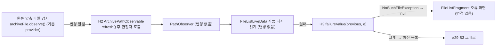

# HLD — 지워진 압축 파일·폴더의 예전 목록 표시 (이슈 #69)

| 항목 | 내용 |
|---|---|
| 상태 | 검수 통과(v1.1 PR #81 2회차, v1.2 변경 절 재검수 통과), 구현됨(PR #84, v1.7.5-beta.2) |
| 근거 | SRS v1.1 (`docs/design/69-stale-archive/SRS.md`) |
| 기준 코드 | `origin/develop` 8cafb75. 줄 번호는 모두 이 커밋 기준이다 |
| 시험한 수정안 | `_workspace/wo/69-stale-archive/prototype.diff`(커밋 없음, AVD HOT 2/2·COLD 1/1 확인). 이 HLD는 그 구조를 따르되 판단을 순수 함수·클래스로 빼 JVM 시험이 가능하게 한다 |

## 1. 구조 개요

기존 모듈 경계를 그대로 쓴다. 새 경계는 없다.
- **백엔드(`provider/archive/`)**: `ArchiveFileSystemProvider.observe()`가 원본 압축 파일의 `PathObservable`을 감싸 돌려준다(H1, H2). `PathObserver`(`filelist/PathObserver.kt:25-46`)·`FileListLiveData`의 감시 연결은 바꾸지 않는다 — 압축 경로도 다른 경로와 같은 길로 T1(감시 알림 → 자동 다시 읽기)을 받는다.
- **프런트엔드(`filelist/`)**: `FileListLiveData.loadFileList()`의 실패 결과(`FileListLiveData.kt:79-81`)가 담을 목록을 순수 함수(H3)로 정한다. 화면(`FileListFragment.onFileListChanged`, `:778-816`)은 바꾸지 않는다 — `Failure(null, e)`는 이미 오류 화면 분기(`:791`, `:803`, `:811`)로 간다.

## 2. 구성요소

| 구성요소 | 위치(패키지·파일) | 책임 | 추적 REQ |
|---|---|---|---|
| H1 압축 감시 위임 | `provider/archive/ArchiveFileSystemProvider.kt` `observe()`(`:278-281`, 기존·상위 코드) | `ArchivePath`가 아니면 지금처럼 `ProviderMismatchException`. 그렇지 않으면 `path.fileSystem.archiveFile.observe(intervalMillis)`(`provider/common/PathExtensions.kt:278-279`)로 원본 감시를 얻어 H2로 감싸 돌려준다. 원본 쪽이 `UnsupportedOperationException`·`IOException`을 던지면 그대로 던진다 — `PathObserver`가 지금처럼 무시한다(`PathObserver.kt:33-39`). 원본이 다시 `ArchivePath`(압축 안의 압축)면 같은 함수가 차례로 불려 바깥 압축부터 무효화된다. 감시 대상은 `path`가 아니라 원본 파일 하나라 압축 안 어느 폴더든 같은 원본을 본다. | REQ-69-01, 06 |
| H2 무효화 후 알림 | `provider/archive/ArchivePathObservable.kt`(새 파일, 이 저장소 코드 — 이름은 LLD에서 바꿀 수 있음) | `PathObservable`을 구현하는 작은 클래스. 생성 인자: 원본 `PathObservable`, 무효화 동작 `() -> Unit`(H1이 `fileSystem::refresh`를 넘긴다, `ArchiveFileSystem.kt:122-129`), 실행기 `Executor`(H1은 `AsyncTask.THREAD_POOL_EXECUTOR` — `PathObserver.kt:26`과 같은 것, 시험은 즉시 실행기). `addObserver(o)`는 "실행기에 { 무효화(예외는 잡아 기록만) → `o()` }를 넘기고 곧바로 돌아오는" 래퍼를 원본에 등록하고 `o` → 래퍼 대응을 기억한다. `removeObserver(o)`는 그 래퍼를 원본에서 뗀다. `close()`는 원본을 닫는다. 안드로이드 의존이 없어 JVM 시험이 가능하다. 묶기(1000ms)는 원본 `AbstractPathObservable`(`provider/common/AbstractPathObservable.kt:20-24`)이 이미 하므로 H2는 묶지 않는다. | REQ-69-01, 02 |
| H3 실패 목록 판단 | `filelist/FileListRefreshPolicy.kt`(기존, 이 저장소 코드 — #29 K3) | 순수 함수 하나를 더한다: `failureValue(previous: List<FileItem>?, e: Exception): List<FileItem>?` = `e is java8.nio.file.NoSuchFileException`이면 `null`, 아니면 `previous`(이름은 LLD에서). 원인 사슬(`cause`)은 보지 않는다 — 직접 형만 본다(6장 R2). | REQ-69-03, 05 |
| H4 실패 결과 게시 | `filelist/FileListLiveData.kt` `loadFileList()`(`:79-81`, 기존·상위 코드) | `Failure(valueCompat.value, e)`를 `Failure(failureValue(valueCompat.value, e), e)`로 바꾼다. 한 줄 변경. 명시·자동 읽기 모두 이 함수를 지나므로(`:25-28`) 계기와 무관하게 적용된다. 그 밖(조용함 판단 `:48-52`, 명시 실패 표식 `:54-60`, 감시 `:39`)은 그대로. | REQ-69-03, 04, 05, 07 |
| 변경 없음 | `filelist/FileListFragment.kt`, `filelist/PathObserver.kt`, `filelist/FileListLoader.kt`, `FileListViewModel.reload()`(`:81-87`, 압축 명시 새로 고침의 `archiveRefresh()`), `ArchiveFileSystem` 읽기 경로, 다른 provider | 그대로 둔다. 정상 압축 열기의 읽기 경로(`ArchiveFileSystem.ensureEntriesLocked`, `:131-146`)는 바뀌지 않는다. | REQ-69-04, 06, 07 |

## 3. 데이터 흐름·상태

### 3.1 압축 원본이 지워질 때 (HOT)
1. 창이 `ArchivePath` `P`를 연다 → `FileListLiveData(P)`가 첫 읽기를 시작하고(`:38`), `PathObserver`가 작업 스레드에서 `P.observe(1000)`을 부른다(`PathObserver.kt:26-32`) → H1 → 원본 `archiveFile.observe()`(로컬이면 `WatchServicePathObservable`, `provider/common/WatchServicePathObservable.kt:21-43`) → H2로 감싼다. 첫 읽기는 감시 설정을 기다리지 않는다(다른 스레드, REQ-69-06).
2. 원본이 지워진다 → 원본 감시의 Poller 스레드가 `notifyObservers()`(`WatchServicePathObservable.kt:71-73`) → 묶기(`ThrottledRunnable`) 뒤 전역 `Notifier` 스레드에서 H2 래퍼(`AbstractPathObservable.kt:23`, `:64-77`) → 래퍼는 작업을 실행기에 넘기고 곧바로 돌아온다 → 작업 스레드에서 `ArchiveFileSystem.refresh()`(`isRefreshNeeded = true`) → `PathObserver`의 관찰자 → 주 스레드로 `onChangeObserved()`(`FileListLiveData.kt:83-89`).
3. 자동 다시 읽기(조용함, #29 REQ-29-01) → `ensureEntriesLocked`가 원본을 다시 읽다 `NoSuchFileException`(로그 `log_r14.I69.txt`, `openArchive … exists=false`) → H4·H3 → `Failure(null, e)` → 화면은 오류 글·부제목 "Error"·목록 비움(`FileListFragment.kt:784`, `:791`, `:803`, `:811`), 토스트 없음(`:796`의 `hasFiles` 거짓).
4. 창이 비활성(홈)이었다면 2의 알림은 `isChangedWhileInactive`로 쌓이고(`FileListLiveData.kt:86-88`), 다시 보일 때 `onActive`(`:91-96`)가 3을 한다 — VIEW intent로 기존 작업을 앞으로 가져온 경우가 이것이다.
5. 이후 계기: 목록이 없으므로 다음 자동 읽기는 로딩 표시와 함께(#29 `shouldLoadSilently`, `FileListRefreshPolicy.kt:17-18`), 당겨서 새로 고침은 지금처럼(`archiveRefresh()` 후 읽기).

### 3.2 로컬·원격 폴더가 지워질 때
알림 경로는 지금과 같다(감시는 #29 K5 그대로). 다시 읽기가 `NoSuchFileException`이면 3.1의 3과 같이 오류 화면. 원격 서버에서 다른 프로그램이 지운 경우는 알림이 없어(SRS L2) 명시 새로 고침 때 같은 결과가 된다.

### 3.3 수명주기·스레드
- 원본 감시의 관찰자(H2 래퍼)는 모든 `PathObservable`이 함께 쓰는 단일 `Notifier` HandlerThread에서 불린다(`AbstractPathObservable.kt:64-77`). `ArchiveFileSystem.refresh()`는 플래그 설정뿐이지만 `lock`을 잡는데(`ArchiveFileSystem.kt:122-129`), 이 `lock`은 항목 읽기(`ensureEntriesLocked`, `:131-146`)가 압축 전체를 읽는 동안 계속 잡혀 있다(`:63-67` 등 모든 조회가 `synchronized(lock)` 안에서 읽는다). 그래서 무효화를 `Notifier`에서 직접 하면 큰 압축을 읽는 중에 그 스레드가 막혀 다른 창·폴더의 변경 알림까지 늦어진다(R6). H2는 무효화와 관찰자 호출을 실행기의 작업 스레드로 넘겨 `Notifier`를 막지 않는다(D6). **#83 뒤**: `refresh()`는 `lock`을 잡지 않고 요청 세대만 올린다(`docs/design/83-archive-anr/HLD.md` H1·H2). 그래서 무효화 자체는 더 이상 막히지 않는다. 실행기 위임(D6)은 그대로 둔다 — 관찰자 호출을 `Notifier` 밖에서 하는 구조는 바뀌지 않고 #69 코드는 고치지 않는다.
- **주 스레드는 `ArchiveFileSystem.lock`을 기다리지 않는다**(#83과 같은 문제를 새로 만들지 않는다). 스레드별로 보면: H1 `observe()`는 `PathObserver`의 풀 작업에서 불린다(`PathObserver.kt:26-32`). H2 래퍼는 `Notifier` 스레드에서 불린다(`ThrottledRunnable(handler, …)`, `AbstractPathObservable.kt:23`, `handler` = `Notifier`의 것, `:67-68`, `:75-76`). `refresh()`와 관찰자 호출은 풀 작업 스레드에서 돈다(D6). 주 스레드는 그 뒤 `mainHandler.post(onChange)`(`PathObserver.kt:41-42`)로 `onChangeObserved()`만 받는다(`FileListLiveData.kt:83-89`). 이어지는 다시 읽기도 풀 작업 스레드에서 돈다(`FileListLiveData.kt:25-28`, `AsyncTask.THREAD_POOL_EXECUTOR`). #69는 주 스레드에서 `refresh()`나 `ArchiveFileSystem`의 다른 잠금 함수를 부르는 곳을 더하지 않는다. 기존 명시 새로 고침의 주 스레드 `archiveRefresh()`(`FileListViewModel.kt:81-87`)는 #83 범위라 그대로 둔다. **#83 뒤**: 그 호출은 남지만 `refresh()`가 `lock`을 잡지 않으므로 주 스레드가 `lock`을 기다리지 않는다(#83 HLD 3.2 표). 주 스레드의 `addPassword()`는 #86 범위다. **#86 뒤**: `addPassword()`도 `lock`을 잡지 않는다(#86 HLD H1).
- 작업 스레드의 `refresh()`는 진행 중인 읽기가 끝날 때까지 기다렸다가 플래그를 세운다. 그 읽기는 예전 내용이었을 수 있지만, 관찰자가 그 뒤에 불려 다음 다시 읽기가 원본을 새로 읽는다 — 무효화가 읽기 결과로 덮여 사라지지 않는다(플래그를 `lock` 밖으로 빼면 읽기 끝의 `isRefreshNeeded = false`, `:144`가 무효화를 지울 수 있어 택하지 않는다, D6). **#83 뒤**: `refresh()`는 기다리지 않고 곧바로 돌아온다. 불변식(무효화가 사라지지 않음)은 플래그 대신 세대 비교로 지킨다 — 조회는 읽기 전의 요청 세대를 기록하므로 읽는 중의 무효화는 다음 조회에서 다시 읽게 한다(#83 HLD 3.1, REQ-83-02). 관찰자는 여전히 무효화 뒤에 불린다.
- 알림이 겹치면 작업이 둘 이상 동시에 돌 수 있다. 각 작업이 "무효화 → 관찰자"를 지키므로 어느 순서든 마지막 알림 뒤에 무효화된 상태에서 다시 읽기가 요청된다. 관찰자(`PathObserver`의 `mainHandler.post`, `PathObserver.kt:41-42`)는 어느 스레드에서 불러도 된다. 닫힌 파일 시스템이면 `ClosedFileSystemException` — H2가 잡는다(REQ-69-02).
- `PathObserver.close()`(`:48-58`) → H2 `close()` → 원본 닫기. `observe()` 호출마다 원본 감시를 새로 만들므로 두 창이 같은 압축을 봐도 각자 닫는다. `ArchiveFileSystem`은 원본 경로별로 공유되므로(`ArchiveFileSystemProvider.getOrNewFileSystem`, `ArchiveFileSystemProvider.kt:58`) 한 창의 무효화가 다른 창의 다음 읽기에도 적용된다 — 같은 원본을 보는 이상 맞는 동작이다.

## 4. 외부 인터페이스
없음. Intent·권한·설정 키·파일 형식을 바꾸지 않는다. `PathObservableProvider.observe()`(`provider/common/PathObservableProvider.kt:11-14`)의 계약은 그대로이고, 압축 provider가 그것을 실제로 구현하게 될 뿐이다.

## 5. 설계 결정

| 결정 | 대안 | 고른 이유 |
|---|---|---|
| D1 압축 감시는 원본 파일 감시에 위임 | 압축 안 경로마다 따로 감시 / 주기적으로 원본 존재 확인(폴링) | 압축 내용은 원본 파일에서만 바뀐다. 위임은 기존 provider 감시를 재사용해 새 스레드·타이머가 없다. 오너 결정 문구와 같다. |
| D2 알림 전에 `refresh()` | 목록 쪽(`FileListLiveData`)에서 압축이면 `archiveRefresh()` 호출 | 무효화를 압축 provider 안에 둬 `filelist/`가 압축을 알 필요가 없다(기존 경계 유지). 명시 새로 고침 경로(`FileListViewModel.kt:81-87`)와 같은 효과다. |
| D3 없음 판단은 예외 형(`NoSuchFileException`)으로 | 실패 뒤 `Files.exists(path)`로 다시 확인 | 추가 I/O·원격 왕복이 없고 순수 함수로 시험할 수 있다. 다시 확인은 원격에서 느리고 또 실패할 수 있다. 오너 결정이 예외 형으로 정했다. |
| D4 판단을 `FileListRefreshPolicy.kt`에, 상위 파일은 한 줄 | `FileListLiveData` 안에서 직접 `is` 검사(시험한 수정안) | #29 D3과 같은 방침 — 상위 동기화 충돌을 줄이고 JVM 시험을 가능하게 한다(SRS C-1). |
| D6 H2는 무효화·알림을 실행기(`AsyncTask.THREAD_POOL_EXECUTOR`)로 넘긴다 | `Notifier`에서 직접 무효화(시험한 수정안) / `isRefreshNeeded`를 `@Volatile`로 두고 `lock` 없이 세우기 / H2 전용 스레드 | 직접 무효화는 공유 `Notifier`를 막는다(R6). `@Volatile`은 상위 코드 `ArchiveFileSystem`을 바꾸고, 읽기 끝의 `isRefreshNeeded = false`(`ArchiveFileSystem.kt:144`)와 경쟁해 무효화를 잃을 수 있다. 전용 스레드는 새 스레드를 만든다. 기존 풀은 `PathObserver`가 이미 쓰는 것이고 알림은 1000ms로 묶여 있어 작업 수가 적다. (#83 뒤: `@Volatile` 플래그 대신 세대 비교로 `refresh()`의 잠금을 없앴다 — 무효화 손실 우려가 없는 방식이라 이 안과 다르다, #83 HLD D1.) |
| D5 H2를 별도 클래스로 | `observe()` 안의 익명 객체(시험한 수정안) | 순서·예외 처리·관찰자 대응을 JVM에서 가짜 `PathObservable`로 시험하기 위해서다. |

## 6. 위험과 미결 사항

| ID | 위험·미결 | 대응 |
|---|---|---|
| R1 | 원본 압축이 쓰이는 동안(복사·다운로드 중인 zip을 열어 둔 경우) 알림마다(1000ms) 압축 항목 전체를 다시 읽는다. 큰 압축이면 CPU·I/O가 든다. 쓰는 중의 읽기는 해석 오류로 실패할 수 있다 — 그때는 B3(예전 목록+"Error")이고 쓰기가 끝난 뒤 알림으로 회복한다. | 드문 사용이라 받아들인다. LLD 시험 항목에 넣지 않고, 문제가 보고되면 별도 이슈. |
| R2 | 파일 시스템이 "없음"을 다른 예외로 알리면(예: `DirectoryIteratorException`으로 감싼 경우, SAF가 `FileNotFoundException` 계열을 다른 형으로 바꾸는 경우) B3로 동작한다(SRS A-1). 루트·원격 프로세스 경로는 `ParcelableException`이 예외를 직렬화해(`provider/remote/ParcelableException.kt:24-34`) 형이 유지될 것으로 보나 **미확인**. | LLD에서 로컬·루트 경로의 `NoSuchFileException` 전달을 코드로 확인한다. 다른 provider는 지금보다 나빠지지 않으므로 확인 실패 시 이슈로 남긴다. |
| R3 | 로컬 감시는 원본이 지워지면 watch가 사라진다(`WatchServicePathObservable.kt:74-76`). 다시 만든 파일은 당겨서 새로 고침이 필요하다(SRS L1). | 알려진 한계로 둔다. |
| R4 | 오류 화면으로 바뀌어도 선택 상태(`FileListViewModel`의 선택 파일)는 지금처럼 지우지 않는다. 지금 첫 읽기 실패와 같은 동작이다. | 바꾸지 않는다(범위 밖). 선택된 항목에 대한 작업은 그 파일 작업의 오류로 끝난다. |
| R6 | 공유 `Notifier` 스레드 막힘: 큰 압축을 읽는 중에 무효화가 `lock`을 기다리면 모든 경로의 변경 알림이 늦어진다(3.3). | D6으로 무효화를 작업 스레드로 넘긴다. 작업 스레드는 읽기가 끝날 때까지 기다릴 수 있으나 `Notifier`와 다른 알림에는 영향이 없다. (#83 뒤: `refresh()`가 `lock`을 기다리지 않으므로 작업 스레드도 무효화에서 막히지 않는다. 위험은 #83으로 해소됐고 D6 위임은 그대로 둔다, `docs/design/83-archive-anr/HLD.md` 3.2.) JVM 시험: 무효화가 막혀 있어도 래퍼 호출이 곧바로 돌아오는지(6.1). |
| R5 | 로컬 폴더가 통째로 지워질 때 폴더 자신의 삭제만으로 알림이 오는지는 미확인(SRS V3). | 결정적 확인은 명시 새로 고침으로 한다(SRS V3). |

### 6.1 검증 (SRS 2장·6장과 대응)
- JVM 단위 시험(`app/src/test/.../filelist/`, `.../provider/archive/`): H3 — (목록, `NoSuchFileException`) → `null`, (목록, `AccessDeniedException`·`IOException`) → 목록, (`null`, 아무 예외) → `null`. H2 — 가짜 원본이 알리면 "무효화 → 관찰자" 순서, 무효화가 예외를 던져도 관찰자 호출, `removeObserver`·`close`가 원본에 전달, 무효화가 막혀 있어도(잠금을 쥔 채 기다리는 가짜 무효화 + 실제 스레드 실행기) 원본이 부른 래퍼는 곧바로 돌아옴(R6). REQ-69-04 — 목록 없는 `Failure(null, …)` 상태에서 `shouldLoadSilently(true, …)`와 `shouldNotifyFailure(…)`가 거짓(`FileListRefreshPolicy.kt:17-18`, `:30-42`; H3 결과가 이 상태를 만든다). 수정 전 코드에는 H2·H3이 없거나 다른 결과라 실패하고(fail-before), 수정 뒤 통과(pass-after). 기존 `FileListRefreshPolicyTest`·`FileListLoaderTest` 통과.
- 코드 검사(LLD·코드 검수): H1·H2·H4가 주 스레드에서 `ArchiveFileSystem`의 `synchronized(lock)` 함수(`refresh`·`getEntry` 등)를 부르지 않는지 확인한다. 특히 H2 래퍼 본문은 실행기에 넘기는 일만 해야 한다(3.3). (#83 뒤: `refresh()`는 `synchronized(lock)` 함수가 아니다 — 잠금 없는 무효화. 나머지 조회 함수는 그대로 잠금 함수다.)
- AVD 확인 SRS V1(HOT)·V2(COLD)·V3·V4·V5. 실기기에는 설치하지 않는다.

## 7. 변경 이력
| 일자 | 버전 | 변경 | 사유 | 요청자 |
|---|---|---|---|---|
| 2026-11-19 | v1 | 최초 작성 | SRS v1.1 | PM |
| 2026-11-19 | v1.1 | 3.1·3.3 스레드 서술을 코드에 맞춤(`Notifier` 스레드, `ArchiveFileSystem.lock`), H2가 무효화를 실행기로 넘김(D6), R6 추가, 6.1에 R6·REQ-69-04 시험. #29 HLD 3장·그림의 `Failure(이전 목록)` 주석 | HLD 1회차 검수 M1·m1·m2 (PR #81) | 검수팀 |
| 2026-11-19 | v1.2 | 3.3에 스레드별 호출 위치와 "주 스레드는 `ArchiveFileSystem.lock`을 기다리지 않는다" 명시, 6.1에 코드 검사 항목. 설계 변경 없음 | #83 분류 뒤 PM 지시(#69가 #83 문제를 새로 만들지 않음을 명시) | PM |
| 2026-11-20 | v1.3 | 3.3·D6에 "#83 뒤" 주석: `refresh()`가 `lock`을 잡지 않음(세대 비교), 주 스레드 `archiveRefresh()`가 `lock`을 기다리지 않음. R6·6.1 코드 검사 줄에도 같은 주석. #69 설계·코드 변경 없음 | #83 HLD H3 (PR #87), HLD 1회차 검수 m2 | 설계팀 |
| 2026-11-20 | v1.4 | 3.3에 "#86 뒤" 주석: `addPassword()`가 `lock`을 잡지 않음. #69 설계·코드 변경 없음 | #86 HLD H3 (PR #90) | 설계팀 |
| 2026-11-20 | v1.4.1 | 머리표 상태에 구현됨(PR #84) 표시. 내용 변경 없음 | 릴리스 v1.7.5-beta.2 문서 동기화 | 설계팀 |
