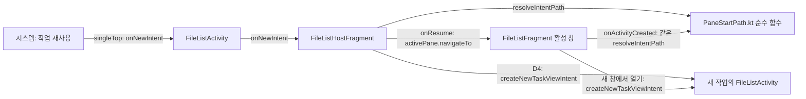

# HLD — 앱이 떠 있을 때 받은 경로 열기 (이슈 #80)

| 항목 | 내용 |
|---|---|
| 상태 | v1.2 수정(LLD 검수와 함께 재검수 대기), v1.1 검수 통과 |
| 근거 | SRS v1.3 (`docs/design/80-view-intent/SRS.md`), V0 기록(`_workspace/wo/80-view-intent/`) |

## 1. 구조 개요
기존 모듈 경계 안에서 끝낸다. `filelist/`의 화면 계층(Activity → Host → Pane)에 "받은 Intent" 경로를 하나 더하고, 시작 경로 규칙은 #11이 만든 순수 함수 파일(`PaneStartPath.kt`)에 모은다. `provider/`, 뷰모델의 이동 기록(`TrailData`), 저장 상태(#11)는 바꾸지 않는다. 새 모듈 경계는 없다.

## 2. 구성요소
| 구성요소 | 위치(패키지·파일) | 책임 | 추적 REQ |
|---|---|---|---|
| C1 시작 방식 | `app/src/main/AndroidManifest.xml:64-68` `FileListActivity` | `android:launchMode="singleTop"`을 더한다. 같은 작업의 맨 위가 `FileListActivity`이면 시스템이 새 화면을 쌓지 않고 `onNewIntent`로 넘긴다. root intent와 같든(1.2 ③ (a)) 다르든((b)) 같은 결과라 V0 결과에 기대지 않는다. | REQ-80-01 |
| C2 Activity 전달 | `filelist/FileListActivity.kt` | `onNewIntent(intent)`를 재정의해 `fragment.onNewIntent(intent)`로 넘긴다. `setIntent`는 부르지 않는다(D5). | REQ-80-01, 07 |
| C3 Host 처리 | `filelist/FileListHostFragment.kt` | `onNewIntent(intent)`: Intent를 분류한다(C4). ① 선택 모드 Intent이거나 경로가 없으면 아무것도 하지 않는다. ② 이 화면이 선택 모드 화면이면(`viewModel.isDualPaneEnabled == false`, `FileListHostFragment.kt:115-116`) 경로를 바꾸지 않고 D4대로 C7의 Intent로 새 작업에 둘러보기 화면을 연다. ③ 둘러보기 화면이면 경로를 보류 값으로 두었다가 `onResume`에서 `activePane.navigateTo(path)`와 `closeNavigationDrawer()`를 부른다. 탐색 서랍의 책갈피 선택과 같은 경로다(`FileListHostFragment.kt:350-352`, `369-371`). D4의 새 작업 시작을 `onNewIntent`에서 할지 `onResume`에서 할지(백그라운드 액티비티 시작 제한)는 LLD에서 정한다. | REQ-80-01, 02, 03, 04, 05, 06 |
| C4 Intent 경로 규칙 | `filelist/PaneStartPath.kt`(기존, #11) | 두 순수 함수를 더한다. `isPickAction(action: String?): Boolean`은 지금 두 곳에 나뉜 선택 모드 판정(`FileListHostFragment.kt:276-281`, `FileListFragment.kt:298-327`)을 하나로 모은다. `resolveIntentPath(action, path, mimeType, downloadsPath: () -> Path): Path?`는 `FileListFragment.kt:335-349`의 선택 모드가 아닌 갈래(다운로드 폴더, 압축 루트 `createArchiveRootPath`)를 그대로 옮긴다. 둘 다 파일 시스템 입출력이 없다(`isArchiveFile`은 MIME 판정뿐, `PathExtensions.kt:22`). | REQ-80-01, 04, 08 |
| C5 창 시작 경로 | `filelist/FileListFragment.kt:295-354` | 시작 경로 계산의 선택 모드가 아닌 갈래를 C4 호출로 바꾼다(동작 불변). `resolvePaneStartPath`의 우선순위(복원 > Intent > 기본, `PaneStartPath.kt:22-26`)는 그대로다. 이 우선순위가 받은 경로를 연 뒤의 #11 복원을 지킨다. | REQ-80-03, 07, 08 |
| C7 새 작업 Intent | `filelist/FileListActivity.kt:75-80` companion | `createNewTaskViewIntent(path)`(이름은 LLD에서 확정)를 더한다. `createViewIntent(path)`에 `FLAG_ACTIVITY_NEW_DOCUMENT\|FLAG_ACTIVITY_MULTIPLE_TASK\|FLAG_ACTIVITY_PREVIOUS_IS_TOP`을 단다. "새 창에서 열기"(`FileListFragment.openInNewTask`, `FileListFragment.kt:977-981`)와 D4가 이 하나를 쓴다. `FLAG_ACTIVITY_PREVIOUS_IS_TOP`이 없으면 `singleTop`에서 이 시작이 보낸 화면 자신의 `onNewIntent`로 넘겨진다(D7). | REQ-80-05, 06 |
| C6 검증 | `app/src/test/.../filelist/PaneStartPathTest.kt`(기존) | C4의 JUnit: 폴더 VIEW·압축 VIEW·`ACTION_VIEW_DOWNLOADS`·선택 모드 4종·`ACTION_MAIN`·경로 없는 VIEW | REQ-80-08 |

## 3. 데이터 흐름·상태
1. **받기**
   - 시스템이 맨 위의 `FileListActivity`에 `onNewIntent`를 부른다. 문서상 그 전에 화면은 `onPause` 상태가 되고, 뒤에 `onResume`이 온다.
   - C2는 그 Intent를 C3로 넘긴다.
   - C3는 C4로 경로를 구해 Host 필드 `pendingIntentPath: Path?`에 둔다. 메인 스레드에서 입출력 없이 끝난다.
2. **적용**
   - Host `onResume`에서 보류 값이 있으면 꺼내 비우고 `activePane.navigateTo(path)`를 부른다.
   - `onResume`까지 미루는 이유가 있다. `FileListFragment.navigateTo`는 뷰에 묶인 `layoutManager`(`FileListFragment.kt:173`, `254`)를 쓴다. 시스템 복원 직후에는 창 뷰가 만들어지기 전에 `onNewIntent`가 올 수 있다고 가정했다. `onResume` 적용은 순서와 상관없이 안전하다.
   - V0(API 36 AVD, `singleTop` 시험 빌드)에서 본 순서: 떠 있을 때 onPause → onNewIntent → onResume, 백그라운드에서 onStart → onNewIntent → onResume, 프로세스 종료 뒤 onCreate(저장 상태 있음) → onStart → onNewIntent → onResume. 어느 경우든 `onNewIntent` 때 Host 수명주기는 STARTED(`isResumed == false`)이고 Host 뷰는 이미 있었다. 다른 버전은 미확인이라 `onResume` 적용을 유지한다.
   - 활성 창은 `viewModel.activePane` 그대로다. 다른 창에는 아무 호출도 없다(REQ-80-02).
3. **뒤로 가기**
   - `navigateTo`는 `TrailData.navigateTo`(`TrailData.kt:18-41`)로 이동 기록을 그 경로의 상위 폴더 목록으로 만든다. 앞부분이 같으면 경로 표시줄 아래 단계와 스크롤 위치가 남는다.
   - 뒤로 가기는 기존 `navigateUp`(`FileListFragment.kt:274-285`)이 그대로 맡는다(REQ-80-03).
4. **오류**
   - 경로를 읽을 수 없으면 기존 목록 읽기(비동기)가 실패를 내고 `onFileListChanged`(`FileListFragment.kt:778-805`)가 오류를 보인다(REQ-80-04).
   - 경로가 없으면 ①에서 끝나므로 화면이 바뀌지 않는다.
5. **상태 저장**
   - 보류 값은 저장하지 않는다. `onNewIntent`와 `onResume` 사이에 상태 저장이 끼는 일은 정상 수명주기에 없다.
   - 적용 뒤의 경로는 #11의 창 경로 저장(`FileListFragment.kt:200-208`)이 그대로 맡으므로, 나중에 복원하면 받은 뒤의 경로가 돌아온다(REQ-80-07).

## 4. 외부 인터페이스
- **Manifest**: `FileListActivity`에 `launchMode="singleTop"`(C1). Intent 필터·새 Intent 종류는 바꾸지 않는다(SRS 1.4).
- **Intent별 결과**: 아래 판단은 AOSP 작업 재사용 규칙에 기댄 것이다. "새 창에서 열기"·폴더 바로 가기 행은 V0(API 36)에서 확인했고, 나머지와 다른 버전은 미확인이라 SRS 4.2 V4·V5에서 확인한다(R1·R4·R5).

  | Intent | 결과 |
  |---|---|
  | 실행기 `ACTION_MAIN` | 이제 `onNewIntent`로 오지만 C3 ①에서 무시한다. 화면은 그대로다(REQ-80-06). |
  | 앱 안 "새 창에서 열기"(`FLAG_ACTIVITY_NEW_DOCUMENT\|FLAG_ACTIVITY_MULTIPLE_TASK`) | 지금 플래그 그대로면 `singleTop`에서 새 작업이 생기지 않고 보낸 화면 자신의 `onNewIntent`로 넘겨진다(V0: `result code=3`, `sr=`자기 자신). 시스템은 맨 위 넘기기를 판단할 때 `NEW_TASK`·`MULTIPLE_TASK`와 상관없이 포커스 작업의 맨 위를 보기 때문이다. 그대로 두면 C3가 그 경로를 활성 창에 열어 REQ-80-06이 깨진다. 그래서 C7로 `FLAG_ACTIVITY_PREVIOUS_IS_TOP`을 더한다. 더하면 새 작업이 생긴다(V0: `result code=0`, 최근 앱에 작업 하나 추가). |
  | 폴더 바로 가기(`FLAG_ACTIVITY_CLEAR_TASK`) | 작업을 지우고 새로 만들므로 영향이 없다(V0, `-f 0x10008000`: 새 인스턴스가 생기고 이전 것은 없어짐). |
  | `FLAG_ACTIVITY_NEW_TASK` 없이 다른 앱이 보낸 Intent | 보낸 앱의 작업 맨 위가 그 앱이라 영향이 없다(SRS 1.2 ④, V0에서 재현 못 함: `am start`는 늘 `NEW_TASK`를 단다. 미확인). |
  | 결과를 바라는 선택 모드 시작(`startActivityForResult`·`registerForActivityResult`) | `singleTop`이어도 맨 위 인스턴스로 넘겨지지 않고 새 화면이 열린다(AOSP `ActivityStarter`는 맨 위로 넘길 때 `resultTo == null`을 요구한다). 이 앱의 선택 모드 계약(`FileListActivity.OpenFileContract` 등)을 부르는 곳은 `FileListActivity` 밖의 화면이다(`PathPreference.kt:27`, `EditSftpServerFragment.kt:47`, `EditBookmarkDirectoryDialogFragment.kt:34`는 `EditBookmarkDirectoryDialogActivity` 안). |

- **권한·설정 키·파일 형식**: 새로 없다.

## 5. 설계 결정
| 결정 | 대안 | 고른 이유 |
|---|---|---|
| D1 `launchMode="singleTop"` + `onNewIntent` | (가) `singleTask`/`singleInstance` (나) 표준 모드 유지 후 새로 쌓인 화면이 이전 화면에 경로를 넘기고 스스로 끝냄 (다) 다른 앱이 보낼 때 `FLAG_ACTIVITY_SINGLE_TOP`을 달기 | (가)는 "새 창에서 열기"의 여러 작업과 다른 앱 작업에 뜨는 화면(SRS 1.2 ④) 동작을 바꾼다. (나)는 (a)(같은 Intent)에서 시스템이 아무 화면도 만들지 않아 고칠 수 없다. (다)는 보내는 쪽을 이 앱이 정할 수 없다. `singleTop`은 (a)·(b)를 모두 `onNewIntent` 하나로 모으고, 결과를 바라는 시작과 다른 작업은 건드리지 않는다. |
| D2 적용은 Host `onResume`에서 | `onNewIntent`에서 바로 적용 | 창 뷰가 없을 때 `navigateTo`가 `layoutManager` 초기화 전 접근으로 죽을 수 있다고 가정했다. V0(API 36)에서는 세 경우 모두 `onNewIntent` 뒤에 `onResume`이 왔고 그때 Host는 resumed가 아니었다(3장 2). 다른 버전은 미확인이고 `onResume` 적용은 순서와 상관없이 안전해서 그대로 둔다. |
| D3 `navigateTo`(앱 안 이동과 같음) | `navigateToRoot`/`resetTo`(새로 연 것처럼 이동 기록을 다시 만듦) | SRS REQ-80-01은 활성 창 자신의 상태가 탐색 서랍의 책갈피 선택과 같게 바뀌기를 요구한다. 그 경로가 `navigateTo`다. 뒤로 가기 결과(상위 폴더)는 두 방식이 같다(REQ-80-03). 경로 표시줄 아래 단계를 남겨 앱 안 이동과 같게 둔다. |
| D4 선택 화면이 맨 위일 때는 새 작업으로 둘러보기 화면을 연다(C7 `createNewTaskViewIntent(path)`, "새 창에서 열기"와 같은 Intent) | (가) 무시 (나) 같은 작업에 쌓기 | (가)는 받은 경로가 보이지 않아 요구사항 2에 어긋난다. (나)는 `singleTop`에서 같은 컴포넌트를 다시 시작하면 그 선택 화면에 다시 넘겨져 쌓을 수 없다. 앱에 이미 있는 "새 창에서 열기" 방식이라 새 동작을 만들지 않는다. 경로는 C4로 이미 정해졌으므로 Intent는 C7로 다시 만든다. 그래서 압축 루트 경로도 그대로 간다. `FLAG_ACTIVITY_PREVIOUS_IS_TOP`이 없으면 선택 화면 자신에게 다시 넘겨진다(V0 시험 빌드에서 `onNewIntent`에서 시작했을 때 여러 번 되풀이됨). 붙이면 떠 있을 때와 백그라운드 모두 새 작업이 생겼다(V0, `BAL_ALLOW_VISIBLE_WINDOW`). 새 작업 시작을 `onNewIntent`에서 할지 `onResume`에서 할지는 LLD에서 정한다(C3). |
| D7 새 작업 Intent에 `FLAG_ACTIVITY_PREVIOUS_IS_TOP`(C7) | (가) `singleTop`을 빼고 다른 방법(D1의 대안) (나) 새 작업을 다른 컴포넌트(별칭·중계 화면)로 시작 (다) Manifest `documentLaunchMode` | 이 플래그는 "지금 화면을 맨 위로 치지 않고 맨 위 넘기기를 판단한다"는 공개 API 문서 그대로의 용도라, 이 시작 하나만 `singleTop` 넘기기에서 뺀다. (가)는 D1 이유로 안 된다. (나)는 새 컴포넌트와 그 Intent 필터·복원 경로가 늘고, 이미 만든 작업의 동작이 바뀐다. (다)는 모든 시작에 적용돼 다른 Intent의 작업 규칙이 바뀐다. 두 시작 지점이 한 팩토리를 써서 플래그가 어긋나지 않게 한다. |
| D5 `setIntent`를 부르지 않음 | `setIntent(intent)` | `getIntent()`는 처음 만들 때(`FileListActivity.kt:31-33`)와 이전 버전 상태 복원(`:41-55`)에서만 읽힌다. 복원 때는 저장 경로가 Intent보다 앞선다(REQ-11-02). 처음 Intent를 그대로 두면 #11 복원 입력이 지금과 같아진다(REQ-80-07). 시스템이 복원 때 넘기는 Intent는 앱의 `setIntent`와 상관이 없다. |
| D6 규칙을 `PaneStartPath.kt`에 둠 | 새 파일 | #11이 시작 경로 규칙을 Android 없이 시험하려고 만든 파일이다(`PaneStartPath.kt:15`). 같은 규칙의 다른 입력이라 한곳에 둔다. `Environment` 호출은 `downloadsPath` 인자로 밖에 둔다. |

## 6. 위험과 미결 사항
| ID | 위험·미결 | 대응 |
|---|---|---|
| R1 | 결과를 바라는 시작이 `singleTop`에서 맨 위 인스턴스로 넘겨지지 않는다는 판단은 AOSP 코드 기억에 따른 것이다(미확인). minSdk 23~ 전 버전에서 같은지도 미확인이다. | LLD 단계 V4에서 확인한다. 앱 안 경로 고르기(설정 기본 디렉터리, SFTP 키 파일, 책갈피 폴더)가 지금처럼 결과를 돌려주는지 본다. 지금 `FileListActivity` 안에서 선택 계약을 부르는 곳은 없다(4장). 그래서 넘겨지더라도 영향받는 경로는 다른 앱이 이 앱 작업에 `NEW_TASK`로 선택 Intent를 보내는 경우뿐이고, 그때 시스템은 결과를 바로 취소한다. |
| R2 | SRS 1.2 ③ (a)·(b)·④와 표준 모드의 `onNewIntent` 여부(V0). | V0(API 36)로 대부분 풀렸다. (a) 같은 VIEW를 떠 있을 때 보내면 `am`은 "delivered to currently running top-most instance"를 찍지만 표준 모드에서는 `onNewIntent`가 불리지 않는다(아무것도 안 움직였을 때의 반환값). 백그라운드에서 root intent와 같은 VIEW는 작업만 앞으로 온다. (b) 다른 VIEW는 같은 작업에 새 화면을 쌓는다. `singleTop`에서는 네 경우 모두 한 인스턴스의 `onNewIntent`로 온다. ④는 다른 앱이 필요해 재현하지 못했다(미확인). D1은 ④ 결과에 기대지 않는다. |
| R3 | 화면이 `onPause` 없이 `onNewIntent`를 받는 기기·버전이 있으면 D2의 적용이 다음 `onResume`까지 늦어진다. | 이미 resumed이면 바로 적용하도록 LLD에서 Host 수명주기 상태(`isResumed`)를 본다. 뷰가 있을 때만 바로 적용한다. |
| R5 | `FLAG_ACTIVITY_PREVIOUS_IS_TOP`(D7)의 동작은 API 36에서만 확인했다. minSdk 23~35는 미확인이다. 어떤 버전에서 이 플래그가 맨 위 넘기기를 막지 못하면 "새 창에서 열기"가 활성 창에서 경로를 여는 것으로 바뀌고(REQ-80-06), D4는 선택 화면이 받은 경로를 바꾸거나 되풀이할 수 있다(REQ-80-05). | V4에서 API 36 AVD로 "새 창에서 열기"와 D4를 확인한다. 다른 버전은 남은 위험으로 둔다. D4가 되풀이되지 않도록 LLD는 C3가 "새 작업 Intent로 다시 받은 경우"를 가려낼 수 있게 할지 정한다. |
| R4 | `launchMode` 변경은 Manifest 수준이라 Intent를 보내는 앱 쪽의 모든 경로에 영향이 있다. 4장 표의 판단은 미확인이다. | 4장 표의 각 행을 V1~V5로 수동 확인한다(SRS 4.2). |

## 7. 변경 이력
| 일자 | 버전 | 변경 | 사유 | 요청자 |
|---|---|---|---|---|
| 2026-11-20 | v1 | 최초 작성 | SRS v1.2 | PM |
| 2026-11-20 | v1.1 | HLD 검수 1회차 경미 반영: 2장 C3·C5 추적 열에 REQ-80-03·07, 3장·D2 수명주기 순서를 가정(미확인)으로, D4 시작 시점은 LLD로, 4장 표 미확인 표시와 V4·V5 연결 | HLD 검수 1회차(PR #85) | 검수팀 |
| 2026-11-20 | v1.2 | C7 새 작업 Intent(`FLAG_ACTIVITY_PREVIOUS_IS_TOP`, "새 창에서 열기"·D4 공용) 추가, D7·R5 추가, 4장 "새 창에서 열기"·폴더 바로 가기·④ 행 정정, 3장 2·D2·R2에 V0 결과, D4를 C7로 | LLD V0에서 `singleTop` 때 "새 창에서 열기"가 보낸 화면 자신에게 넘겨지는 결함 발견(`newwin_S.txt`, `newwin_S2.txt`, `d4_fg.txt`, `d4_S2.txt`) | 개발팀 |
