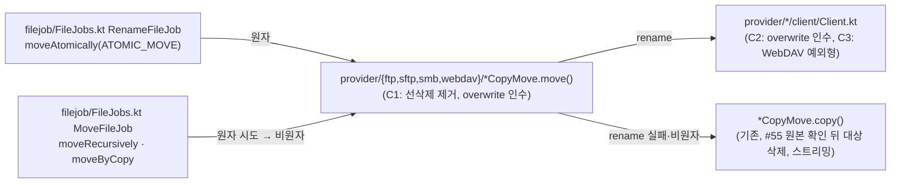

# HLD — 네트워크 이동·이름 바꾸기: rename과 MOVE 구분, 바꾸기 이동의 대상 선삭제 없애기 (이슈 #95)

| 항목 | 내용 |
|---|---|
| 상태 | 검수 통과(v2.5). LLD는 개발팀 |
| 근거 | SRS v2.4(오너 rename/MOVE 구분, "사본 남기기", "모든 이동에 적용" 결정 2026-11-20 반영) |
| 기준 코드 | `origin/develop` 9374221. 경로는 `app/src/main/java/me/zhanghai/android/files/` 기준 |

## 1. 구조 개요

기존 모듈 경계 안에서 `provider/`만 고친다. `filejob/`은 바꾸지 않는다. 새 모듈·새 인터페이스 없음.

- **이름 바꾸기**: 바꾸지 않는다. 원자 경로가 이미 대체 없이 끝난다(SRS 1.4-1). C1의 변경은 원자 경로의 동작을 바꾸지 않는다(이름 바꾸기에는 `REPLACE_EXISTING`이 없어 덮어쓰기도 꺼진다).
- **이동**: 층 1(`move()`의 rename 실패 → `copy()` + 원본 삭제)과 층 2(`FileJobs.kt` `moveRecursively`)의 대체를 그대로 둔다(SRS REQ-95-02). 바뀌는 것은 바꾸기 이동의 순서와 rename 인수뿐이다.
- v1.x HLD의 `ServerRenameScope`(같은 서버 판정 인터페이스)와 `FileJobs.kt` 폴더 처리 변경(C6)은 쓸 곳이 없어져 **뺀다**.

## 2. 구성요소

| 구성요소 | 위치(패키지·파일) | 책임 | 추적 REQ |
|---|---|---|---|
| C1 제공자 `move()` 4개 | `provider/ftp/FtpCopyMove.kt:146`, `provider/sftp/SftpCopyMove.kt:241`, `provider/smb/SmbCopyMove.kt:169`, `provider/webdav/WebDavCopyMove.kt:157` | (1) 바꾸기일 때 rename 앞에서 대상을 지우는 블록을 없앤다(FTP `:166-170`, SFTP `:275-279`, SMB `:198-202`, WebDAV `:177-181`). (2) rename에 `overwrite = 대상 있음 && copyOptions.replaceExisting`을 넘긴다. (3) 원자면 실패를 던지고, 비원자면 실패를 무시하고 대체 꼬리(옵션 보정 → `copy()` → 원본 삭제)로 가는 흐름은 그대로. (4) 원본 삭제 실패 시 대상 복사본을 지우는 되돌리기를 없앤다(FTP `:199-208`의 `:200-206`, SFTP `:308-317`의 `:309-315`, SMB `:233-242`의 `:234-240`, WebDAV `:210-219`의 `:211-217`) — 원본 삭제 예외를 그대로 던진다 | REQ-95-01, 02, 03, 04, 05, 07, 08, 09 |
| C2 클라이언트 rename | `provider/sftp/client/Client.kt:98`, `provider/smb/client/Client.kt:445`, `provider/webdav/client/Client.kt:113` | `overwrite: Boolean` 인수 추가. SFTP: `true`면 `SFTPClient.rename(old, new, setOf(RenameFlags.OVERWRITE))`, 아니면 지금 2인수 호출. SMB: `DiskEntry.rename(path, overwrite)`(지금 상수 `true`, `:469`). WebDAV: `DavResource.move(url, overwrite)`(지금 상수 `false`, `:118`). FTP `Client.renameFile`(`ftp/client/Client.kt:206`)은 그대로 — RNTO에는 덮어쓰기 지정 수단이 없어, 바꾸기 이동이면 기존 파일 위로 그냥 RNTO한다 | REQ-95-04 |
| C3 WebDAV 다른 서버 예외형 | `provider/webdav/client/Client.kt:114-116` | 다른 `Authority`일 때의 `IOException`을 `DavException`형(`IOException.toDavException()`, `webdav/client/DavIOException.kt:16`)으로 던져 `WebDavCopyMove.move`의 `catch (e: DavException)`(`:187`)에 걸리게 한다. 그러면 비원자 이동은 대체로, 원자 시도는 변환된 오류로 간다 — 다른 세 백엔드와 같다 | REQ-95-06 |
| C5 다른 이동 경로의 되돌리기 제거 | `provider/common/ForeignCopyMove.kt:164-186`, `provider/linux/LinuxCopyMove.kt:299-310`(루트도 같은 함수: `root/RootableFileSystemProvider.kt:104-106` → `linux/LocalLinuxFileSystemProvider.kt:225`), `provider/document/resolver/DocumentResolver.kt:374-383` | C1 (4)와 같은 변경: 원본 삭제 실패 `catch` 안의 대상 삭제를 없애고 지금 던지는 예외를 그대로 던진다. `ForeignCopyMove`는 `IOException` 분기(`:167-175`)와 `UnsupportedOperationException` 분기(`:178-184`) 둘 다. `LinuxCopyMove`는 `:302-308`, `DocumentResolver.moveByCopy`는 `:375-382`. 각 경로의 다른 동작(바꾸기 선삭제 등)은 그대로 | REQ-95-07, 08, 09 |
| C4 검증 코드 | `app/src/test/java/me/zhanghai/android/files/...`(JVM) | 6.1 표 | 전부 |

바꾸지 않는 곳: `filejob/FileJobs.kt` 전체 — `RenameFileJob`·`MoveFileJob`·`moveRecursively`·`copyOrMove`·`askCopyError`. 되돌리기에 해당하는 코드도 없다: 폴더 원본 삭제(`postVisitDirectory` `:1500-1510` → `delete()` 헬퍼 `:1348-`)는 실패 시 대상을 지우지 않는다. 그 밖에 바꾸지 않는 곳: 네 `copy()`와 `provider/common/SourceCheckedReplace.kt`, `ForeignCopyMove`·로컬·루트·SAF 제공자의 C5 밖 동작(바꾸기 선삭제 `LinuxCopyMove.kt:266-270`·`DocumentCopyMove.kt:94-103` 포함), 압축 제공자(읽기 전용), 내장 FTP 서버(`ftpserver/ProviderFtpFile.kt:168`, `Path.moveTo` 호출자 — 비원자 이동이라 바꾸기·덮어쓰기와 무관. C1 (4)·C5의 영향은 R6), 문자열.

## 3. 데이터 흐름·상태

### 3.1 C1 `move(source, target, copyOptions)` 흐름 (네 백엔드 공통)
1. 원본 정보 읽기(지금과 같음).
2. 대상 정보 읽기(지금과 같음). 대상이 있으면: 같은 파일이면 진행률만 올리고 끝. 바꾸기가 아니면 `FileAlreadyExistsException`. **바꾸기면 지우지 않고 다음으로**(변경).
3. `Client.rename/move(source, target, overwrite = 대상 있음 && replaceExisting)`(FTP는 인수 없음).
   - 성공: 진행률 올리고 끝.
   - 실패, 원자: 지금처럼 변환해 던진다(이름 바꾸기·`MoveFileJob` 원자 시도).
   - 실패, 비원자: 지금처럼 무시하고 4로.
4. 대체: 옵션 보정(`replaceExisting` 유지) → `copy(source, target, …)` → 원본 삭제. 원본 삭제가 실패하면 복사본은 남기고 그 예외를 던진다(변경, REQ-95-09). `NoSuchFileException`이면 지금처럼 그대로 던진다(지금도 이 경우는 되돌리지 않는다).
   - 바꾸기면 `copy()`가 대상이 아직 있음을 다시 보고, #55 C1/C2 순서로 처리한다: 일반 파일은 원본을 연 뒤(`replaceAfterOpeningSource`, `SourceCheckedReplace.kt:24`), 폴더는 원본 목록을 확인한 뒤(`replaceAfterCheckingSource`, `:57`) 대상을 지운다. 원본을 열 수 없으면 대상은 남고 오류(REQ-95-05).
   - 복사는 스트리밍이다(SRS 1.5). SMB 같은 세션이면 서버 안 복사.

### 3.2 경우별 결과
| 경우 | 지금 | 바뀐 뒤 |
|---|---|---|
| 이름 바꾸기, rename 성공/실패 | 성공 / 오류 창 | 같음 |
| 이동(같은·다른 서버), rename 성공 | 성공 | 같음 |
| 이동, rename 실패(같은 서버·FTP/SFTP/SMB 다른 서버) | 스트리밍 복사 + 원본 삭제 | 같음 |
| 이동, WebDAV 다른 서버(같은 scheme) | `IOException` 탈출 → 오류 창 | 스트리밍 복사 + 원본 삭제 |
| 바꾸기 이동, 서버 덮어쓰기 수락 | 대상 선삭제 → rename | 서버가 한 번에 바꿈 |
| 바꾸기 이동, 덮어쓰기 거절·미지원 → 대체 | 대상 선삭제 → rename 실패 → 복사 | rename 실패 → 복사(원본 연 뒤 대상 삭제) |
| 바꾸기 이동, 덮어쓰기 거절 + 원본 열기 실패 | 기존 대상 이미 없음 | 기존 대상·원본 그대로, 오류 창 |
| 일반 이동, 확인과 rename 사이에 대상이 생김(SMB) | 조용히 덮어씀 | rename 실패 → `copy()`가 대상 존재로 `FileAlreadyExistsException` → 충돌 창 |

### 3.3 층 2와 오류
- `FileJobs.kt`는 바뀌지 않는다. 바꾸기 이동은 지금처럼 충돌 창 "교체" → `REPLACE_EXISTING`으로 `moveTo`(`FileJobs.kt:1695`, `:1719`) → C1. 남는 오류는 `copyOrMove`의 `askCopyError`(항목 단위, Q3 (가)).
- 스레드: `FileJobService` 작업 스레드 동기 호출. 새 스레드·상태 없음. 취소(`InterruptedIOException`)는 기존 경로 그대로.

## 4. 외부 인터페이스
- 화면·문자열·설정·권한: 변화 없음.
- 서버 요청 변화:
  - 바꾸기 이동: 지금 "대상 삭제 요청 → rename 요청"이 "덮어쓰기 rename 요청"으로 바뀐다. 거절되면 그 뒤 "원본 읽기 열기 → 대상 삭제 → 쓰기"(지금 `copy()` 순서).
  - SFTP 덮어쓰기: sshj가 v5+면 플래그, v3이고 `posix-rename@openssh.com`을 알리면 그 확장, 아니면 요청 없이 실패 → 대체.
  - SMB 일반 이동: ReplaceIfExists `true` → `false`.
  - WebDAV 바꾸기 이동: `Overwrite` 헤더 생략(=T). 그 밖은 지금처럼 `Overwrite: F`.
  - WebDAV 다른 서버 이동: MOVE 요청 없이(지금도 없음) 대체 복사로.

## 5. 설계 결정

| 결정 | 대안 | 고른 이유 |
|---|---|---|
| D1 `filejob/`을 고치지 않는다 | 이동·이름 바꾸기를 작업 단계에서 구분하는 새 분기 | 구분은 이미 있다: 이름 바꾸기는 원자 경로만(`RenameFileJob`), 이동은 원자 시도 뒤 대체(`MoveFileJob`). 오너 규칙이 지금 구조와 맞으므로 바꿀 이유가 없다 |
| D2 바꾸기의 기존 대상 삭제를 `copy()`에 맡긴다 | `move()`에서 rename 실패 뒤 원본 확인하고 직접 삭제 | `copy()`는 #55 C1/C2로 이미 원본 확인 뒤 삭제를 하고 시험도 있다(`app/src/test/.../provider/common/SourceCheckedReplaceTest.kt`). 같은 일을 두 곳에 두지 않는다 |
| D3 덮어쓰기는 `replaceExisting && 대상 있음`일 때만 | 바꾸기면 늘 / 늘(SMB 지금) | 일반 이동·이름 바꾸기에서 조용한 덮어쓰기 경쟁을 만들지 않는다(SRS REQ-95-04). 대상이 없으면 필요 없다 |
| D4 WebDAV는 `Client.move`의 예외형을 고친다 | `WebDavCopyMove.move`에서 `IOException`도 잡기 | 다른 `Client` 메서드들은 `IOException`을 `toDavException()`으로 바꿔 던진다(예: `webdav/client/Client.kt:119-121`). 한 줄로 같은 규칙에 맞추면 호출자 모두가 고쳐진다 |
| D5 `ServerRenameScope`·`FileJobs` 폴더 처리 변경을 뺀다 | v1.1 HLD 유지 | 이동은 같은 서버라도 대체를 유지하므로(오너 2026-11-20) 같은 서버 판정이 쓰일 곳이 없다 |

## 6. 위험과 미결 사항
- **R1 실서버 미확인**: 서버별 덮어쓰기 rename 동작(FTP RNTO, SMB 폴더 대상, WebDAV 서버 구현, SFTP 확장)은 실기로 확인하지 못했다. 어느 경우든 결과는 "서버가 바꿈" 또는 "대체 복사(#55 순서)"다.
- **R2 SMB 일반 이동의 동작 변화**: ReplaceIfExists를 일반 이동에서 끄면, 확인과 rename 사이에 대상이 생긴 드문 경우 덮어쓰던 것이 충돌 창으로 바뀐다(3.2 마지막 줄). 의도된 변화(D3).
- **R3 대체 뒤 원본 삭제 실패 → 복사본 유지(C1 (4))**: 대상에 새 내용, 원본도 남는다. 내용 손실은 없고 같은 파일이 두 곳에 있게 된다. 사용자는 오류 창(재시도·건너뛰기·취소)을 본다. "재시도"를 고르면 `copyOrMove`가 같은 옵션으로 다시 `moveTo`를 부른다(`FileJobs.kt:1759-1763`): 일반 이동이면 대상이 이제 있으므로 `FileAlreadyExistsException` → 충돌 창, 바꾸기 이동이면 다시 덮어쓰기 rename/대체 → 원본 삭제를 한 번 더 시도한다. 새 분기 없이 기존 흐름으로 처리된다. 끝 알림의 정리 실패 목록(`cleanupFailures`)에는 들어가지 않는다(그 목록은 실패한 복사의 부분 대상용, `CleanupFailureCopyOption`).
- **R4 FTP 바꾸기 이동의 서버 의존**: 덮어쓰기를 하는 FTP 서버는 RNTO로 끝나고, 거절하는 서버는 대체 복사로 간다. 어느 서버가 어느 쪽인지 미리 알 수 없지만 결과는 둘 다 이동 성공(대체가 되면)이다.
- **R5 WebDAV 업로드 본문(기존 동작)**: 대체 복사의 업로드는 길이 없는 one-shot 본문(`DavResourceCompat.kt:64-`, okio `Pipe`)이라 일부 서버가 거절할 수 있다. 그러면 대체 복사가 실패하고 오류 창으로 간다(REQ-95-07). 지금과 같고 이 작업에서 바꾸지 않는다(미확인).
- **R6 비원자 폴더 이동의 대체(내장 FTP 서버 경로)**: `MoveFileJob`은 폴더를 제공자 `move()`로 옮기지 않지만(`copyForMove` 경로), 내장 FTP 서버의 `Path.moveTo`는 폴더도 제공자 비원자 `move()`로 보낸다. rename이 실패하면 `copy()`가 빈 폴더만 만들고 원본 폴더 삭제는 비어 있지 않아 실패한다. 지금은 빈 폴더를 되돌려 지우지만 C1 (4) 뒤에는 대상에 빈 폴더가 남는다. 공유 대상이 로컬·루트·SAF 경로이거나 공급자가 다른 이동이어도 C5 때문에 같다(빈 대상 폴더가 남음). 드문 경로이고 손실은 없다.
- **R7 폰 안 이동의 동작 변화(C5)**: 로컬·루트·SAF 이동에서 rename/`moveDocument`가 안 돼 복사로 대신하고 원본 삭제만 실패하면(예: 쓰기 금지 SD카드 원본, 삭제 권한 없는 문서 제공자), 지금은 사본을 지우지만 바뀐 뒤에는 대상에 사본이 남고 오류 창이 뜬다. 오너 결정("모든 이동에 적용")대로의 변화다. R3의 재시도 흐름이 같게 적용된다. 폴더는 `MoveFileJob`이 제공자 `move()`로 보내지 않으므로 이 변화는 파일에 해당하고, 내장 FTP 서버 경로의 폴더는 R6(빈 폴더가 남음, 손실 없음)이다.
- 미결 없음(ForeignCopyMove 포함 여부는 오너 결정 "모든 이동에 적용"으로 닫힘).

### 6.1 검증 계획
| 대상 | 방법 | REQ |
|---|---|---|
| 이름 바꾸기 불변 | 코드 검사: 네 `move()`의 원자 경로(SRS 1.4-1 표)가 rename 실패 시 던지고 `copy()`에 닿지 않는다. 덮어쓰기 인수가 원자 이름 바꾸기에서 `false`(바꾸기 아님) | REQ-95-01 |
| 이동 대체 유지 | 코드 검사: 비원자 rename 실패 뒤 `copy()`+원본 삭제가 남아 있다. `FileJobs.kt` diff 없음 | REQ-95-02, 07 |
| 선삭제 제거·순서 | 코드 검사: 네 `move()`의 rename 앞에 `Client.delete`/`remove` 없음. 단위 테스트(가능하면): 흐름 결정을 순수 함수로 떼면(LLD) "바꾸기·대상 있음 → 삭제 없이 overwrite=true rename" 시험 | REQ-95-03 |
| 덮어쓰기 인수 | 코드 검사: `overwrite`가 `대상 있음 && replaceExisting`에서만 참. SFTP 3인수·SMB·WebDAV 전달. 순수 함수로 떼면 진리표 시험 | REQ-95-04 |
| 대체의 #55 순서 | 코드 검사: 대체가 기존 `copy()`를 그대로 부른다. 기존 `SourceCheckedReplaceTest`가 순서를 덮는다 | REQ-95-05 |
| 복사본 유지 | 코드 검사: C1 (4)의 네 곳과 C5의 세 곳(`ForeignCopyMove` 두 분기 포함)의 원본 삭제 `catch`에 대상 삭제가 없고 원본 삭제 예외를 그대로 던진다. 단위 테스트: `ForeignCopyMove`는 기존 `app/src/test/.../provider/common/ForeignCopyMoveCleanupTest.kt`와 같은 방식으로 "원본 삭제 실패 → 대상 남음" JVM 시험. 네트워크 네 곳은 흐름을 순수 함수로 떼면 시험(LLD에서 판단). 수동: 로컬은 기기에서 확인 가능(설치 전 오너에게 묻기), 서버는 미확인 | REQ-95-09 |
| WebDAV 예외형 | 코드 검사: `Client.move`의 다른 서버 예외가 `DavException`형. 경로 객체를 JVM에서 만들 수 있으면 단위 테스트(LLD에서 판단) | REQ-95-06 |
| 회귀 | `./gradlew assembleDebug`와 기존 JVM 테스트 전부 통과 | REQ-95-08 |
| 실서버 | 수동(미확인): 바꾸기 이동(덮어쓰기 수락 서버/거절 서버), WebDAV 두 서버 사이 이동, SMB 일반 이동. 서버가 없어 이번에는 하지 않음 | — |

## 7. 변경 이력
| 일자 | 버전 | 변경 | 사유 | 요청자 |
|---|---|---|---|---|
| 2026-11-20 | 1.0 | 최초 작성 | SRS v1.2 검수 통과·오너 결정 | PM |
| 2026-11-20 | 1.1 | R6·Q4(구조상 rename 불가 경우) 추가, C3 추적에 REQ-95-02, 6.1에 메시지 보존 시험, 내장 FTP 서버 호출자 명시, 근거 행 정정 | HLD 검수 반려(중요 1, 경미 4, PR #96) | 검수팀 |
| 2026-11-20 | 1.1 | 상태 행 갱신 | 2회차 검수 경미 1 | 검수팀 |
| 2026-11-20 | 2.0 | SRS v2.0에 맞춰 다시 씀: 이동 대체 유지로 `ServerRenameScope`·`FileJobs` 폴더 처리 변경·Q4 삭제. 구성요소를 C1 `move()` 선삭제 제거와 overwrite 인수, C2 클라이언트 인수, C3 WebDAV 예외형, C4 시험으로 정리 | 오너 2026-11-20 rename/MOVE 구분(#95 코멘트) | PM(오너 결정 전달) |
| 2026-11-20 | 2.1 | C1 추적에 REQ-95-07(남는 오류가 기존 오류 창으로 감), R5 WebDAV 업로드 본문 위험 추가 | v2.0 검수 조건부 통과 경미 2·참고(PR #96) | 검수팀 |
| 2026-11-20 | 2.2 | C1 (4) 원본 삭제 실패 시 되돌리기 제거, 3.1-4 갱신, R3를 새 동작(재시도 흐름 포함)으로 교체, R6(내장 FTP 서버 폴더 이동)·미결(ForeignCopyMove 범위) 추가, 6.1 검증 행 추가 | 오너 원문 2026-11-20: "사본 남기기 (추천)". PM 요약(#95 코멘트): 대체 복사가 성공하고 원본 삭제만 실패하면 대상의 사본을 남기고 원본 삭제 오류를 알린다 | PM(오너 결정 전달) |
| 2026-11-20 | 2.3 | 2장 "바꾸지 않는 곳" 문장 괄호 정리와 FileJobs 인용 정정, 변경 이력 2.2의 오너 원문과 PM 요약 구분 | v2.2 검수 조건부 통과 경미 2건(PR #96) | 검수팀 |
| 2026-11-20 | 2.4 | C5(공급자 간·로컬·루트·SAF 이동의 되돌리기 제거) 추가, "바꾸지 않는 곳" 갱신, 미결 닫음, R7 추가, 6.1 복사본 유지 행 확장 | 오너 원문 2026-11-20: "모든 이동에 적용". PM 요약(#95 코멘트): 사본 남기기 규칙(REQ-95-09)을 복사로 대신하는 모든 이동에 적용, `ForeignCopyMove.move` 포함 | PM(오너 결정 전달) |
| 2026-11-20 | 2.5 | R6·R7과 2장 "바꾸지 않는 곳"에 C5 경로(로컬·루트·SAF·공급자 간)의 폴더 영향(빈 대상 폴더가 남음) 추가 | v2.4 검수 조건부 통과 경미 1(PR #96) | 검수팀 |
