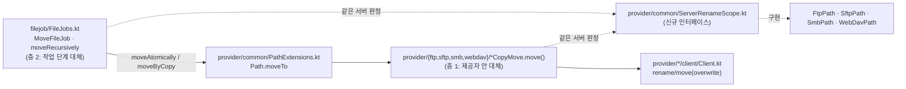

# HLD — 네트워크 같은 서버 안 이동: rename 실패 시 복사+삭제로 다시 시도하지 않기 (이슈 #95)

| 항목 | 내용 |
|---|---|
| 상태 | 검수 조건부 통과(v1.1). 6.0 Q4 오너 결정 대기 — 3.1-4·3.2·C3·C6의 LLD는 Q4 결정 뒤에 시작 |
| 근거 | SRS v1.3(v1.1 검수 통과, v1.2·v1.3 결정 기록은 이번 검수에서 함께 확인. 오너 결정 Q1 (가)·Q3 (가), PM Q2 범위 안) |
| 기준 코드 | `origin/develop` 9374221. 경로는 `app/src/main/java/me/zhanghai/android/files/` 기준 |

## 1. 구조 개요

기존 모듈 경계를 그대로 쓴다. 바뀌는 곳은 두 층이다.

- **층 1 (제공자, `provider/`)**: 네 `*CopyMove.move()`가 먼저 "같은 서버인가"를 판정한다. 같은 서버면 서버 rename 하나로 끝내고 실패하면 그 오류를 던진다(대체 없음). 다른 서버면 rename을 부르지 않고 바로 기존 `copy()` + 원본 삭제로 간다. 바꾸기 이동은 rename 전에 대상을 지우지 않고 서버의 덮어쓰기 rename을 쓴다.
- **층 2 (작업, `filejob/`)**: `moveRecursively`의 폴더 처리에서, 같은 서버 폴더의 rename이 "대상 있음" 외의 이유로 실패하면 `copyForMove`(대상에 폴더 만들고 들어가기)로 가지 않고 기존 오류 창(`askCopyError`)을 띄운다. 파일 처리는 바꾸지 않는다(층 1이 대체를 없애면 기존 경로가 그대로 오류 창에 닿는다, 3.2).
- **새 경계 하나**: `provider/common`에 같은 서버 판정 인터페이스 `ServerRenameScope`를 둔다. 이유: (1) 층 1과 층 2가 **같은 판정**을 써야 하고(둘이 어긋나면 한쪽만 대체하는 상태가 생김), (2) `filejob/`이 네 백엔드의 `internal` 경로 클래스·`Authority`를 직접 알지 않게 하고, (3) 이 인터페이스를 구현하지 않은 백엔드(로컬·루트·SAF·압축)는 자동으로 지금 동작을 유지한다(REQ-95-07).

## 2. 구성요소

| 구성요소 | 위치(패키지·파일) | 책임 | 추적 REQ |
|---|---|---|---|
| C1 `ServerRenameScope` | `provider/common/ServerRenameScope.kt`(신규) | `fun isInSameRenameScope(other: Path): Boolean` 하나. "서버 rename이 원리상 가능한 같은 서버"인지(SRS 1.6). 그리고 판정 헬퍼 `Path.isInSameRenameScope(other)`(구현하지 않은 경로는 `false`) | REQ-95-01, 02, 05, 07 |
| C2 경로 구현 | `provider/ftp/FtpPath.kt:29`, `provider/sftp/SftpPath.kt:27`, `provider/smb/SmbPath.kt:26`, `provider/webdav/WebDavPath.kt:28` | C1 구현: 같은 경로 클래스이고 `authority`가 같으면 `true`. SMB는 추가로 `sharePath?.name`이 같아야 한다(`smb/client/Client.kt:449-456`과 같은 기준). FTP의 `authority`는 protocol·mode·encoding까지 포함(`ftp/client/Authority.kt:16-21`) — 지금 `renameFile`의 기준(`ftp/client/Client.kt:207`)과 같다 | REQ-95-01, 05 |
| C3 제공자 `move()` 4개 | `provider/ftp/FtpCopyMove.kt:146`, `provider/sftp/SftpCopyMove.kt:241`, `provider/smb/SmbCopyMove.kt:169`, `provider/webdav/WebDavCopyMove.kt:157` | 3.1의 흐름으로 다시 짠다: 같은 서버면 rename만(실패 시 변환된 오류를 원자·비원자 모두 던짐), 다른 서버면 rename 없이 `copy()`+원본 삭제(원자 이동이면 `AtomicMoveNotSupportedException`). rename 전 대상 선삭제 제거 | REQ-95-01, 02, 03, 05, 06, 08 |
| C4 클라이언트 rename | `provider/sftp/client/Client.kt:98`, `provider/smb/client/Client.kt:445`, `provider/webdav/client/Client.kt:113`, `provider/ftp/client/Client.kt:206` | 덮어쓰기 여부 인수 `overwrite: Boolean`를 받는다. SFTP: `true`면 `SFTPClient.rename(old, new, setOf(RenameFlags.OVERWRITE))`, 아니면 지금 2인수 호출. SMB: `DiskEntry.rename(path, overwrite)` — 지금 상수 `true`(`:469`)를 인수로 바꿈. WebDAV: `DavResource.move(url, overwrite)` — 지금 상수 `false`(`:118`). FTP: 인수 없음(RNTO는 덮어쓰기 지정 수단이 없다, SRS 1.5) | REQ-95-06 |
| C5 WebDAV 다른 서버 예외 | `provider/webdav/client/Client.kt:114-116` | C3이 다른 서버면 `Client.move`를 부르지 않으므로 결함 경로가 없어진다. 남는 방어로 이 `IOException`을 `DavException`형(`toDavException()`, `webdav/client/DavIOException.kt:16`)으로 던져 `WebDavCopyMove`의 `catch`에 걸리게 한다 | REQ-95-05 |
| C6 작업 단계 폴더 처리 | `filejob/FileJobs.kt:1457-1474` `moveRecursively.preVisitDirectory` | 3.2: 같은 서버 폴더의 rename 실패(대상 있음 제외)는 `askCopyError`(재시도·건너뛰기·취소)로. 건너뛰면 `SKIP_SUBTREE`. 대상 있음이면 지금처럼 `copyForMove`(충돌 창·합치기) | REQ-95-02, 03, 04, 08 |
| C7 검증 코드 | `app/src/test/java/me/zhanghai/android/files/...`(JVM) | 5장 표 | 전부 |

바꾸지 않는 곳: `MoveFileJob.run`(`FileJobs.kt:1423-1446`), `moveRecursively.visitFile`(`:1477-1491`)·`postVisitDirectory`(`:1500-1510`), `copyOrMove`(`:1545-`), `ForeignCopyMove`, 로컬·루트·SAF·압축 제공자, 충돌·오류 창과 문자열. `Path.moveTo`의 또 다른 호출자인 앱 내장 FTP 서버(`ftpserver/ProviderFtpFile.kt:168`, 실패를 `false`로 돌려줌)도 코드는 바꾸지 않는다 — 공유 대상이 네트워크 경로일 때 같은 서버 대체가 없어지는 영향만 받는다(실패 시 FTP 클라이언트에 거절 응답).

## 3. 데이터 흐름·상태

### 3.1 층 1 — 제공자 `move(source, target, copyOptions)` (네 백엔드 공통 흐름)
1. 원본 정보 읽기(지금과 같음. 실패면 오류).
2. 대상 정보 읽기(지금과 같음). 대상이 있으면: 같은 파일이면 진행률만 올리고 끝(지금과 같음). 바꾸기가 아니면 `FileAlreadyExistsException`(지금과 같음).
3. `sameScope = source.isInSameRenameScope(target)`.
4. **같은 서버**: `overwrite = (대상 있음 && copyOptions.replaceExisting)`로 C4 rename 호출.
   - 성공: 진행률(원본 크기) 올리고 끝.
   - 실패: 지금 원자 경로가 쓰던 변환(FTP `toFileSystemExceptionForFtp(source, target)`, SFTP·WebDAV `toFileSystemException(source, target)`, SMB는 `maybeThrowAtomicMoveNotSupportedException`·`maybeThrowInvalidFileNameException` 뒤 `toFileSystemException`)으로 던진다. **원자·비원자 구분 없이** 같다. 복사·삭제 호출 없음. 대상은 건드리지 않았으므로 그대로 남는다.
5. **다른 서버**: 원자 이동이면 `AtomicMoveNotSupportedException(source, target, …)`를 던진다(rename 호출 없음). 아니면 지금 대체 꼬리(옵션 보정 → `copy()` → 원본 삭제, 실패 시 대상 정리)를 그대로 쓴다. 바꾸기면 기존 대상 삭제는 `copy()` 안의 "원본 확인 뒤 삭제"(#55 REQ-55-08, 예: `FtpCopyMove.kt:44-54`의 `deleteExisting` → `replaceAfterCheckingSource`/`replaceAfterOpeningSource`)가 맡는다 — `move()`에서 따로 지우지 않는다.

상태 변화 요약:

| 경우 | 지금 | 바뀐 뒤 |
|---|---|---|
| 같은 서버, rename 성공 | 성공 | 같음 |
| 같은 서버, rename 거절 | 복사+원본 삭제로 재시도 | 그 오류. 원본·대상 그대로 |
| 같은 서버, 바꾸기, 서버가 덮어쓰기 수락 | 대상 선삭제 → rename | 서버가 한 번에 바꿈 |
| 같은 서버, 바꾸기, 서버가 덮어쓰기 거절 | 대상 선삭제 → rename 실패 → 복사 | 오류. 기존 대상·원본 그대로 |
| 다른 서버(FTP·SFTP·SMB) | rename 실패 → 복사+삭제 | rename 없이 복사+삭제 |
| 다른 서버(WebDAV, 같은 scheme) | `IOException` 탈출 → 오류(SRS 1.4-4) | 복사+삭제 |

### 3.2 층 2 — 이동 작업
- `MoveFileJob.run`: 바뀌지 않는다. 원자 시도가 실패하면(같은 서버 거절 포함) 지금처럼 `sourcesToMove`에 넣고 스캔 뒤 `moveRecursively`로 간다. 오류 창에 진행 정보(`TransferInfo`)가 필요하기 때문이다.
- **파일**(`visitFile`): 바뀌지 않는다. `moveAtomically` 실패 → `moveByCopy` → `copyOrMove(useCopy=false)` → 제공자 비원자 `move()` → 3.1-4가 rename을 다시 시도하고 실패하면 오류를 던짐 → `copyOrMove`의 `catch (e: IOException)` → `askCopyError`(재시도·건너뛰기·취소). 대상이 있으면 `FileAlreadyExistsException` → 충돌 창 → 바꾸기면 `REPLACE_EXISTING`으로 다시 `move()` → 3.1-4 덮어쓰기 rename. rename이 원자 시도 포함 두 번 불리는 것은 SRS 1.4-2대로 무해하다.
- **폴더**(`preVisitDirectory`, C6): `moveAtomically` 실패 시
  - `FileAlreadyExistsException`이거나 같은 서버가 아니면(`!directory.isInSameRenameScope(directoryInTarget)`): 지금처럼 `copyForMove`(대상 폴더 만들기·충돌 창·합치기, REQ-95-04).
  - 같은 서버이고 다른 오류면: `askCopyError(e, directory, directoryInTarget, MOVE, canRetry = true, actionAllInfo)`.
    - 재시도: `moveAtomically`부터 다시(대상이 그 사이 생겼으면 위 첫 갈래로).
    - 건너뛰기: `transferInfo.skipFile(directory)`·알림 갱신 후 `SKIP_SUBTREE`. `walkFileTree`는 `SKIP_SUBTREE`를 돌려준 폴더의 `postVisitDirectory`를 부르지 않으므로 원본 폴더는 지워지지 않는다(지금 성공 경로 `:1463-1465`도 같은 성질에 기댐).
    - 취소: `canceledByUser()`.
  - `InterruptedIOException`은 지금처럼 즉시 다시 던진다(REQ-95-08).
- 합치기 중 자식 하나를 건너뛰면 원본 폴더가 비지 않아 `postVisitDirectory`의 삭제가 실패하고 지금의 삭제 오류 처리로 간다(지금과 같은 동작, 변경 없음).
- 스레드·수명주기: 지금처럼 `FileJobService`의 작업 스레드에서 동기 호출. 새 스레드·상태 없음.

### 3.3 오류 전파
- 사용자에게 보이는 문구는 지금 오류 창(`file_job_move_error_message_format`)에 `e.toString()`(`FileJobs.kt:1806`)이 들어간다. 3.1-4가 rename 예외를 감싸지 않고 기존 변환 그대로 던지므로 서버 응답에서 온 메시지가 그대로 보인다(REQ-95-03). 새 예외형·새 문자열 없음(Q3 (가)).

## 4. 외부 인터페이스
- 사용자 화면·문자열·설정 키·권한: 변화 없음.
- 서버로 가는 요청:
  - SFTP: 바꾸기 이동일 때만 `OVERWRITE` 플래그 → sshj가 v5+면 플래그, v3에서 `posix-rename@openssh.com`을 알리는 서버면 그 확장, 아니면 요청 없이 `SFTPException`(SRS 1.5).
  - SMB: `FileRenameInformation.ReplaceIfExists`가 바꾸기 이동일 때만 `true`(지금은 항상 `true`). 일반 이동에서 확인과 rename 사이에 생긴 대상을 덮어쓰던 경쟁이 없어지고 서버 오류로 바뀐다.
  - WebDAV: 바꾸기 이동일 때만 `Overwrite` 헤더 생략(=T), 그 밖에는 지금처럼 `Overwrite: F`.
  - FTP: 바꾸기 이동이면 기존 파일 위로 RNTO(지금은 DELE 뒤 RNTO).
  - 다른 서버 이동: rename 요청을 보내지 않는다(지금은 FTP·SFTP·SMB가 클라이언트 쪽에서 미리 실패시켜 요청은 원래 없음 — 차이 없음).

## 5. 설계 결정

| 결정 | 대안 | 고른 이유 |
|---|---|---|
| D1 같은 서버 판정을 `provider/common` 인터페이스(C1)로 두고 네 경로가 구현 | (a) `FileJobs`가 scheme·`Authority`를 직접 비교 (b) 같은 서버 거절을 새 예외형으로 감싸 `FileJobs`가 예외형으로 판단 | (a)는 `filejob/`이 `internal` 클래스에 기대고 SMB 공유 규칙을 중복한다. (b)는 `e.toString()`이 오류 창에 그대로 나가므로(3.3) 사용자 문구가 바뀌고, 기존 변환 예외형(`AccessDeniedException` 등)을 잃는다. C1은 층 1·2가 같은 판정을 쓰고 구현 안 한 백엔드는 자동으로 제외된다 |
| D2 다른 서버면 rename을 아예 부르지 않고 복사로 | 지금처럼 rename을 시도하고 "다른 서버" 실패만 골라 대체 | 실패 원인을 예외로 가려내는 짐작이 없어진다(#55 원칙). WebDAV 예외형 결함(C5)도 경로째 사라진다 |
| D3 덮어쓰기 rename은 `replaceExisting && 대상 있음`일 때만 | 바꾸기면 늘 덮어쓰기 / 늘 덮어쓰기(SMB 지금) | SRS REQ-95-06, 검수 지적 1: 일반 이동에서 조용한 덮어쓰기 경쟁을 만들지 않는다. 대상이 없으면 덮어쓰기가 필요 없다 |
| D4 층 2는 폴더 처리만 고친다 | `visitFile`도 같은 서버 거절을 직접 `askCopyError`로 | 파일은 층 1을 고치면 기존 `moveByCopy → copyOrMove` 경로가 이미 오류 창에 닿고, 같은 경로가 충돌 창·바꾸기 재시도도 처리한다. 바꾸지 않는 편이 회귀가 적다 |
| D5 `MoveFileJob.run`은 그대로 | 원자 시도에서 같은 서버 거절이면 스캔 없이 바로 오류 | 오류 창의 진행 정보·"모두 건너뛰기"(`actionAllInfo`)가 스캔 뒤에 생긴다. 바로 띄우려면 새 경로가 필요해 범위가 커진다. 대가는 6장 R3 |
| D6 C5 방어 수정도 함께 | C3만 고치고 C5는 그대로 | 한 줄이고, 다른 호출자가 생겨도 같은 결함이 다시 나지 않는다 |

## 6. 위험과 미결 사항
- **R1 실서버 미확인**: 서버별 덮어쓰기 rename 동작(FTP RNTO, SMB 폴더 대상, WebDAV 서버 구현, SFTP 확장 유무)은 실기로 확인하지 못했다. 설계상 결과는 "성공 또는 오류(손실 없음)" 둘뿐이다. 수동 확인은 "미확인"으로 남긴다. 오너 기기 설치가 필요하면 미리 묻는다.
- **R2 SMB 일반 이동의 동작 변화**: `replaceIfExists`를 일반 이동에서 `false`로 바꾸면, 확인과 rename 사이에 대상이 생긴 드문 경우 덮어쓰던 것이 오류로 바뀐다. 의도된 변화(D3).
- **R3 폴더 거절 전 스캔**: 같은 서버 폴더 rename이 거절되면 오류 창 전에 `scan`이 그 폴더 트리를 끝까지 읽는다(지금도 같은 스캔을 한다). 큰 폴더면 오류가 늦게 보인다. 범위 밖으로 둔다(D5).
- **R4 rename 두 번**: 같은 서버 파일 거절 시 rename 요청이 두 번 간다(원자 시도 + 비원자 `move()`). 서버 상태를 바꾸지 않는 실패 요청이라 무해하다. 서버 로그에 실패가 두 번 남는다.
- **R5 SFTP OVERWRITE의 v5+ 서버**: sshj는 v5 이상이면 플래그를 그대로 보낸다. 그런 서버의 덮어쓰기 의미는 서버 구현(미확인). 결과는 R1과 같다.
- **R6 같은 서버 안의 "구조상 rename 불가"도 대체가 없어진다(검수 지적 1, 오너 확인 필요)**: 권한 거절이 아니라 서버 구조 때문에 rename이 안 되는 경우다.
  - SMB: 같은 공유 안이라도 서버 쪽에서 장치·마운트를 넘으면 `STATUS_NOT_SAME_DEVICE`가 온다. 지금은 비원자 이동이 대체로 복사+삭제되어 성공하고(`SmbCopyMove.kt:204-215`), 원자 경로에서만 `AtomicMoveNotSupportedException`으로 바꾼다(`:209-211`). 3.1-4대로면 오류가 된다.
  - SFTP: 서버에서 파일시스템을 넘는 rename을 일반 `FAILURE`로 거절하는 경우. 원인을 응답으로 가려낼 수 없다.
  - FTP·WebDAV: 같은 종류의 경우가 있을 수 있으나 응답으로 가려낼 수 없다(미확인).
  - 바꾸기 이동이 덮어쓰기 rename을 지원하지 않는 서버(FTP 일부, posix-rename 없는 SFTP v3)에서 오류가 되는 것은 오너 Q1 (가) 결정문("If the server refuses, it is an error")에 포함되므로 R6에서 제외한다.

### 6.0 미결 — Q4 (오너 확인, R6)
| 선택지 | 뜻 | 사용자에게 |
|---|---|---|
| (가) 예외 없음 | 같은 서버면 원인과 관계없이 rename 하나만. 실패면 오류 | 서버 안에서 디스크를 넘는 이동이 오류가 된다. 사용자는 복사 뒤 원본 삭제를 직접 해야 한다 |
| (나) **원인이 응답에 명시된 경우만 복사+삭제 [추천]** | SMB `STATUS_NOT_SAME_DEVICE`(=`AtomicMoveNotSupportedException`)처럼 서버가 "이 이동은 구조상 안 된다"고 분명히 말할 때만 지금의 복사+삭제로 간다. 권한·잠금·일반 실패는 오류 | SMB에서 디스크를 넘는 이동은 지금처럼 된다. SFTP 등 원인을 알 수 없는 실패는 오류 |
| (다) 지금처럼 모든 실패 대체 | 이번 작업의 요구사항 1과 충돌 | — |

추천 이유: (나)는 짐작이 아니라 서버가 명시한 원인에 따른 분기라 #55 원칙("원인을 모르면 지우지 않는다")과 오너 #95 판단(거절한 서버에 우회는 무의미)에 모두 맞는다. 구현 영향은 C3 SMB `move()`의 한 갈래(`AtomicMoveNotSupportedException`이면 3.1-5로)와 C6의 판정(같은 예외면 `copyForMove`로)이다. **Q4 결정 전까지 HLD는 (가) 기준으로 쓰여 있고, (나)로 정해지면 3.1-4·3.2·C3·C6를 고친다.**

### 6.1 검증 계획
| 대상 | 방법 | REQ |
|---|---|---|
| C1·C2 판정 | JVM 단위 테스트: 판정 규칙(같은 클래스·같은 `authority`, SMB 같은 공유)을 경로 객체 생성이 가능한 범위에서. 생성이 무거우면 판정을 `Authority`·공유 이름을 받는 순수 함수로 떼어 그 함수를 시험(LLD에서 정함). 구현 안 한 `TestPath`(`app/src/test/.../filejob/TestPaths.kt`)는 `false` | REQ-95-01, 05, 07 |
| C3 흐름 | 코드 검사: 네 `move()`에서 같은 서버 실패 뒤 `copy(`·삭제 호출 없음, rename 전 대상 삭제 없음, 다른 서버면 rename 호출 없음. 클라이언트가 `object`라 가짜를 꽂기 어려우면 흐름 결정(같은 서버/다른 서버, 덮어쓰기 여부)을 순수 함수로 떼어 JVM 시험(LLD에서 정함) | REQ-95-01, 03, 05, 06 |
| 오류 메시지 보존 | JVM 단위 테스트: C3 흐름 결정을 순수 함수로 뗄 때, rename 실패 예외가 감싸이지 않고 그대로 나가는지(메시지·예외형 보존) 시험 | REQ-95-03 |
| C4 플래그 | 코드 검사: `overwrite`가 `replaceExisting && 대상 있음`일 때만 `true`. SFTP 2인수/3인수 호출, SMB·WebDAV 인수 전달 | REQ-95-06 |
| C5 | 코드 검사: `Client.move`의 다른 서버 예외가 `DavException`형 | REQ-95-05 |
| C6 | JVM 단위 테스트(가능하면): 폴더 처리 결정을 순수 함수(예외·같은 서버 여부 → 복사로/오류 창으로)로 떼어 시험. 코드 검사: `SKIP_SUBTREE`, 취소·중단 재던지기 | REQ-95-02, 04, 08 |
| 회귀 | `./gradlew assembleDebug` 및 기존 JVM 테스트 전부 통과 | REQ-95-07 |
| 실서버 | 수동(미확인): SRS REQ-95-02·04·06의 수동 절차. 서버가 없어 이번에는 하지 않음 | — |

## 7. 변경 이력
| 일자 | 버전 | 변경 | 사유 | 요청자 |
|---|---|---|---|---|
| 2026-11-20 | 1.0 | 최초 작성 | SRS v1.2 검수 통과·오너 결정 | PM |
| 2026-11-20 | 1.1 | R6·Q4(구조상 rename 불가 경우) 추가, C3 추적에 REQ-95-02, 6.1에 메시지 보존 시험, 내장 FTP 서버 호출자 명시, 근거 행 정정 | HLD 검수 반려(중요 1, 경미 4, PR #96) | 검수팀 |
